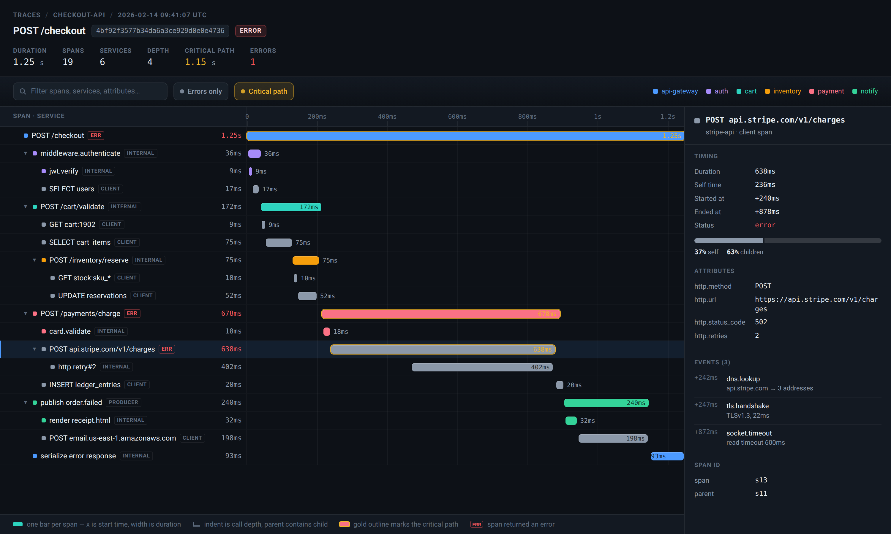
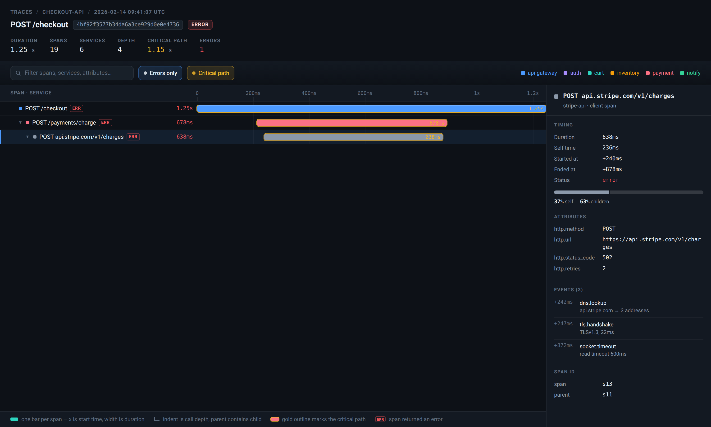
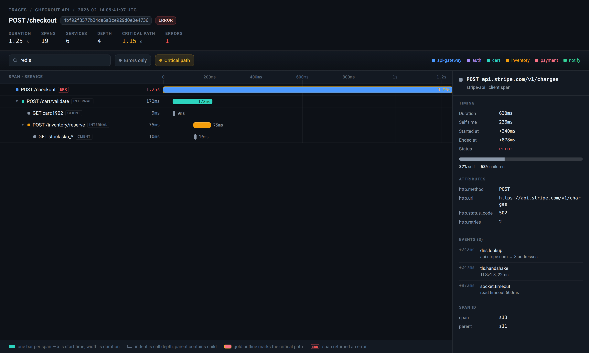

# Trace view — distributed trace waterfall (prototype)

A single-file HTML mock of the trace detail view you see in Grafana Tempo, Jaeger,
Honeycomb, or Datadog APM: one request, every span it spawned, drawn on a shared
time axis. Open **`index.html`** directly (`file://`) or through any static server.
No build, no dependencies, no network.

## The trace it draws

`POST /checkout` against a fake e-commerce stack — 19 spans, 6 services, 4 levels
deep, 1.25 s wall clock, ending in a 502. The interesting part is where the 1.25 s
goes: `POST /payments/charge` holds 678 ms of it, and 638 of those are a stalled
`POST api.stripe.com/v1/charges` that times out and retries.

## How a trace diagram reads

| Element | Meaning |
|---|---|
| One row per span | A span is one timed unit of work: a server handler, an internal function, a DB query, an HTTP call, a queue publish. |
| Row indent | Call depth. A span is nested inside the row above it at one less indent — the parent. The root (`POST /checkout`) is the whole request. |
| Bar x-position | When the span started, as an offset from the request start. |
| Bar width | How long the span took. All rows share one axis, so gaps between bars are real idle or waiting time. |
| Bar color | The service that emitted the span. |
| Kind tag | `SERVER` (inbound handler), `INTERNAL` (in-process work), `CLIENT` (outbound call — DB, cache, HTTP, queue), `PRODUCER` (message published). |
| Gold outline | Span lies on the [critical path](https://en.wikipedia.org/wiki/Critical_path_method): the chain of the longest child at each level. Shrinking it is what actually shortens the request. |
| `ERR` tag | The span failed. Here the failure sits at the leaf (`socket.timeout`), and the parents are marked because each returned 5xx upward. |
| Self time | Duration minus the durations of its children: time the span spent on its own work, shown in the right-hand panel. |

What separates a good trace view from a list of timings:

1. **Shared axis.** Every bar is placed on the request's clock, so parallelism
   shows up as bars at the same x, and sequential waiting shows up as gaps.
2. **Nesting, not sorting.** Rows sort by start time within a parent, not
   alphabetically, so a call tree reads top-down.
3. **Drill-down.** The span's attributes (`db.statement`, `http.status_code`,
   `retry.attempt`) and its in-span events (`dns.lookup`, `tls.handshake`,
   `socket.timeout`) are where the "why" lives — the waterfall only shows "where".

## Interactions

| Action | Result |
|---|---|
| Click a row | Opens the span in the right panel: timing split (self vs children), attributes, events, span/parent ids. |
| Search box | Filters by span name or service, keeping the ancestors of each match so the tree still reads. |
| **Errors only** | Narrows to failed spans and the path down to them. |
| **Critical path** | Toggles the gold outline on the longest chain. |
| Expand / collapse | The caret on any non-root row hides its subtree. |
| `↑` / `↓` | Moves the selection through visible rows. |

Deep links: `?q=redis`, `?errors=1`, `?span=s13`.

## Screenshots

Errors only — the failing chain, with its ancestor path kept:

Filtered to `redis` — every span whose name or service matches, plus ancestors:

## Files

| File | Role |
|---|---|
| `index.html` | The whole prototype: span data, tree layout, waterfall rendering, detail panel. |
| `screenshots/` | Captures of the three states above. |

The span data is hand-written mock data in `SPANS` at the top of the script —
a real viewer gets it from an OpenTelemetry-style store and maps
`parentSpanId` → depth the same way `depth` is derived here.
