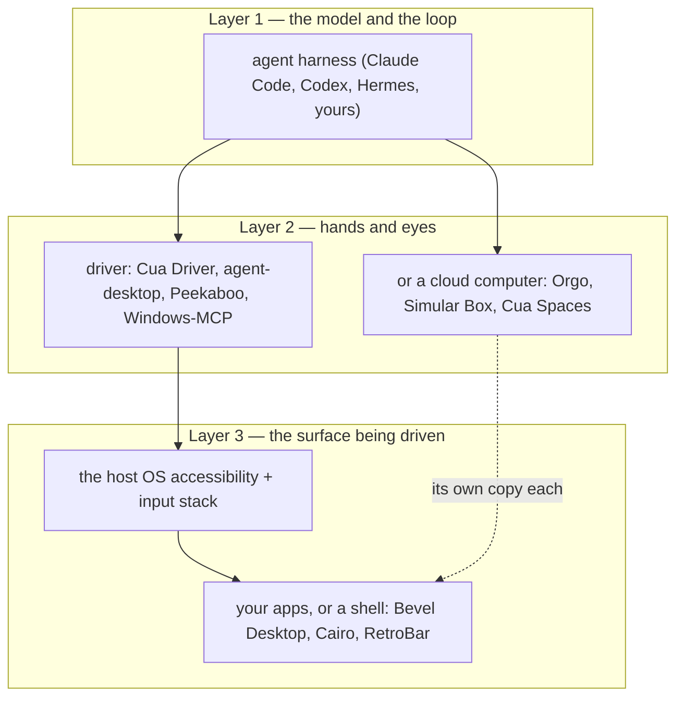

# "Bevel Agent Desktop" — Three Name Collisions, What Bevel Desktop Is, and the Alternative Field

## TL;DR

- **Nothing is called "Bevel agent desktop", and the phrase hides three unrelated products.** The nearest answer is [Bevel Desktop](https://bevel.run/): not a driver and not an agent tool, but a *desktop shell replacement* — the thing that draws your taskbar — with no MCP server and no tool schema.
- **"Bevel agent desktop" resolves to at least three unrelated products.** [Bevel Desktop](https://github.com/ikari-software/bevel) (a C#/Avalonia Win2000-style shell, macOS only today), [Bevel OS / Hexis](https://www.bevel.software/) (a German enterprise AI control plane for agent skills, tools, permissions and identity), and [Bevel AI](https://www.bevelai.com/) (research agents) plus the [Bevel health app](https://www.bevel.health/). Only the first is a desktop, only the second is for agents.
- **Against a driver it composes rather than competes.** A driver gives an agent hands; Bevel Desktop replaces the surface under those hands. Install both and neither knows the other exists — the coupling is the driver's accessibility tree reached through Bevel's own accessibility gate. The head-to-head that matters is [Cua Driver against Vercel agent-desktop](./cua-driver-vs-vercel-agent-desktop.md).
- **If you only want to drive the desktop, Cua Driver is the strongest open option and Bevel Desktop is not a substitute.** MIT, three OSes, MCP/CLI/SDK, background delivery with a documented refusal ladder, and it is what [Hermes pins](https://hermes-agent.nousresearch.com/docs/user-guide/features/computer-use) as its default driver.
- **Alternatives split on one axis: who owns the computer.** Driver-class (agent drives *your* desktop): [agent-desktop](https://github.com/vercel-labs/agent-desktop), [Peekaboo](https://github.com/openclaw/Peekaboo), [Windows-MCP](https://github.com/CursorTouch/Windows-MCP), [open-computer-use](https://github.com/ifuryst/open-codex-computer-use), Playwright MCP. Desktop-class (agent gets *its own*): Cua Spaces, [Orgo](https://www.orgo.ai/), [Simular Box](https://www.simular.ai/alternatives/best-computer-use-mcp-servers). Shell-class (what Bevel Desktop actually competes with): [Cairo](https://github.com/cairoshell/cairoshell), [RetroBar](https://github.com/dremin/RetroBar), [Open-Shell](https://github.com/Open-Shell/Open-Shell-Menu), [ExplorerPatcher](https://github.com/valinet/ExplorerPatcher), [StartAllBack](https://www.startallback.com/).
- **Pick Cua Driver** to let an agent work in your apps while you keep your cursor. **Pick Bevel Desktop** if the desktop itself is the thing you dislike and you are on Apple Silicon. **Pick neither** if the agent should get its own machine — that is a cloud desktop, and it is one row down.

## Context

Asked on 2026-11-07. The repo already covers Cua in depth — [what the project is and which part OpenMausBot pins](./cua-computer-use-stack.md), the driver seam in [OpenMausBot's computer layer](./openmausbot-computer-layer.md), and the [gVisor stack constraints](./computer-use-stack-for-agents-on-gvisor.md) — so the Cua side of this file is a pointer, not new research. Bevel appears nowhere in the repo: `grep -ri bevel research/ notes/ sources/` returns nothing.

The complication is that "Bevel agent desktop" is not a product name anyone uses. Three searches under that phrase return [Verint's call-centre glossary](https://www.verint.com/glossary/agent-desktop/), Vercel's `agent-desktop`, and the health app. The disambiguation below is therefore the first deliverable; the comparison is the second.

## What "Bevel agent desktop" names

| Reading | Product | What it is | Is it a desktop for agents? |
|---|---|---|---|
| Most likely, by the word "desktop" | [Bevel Desktop](https://bevel.run/) by ikari.software | Owner-drawn Win2000/XP-style shell replacement: desktop, taskbar, tray, Start menu, Filer. C#/Avalonia, v0.1.0, macOS 13+ arm64 only; Windows x64 and Linux ship as unsigned experimental zips | A desktop, yes. For agents, only in the sense that it registers an automation surface |
| By the word "agent" | [Bevel OS and Hexis](https://www.bevel.software/platform) | Git-backed control plane for enterprise agent skills, context, permissions, roles and audit. Hexis is the open-source core | Agent infrastructure, no computer |
| Neither | [Bevel AI](https://www.bevelai.com/), [Bevel health](https://www.bevel.health/) | Research-agent consultancy; a wearable health coach with $10M Series A | No |

Bevel Desktop is what the rest of this file compares, because it is the only one with the word "desktop" attached, and because the other two would be a category error against a driver.

**Bevel Desktop has no agent interface.** Its own master plan lists its automation surfaces — `bevelctl`, the `bevel://` scheme, an AppleScript suite, DBus `…Shell1`, and post-v1 COM — and routes them through one internal `IShellAutomation` command model ([08-os-interop §1](https://raw.githubusercontent.com/ikari-software/bevel/main/docs/spec/08-os-interop.md), [00-master-plan](https://raw.githubusercontent.com/ikari-software/bevel/main/docs/spec/00-master-plan.md)). That is a scripting surface aimed at humans and shell extensions. There is no MCP server, no accessibility-tree snapshot command, and no tool schema anywhere in either document. An agent could drive Bevel the same way it drives anything else: through Cua Driver, reading Bevel's Avalonia accessibility tree.

## The three layers, and which one you are shopping for

Every product in this file sits on exactly one layer. Cua Driver is layer 2. Bevel Desktop is layer 3. Nothing is a substitute for something on a different layer, which is why the honest answer to "compare A against B" is "they compose".

## Cua Driver against the two Bevel products

Rows are dimensions. Columns are products. A cell that needs prose gets a section below the table.

| Dimension | Cua Driver | Bevel Desktop | Bevel OS / Hexis |
|---|---|---|---|
| Layer | 2 — driver | 3 — shell | 1–3 — control plane |
| What it does for an agent | Observes and acts on native apps | Replaces the surface the agent would see | Stores and governs what an agent may know and call |
| Call surface | MCP over stdio, `cua-driver call` CLI, typed Python/TS SDK | None for agents; `bevelctl`, `bevel://`, AppleScript, DBus | MCP-native, per its own README |
| Observation model | Accessibility tree plus screenshot in one call, `element_token` per element | Avalonia / NSAccessibility / UIA tree, unnamed automation nodes | n/a — documents and tool manifests |
| Input model | Background first, four-rung ladder, per-call target | n/a | n/a |
| Verification | `effect` and `escalation` fields, `verified` only on read-back | n/a | n/a |
| Platforms | macOS 14+, Windows 10/11/Server, Linux x86_64 ([table](https://cua.ai/docs/cua-driver/concepts/platform-support)) | macOS 13+ arm64 now; Windows and Linux staged | Web |
| Licence | MIT for the driver; FSL-1.1-MIT for Spaces; AGPL-3.0 on the optional perception extension | Apache-2.0 open core, Filer proprietary, trademark withheld; [LICENSE](https://raw.githubusercontent.com/vercel-labs/agent-desktop/main/LICENSE) | [Repo](https://github.com/Bevel-Software/Hexis) open, platform sold as enterprise engagement |
| Cost | $0 | $0 | Sales-led |
| Maturity | Shipping, versioned wheel, pinned downstream | v0.1.0 | Organisational product |
| Best at | Hands-off desktop automation | Making a Mac look and behave like Windows 2000 | Context and permission governance across many agents |

### What the driver side actually does, in one paragraph each

Cua Driver is the UI layer of a loop it does not own ([how it works](https://cua.ai/docs/cua-driver/concepts/how-cua-driver-works)), on a project at [trycua/cua](https://github.com/trycua/cua): `get_window_state` returns an accessibility tree and a screenshot together, every input names one exact target, and delivery climbs a four-rung ladder from background element to foreground while reporting `effect` and an `escalation` hint ([how it works](https://cua.ai/docs/cua-driver/concepts/how-cua-driver-works)). agent-desktop reads the same kind of tree, hands back a ref per actionable element, and has no pixel path at all ([FAQ](https://raw.githubusercontent.com/vercel-labs/agent-desktop/main/docs/faq.md)). The full head-to-head, including the benchmark numbers, is [Cua Driver against Vercel agent-desktop](./cua-driver-vs-vercel-agent-desktop.md).

One licensing fact belongs here because it decides redistribution: Cua's optional `cua-perception` extension is **not MIT** — its OmniParser detector is AGPL-3.0-only, so a hosted deployment that installs it owes corresponding source. The driver itself stays MIT ([driver README](https://raw.githubusercontent.com/trycua/cua/main/libs/cua-driver/README.md)).

### Bevel Desktop's honest limits

macOS 13+ on Apple Silicon, Developer ID signed and notarized; Windows x64 and Linux x64 are unsigned self-contained zips, and "the Linux PAL is incomplete — use `--pal=fake` for the UI demo" ([bevel.run](https://bevel.run/)). The repo's own README says Windows and Linux "PALs are planned" while the download page already ships them as experiments — the docs and the page disagree, and the page is newer.

It is open core in the specific way that matters for a shell: the Filer and "certain widgets" live in a private repository under proprietary terms, and the Apache-2.0 grant "confers no rights in the proprietary parts" ([README](https://raw.githubusercontent.com/ikari-software/bevel/main/README.md)). The Apache-2.0 choice over GPL/FSL/PolyForm is recorded in `docs/legal/open-core-boundary.md` with one hard constraint: the public repo must build, run and pass tests with the private half absent. "Bevel" and the mark are withheld by §6 — fork freely, do not ship it as Bevel.

The remaining rough edge is that a shell replacement is a bet on the host OS. Bevel's own plan document names the three hard platform bets — AX window management across Electron and Java apps, tray mirroring through ScreenCaptureKit, and Dock work-area nudging with no supported API — and estimates 65–91 engineer-weeks for macOS v1 alone ([master plan](https://raw.githubusercontent.com/ikari-software/bevel/main/docs/spec/00-master-plan.md)).

### The two together

Bevel Desktop's accessibility story is a release gate: "an owner-drawn shell must not be a screen-reader black hole", with VoiceOver/Narrator smoke passes ([master plan](https://raw.githubusercontent.com/ikari-software/bevel/main/docs/spec/00-master-plan.md)). That same tree is what a driver reads. A Cua-driven agent on a Bevel desktop would see Bevel's taskbar, Start menu and Filer as ordinary accessibility nodes — the Start menu is typeable, and the tray icons carry their native titles by design. Nothing needs to be built. What you would lose is background delivery against the shell's own owner-drawn chrome, since neither driver's proven routes cover custom-drawn controls.

## Alternatives, driver class — an agent drives your desktop

These are what a Cua Driver comparison actually ranges over. Two are covered in depth in [Cua Driver against Vercel agent-desktop](./cua-driver-vs-vercel-agent-desktop.md); the rest are here so the field is not narrowed to a pair.

| Project | Platforms | Observation | Input | Licence | Delivery | Distinctive |
|---|---|---|---|---|---|---|
| **Cua Driver** | macOS, Windows, Linux | AX tree + screenshot, tokens | Background ladder + foreground | MIT | MCP, CLI, SDK | Verification protocol, permission modes |
| **agent-desktop** (Vercel Labs) | macOS, Windows, Linux | AX tree only, snapshot-scoped refs | Ref actions, headless by default | Apache-2.0 | CLI + C library + MCP | `STALE_REF`/`AMBIGUOUS_TARGET` codes, skeleton-then-drill for dense apps |
| **Peekaboo** | macOS 15+ | Screen capture + AX inspection | Click/type by element name, window-pinned | MIT | CLI, MCP, menu-bar app | Capture-first, visual QA, signed DMG |
| **Windows-MCP** | Windows 10/11 | UI Automation, optional DOM mode | SendInput plus PostMessage | MIT | MCP | 0.2–0.5 s action latency, 2M+ users |
| **open-computer-use** | macOS 14+, Windows, Linux | AX-based, Codex-inspired | Computer-use actions | MIT | MCP, `ocu` CLI | Open clone of Codex computer use |
| [**Playwright MCP**](https://github.com/microsoft/playwright-mcp) | Any | Browser accessibility snapshot | Playwright actions | Apache-2.0 | MCP | No desktop at all; browser-shaped work only |
| **Hermes `computer_use`** | macOS, Windows, glibc Linux | — | — | Harness-level | MCP over stdio to Cua Driver | Not a driver; a consumer that pins one |

**Cua Driver is substrate for other products, which no other entry is.** Hermes ships it pinned in `pm/lock.json`, installs it by default on every glibc target, and reuses an existing `cua-driver` when it satisfies the 0.20 runtime contract ([Hermes docs](https://hermes-agent.nousresearch.com/docs/user-guide/features/computer-use)). OpenMausBot pins the wheel by per-architecture SHA-256 ([computer layer](./openmausbot-computer-layer.md)). Being the thing two independent products reimplement against is a stability signal the alternatives do not have.

## Alternatives, desktop class — the agent gets its own computer

| Option | What it is | Platform | Cost | Note |
|---|---|---|---|---|
| **Cua Spaces** | macOS VM or Linux/Omarchy image per agent, in the menu bar | macOS 26+ host; AWS, GCP or Modal | Free tier; $18/mo Pro, $30/seat Teams | FSL-1.1-MIT; RCDP, Teleport, per-agent cursor |
| **Orgo** | Always-on cloud Linux, Windows, Mac or iPhone desktops for agents | Hosted | $23–$319/mo, $0.055/computer-hour | REST, SDK, MCP; 1,000+ teams |
| **Simular Box** | Ubuntu micro-VM per agent over a remote MCP URL | Hosted | Freemium, pay as you go | 1.2 s p95 spin-up, GPU-ready |
| **Beam Cloud** | Persistent Linux desktops for computer-use agents | Hosted | Usage | BYO agent |
| **Bytebot** | Self-hosted Linux desktop agent in a container | Self-host | Free | **Archived 2026-03-07**, read-only |
| [**Beam Cloud**](https://www.beam.cloud/use-cases/computer-use) | Persistent Linux desktops for computer-use agents | Hosted | Usage | BYO agent |

The trade is unaesthetic but real: a cloud desktop survives your laptop closing and a mistake stays in the box, at the price of the logins and files the task needs living somewhere else ([Simular's framing](https://www.simular.ai/alternatives/best-computer-use-mcp-servers), which sells Box). Bytebot is the notable casualty — it remains the reference self-hosted design, and the repository has been read-only since March 2026 ([repo](https://github.com/bytebot-ai/bytebot)).

## Alternatives, shell class — what Bevel Desktop actually competes with

| Product | Scope | Platforms | Licence | Cost | State |
|---|---|---|---|---|---|
| **Bevel Desktop** | Whole shell: desktop, taskbar, tray, Filer | macOS (Win/Linux experimental) | Apache-2.0 open core, Filer proprietary | Free | v0.1.0 |
| **Cairo** | Whole shell: dynamic desktop, taskbar, programs menu, folder stacks | Windows | Apache-2.0 | Free | Actively maintained, 3.4k stars |
| **RetroBar** | Taskbar only, classic skins | Windows 7–11 | Open source | Free | Maintained, ManagedShell-based |
| **Open-Shell** | Start menu and Explorer toolbars | Windows 7–11 | MIT | Free | Maintained, 9.4k stars |
| **ExplorerPatcher** | Restores Windows 10 taskbar, Start and Alt+Tab | Windows 11 | Open source | Free | Maintained |
| **StartAllBack** | Taskbar, Explorer, context menus, Start | Windows 11 | Closed | Paid | Commercial, v3.9.28 on 2026-10-12 |

The whole field except Bevel Desktop is Windows-only. That is the opening Bevel Desktop takes: there is no supported shell-replacement story on macOS at all, which the project names as the reason it started there ([master plan](https://raw.githubusercontent.com/ikari-software/bevel/main/docs/spec/00-master-plan.md)). Against Cairo — the one other whole-shell Apache-2.0 project — Bevel Desktop has one release, 0.1.0 on 2026-09-30, where Cairo has 1,616 commits and 3.4k stars ([Cairo repo](https://github.com/cairoshell/cairoshell)), and the hazard buried in Cairo's issue history is the one Bevel's unbuilt Windows PAL inherits: UWP and WinRT launches failing once it is the default shell ([issue 365](https://github.com/cairoshell/cairoshell/issues/365)).

The narrower tools are the pragmatic choice on Windows. RetroBar replaces only the taskbar and leaves Explorer intact; Open-Shell only the Start menu; StartAllBack bundles all of it for money. A whole-shell swap buys the era-faithful behaviour Bevel argues for — behaviour profiles, never grouping buttons under Win2000 — and pays for it in blast radius.

## Decision guide

| If you want | Use |
|---|---|
| An agent to work in your apps while you keep your cursor | **Cua Driver** |
| Only deterministic element targeting, no pixels | **agent-desktop** |
| An agent driving a Mac with capture and visual verification | **Peekaboo** |
| Windows-only UI Automation, nothing else | **Windows-MCP** |
| Web pages only | **Playwright MCP** |
| The whole job to belong to an agent that also owns the credentials | [**Aside**](./aside-ai-browser.md) — desktop control included, but Max-plan and local-only |
| The agent to have its own machine | **Orgo**, **Simular Box**, **Cua Spaces** |
| A Mac desktop that behaves like Windows 2000, accepting a 0.1.0 | **Bevel Desktop** |
| A Windows 11 taskbar back, minimal blast radius | **RetroBar**, **Open-Shell**, **ExplorerPatcher**, **StartAllBack** |
| A whole Windows shell replacement | **Cairo** |
| Agent skills, permissions and identity governed centrally | **Bevel OS / Hexis** |

## Gotchas

- **AGPL travels with Cua's perception extension, not the driver.** Install it and a hosted deployment may owe source; skip it and pixel targeting falls back to raw coordinates from a screenshot the tree could not explain.
- **Neither driver's success field is proof of change.** Cua Driver sets `verified: true` only on an accessibility read-back, and returns `unverifiable` for Electron writes that echo without applying. agent-desktop has no such field: it observes the pinned window after the action but reports command success, so a passing call still wants a fresh snapshot.
- **Bevel Desktop is a shell, so it can break app launching.** Its Windows restore path is a documented `RESTORE-SHELL.md` because a broken shell is a broken session.
- **Wayland is not one target.** Every compositor in Cua's table differs; KWin is read-only and niri cannot capture tiled windows.
- **Bytebot still looks current in search results.** It has been archived since 2026-03-07.

## Negative results

- **No product called "Bevel agent desktop" exists.** The phrase returns call-centre glossaries. Any comparison must fix its referent first.
- **Bevel Desktop exposes no MCP server and no agent tool schema.** Its published automation surfaces are for scripts.
- **Bevel Desktop does not run on Linux yet.** The zip launches with `--pal=fake`; there is no native window or tray PAL.
- **Bevel Desktop's Windows PAL is planned in the README while a Windows zip ships.** Docs and download page disagree.
- **A pure-Wayland Linux desktop cannot be fully driven in the background.** Raw input to an occluded window generally refuses; semantic AT-SPI actions work where the app exposes them.
- **Windows support is described two ways by Cua itself** — Homepage "preview", docs "Supported". Assume preview.

## Open Questions

- **Which Bevel did the asker mean?** If the intent was Bevel OS / Hexis, the honest framing is `control plane against driver` and the sections above comparing Bevel Desktop are the wrong column.
- **Does Bevel Desktop's automation model reach an agent at all?** `bevelctl` and `bevel://` exist in the spec; whether their command set covers what a computer-use loop needs — snapshot, act on a named element, read back — is unproven and undocumented.
- **How does Cua Driver behave against an owner-drawn Avalonia shell?** Bevel's Start menu and Filer are custom controls in one process. The accessibility gate is a screen-reader smoke pass, not an automation contract, and nothing published says an agent can enumerate them.
- **Does a shell replacement disturb the host accessibility tree?** Bevel replaces the desktop and intercepts Finder's reveal path; whether AX consumers lose anything when Finder is windowless is untested here.
- **StartAllBack's licence terms and price** were not read; only the version date from its page.

## Related

- [Cua Driver against Vercel agent-desktop — the head-to-head and the benchmark](./cua-driver-vs-vercel-agent-desktop.md)
- [Aside — the browser-with-an-agent layer, and what it buys](./aside-ai-browser.md)
- [Cua — what the project is, what "Cua sandbox" means, and which part OpenMausBot takes](./cua-computer-use-stack.md)
- [OpenMausBot's bot computer — the Cua Driver seam](./openmausbot-computer-layer.md)
- [Computer-use stacks for agents under gVisor](./computer-use-stack-for-agents-on-gvisor.md)
- [Windows-like Linux desktops](./windows-like-linux-desktops.md)
- [Open-source Grok Bot alternatives with first-class sandbox VMs](./open-source-grok-bot-alternatives.md)
- [The Functional Source License](./functional-source-license.md) — the licence Cua Spaces uses

## Changelog

- 2026-11-07 — created, then split: the Cua Driver head-to-head moved to [its own file](./cua-driver-vs-vercel-agent-desktop.md) after the asker corrected "Bevel agent desktop" to Vercel's agent-desktop, and this file was retitled around the disambiguation. All external sources via TinyFish search and fetch; confidence is `medium` only because the universe of the phrase is underdetermined, and every fact is cited to a primary source read on this date.
