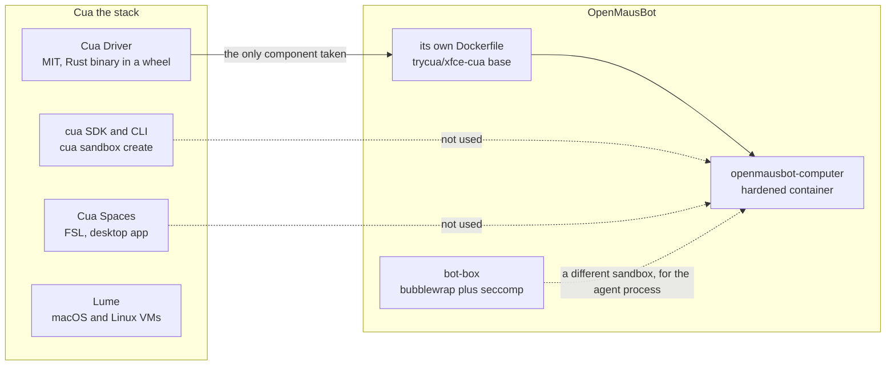

# Cua, and the three things called a sandbox

## TL;DR

- Cua is the open-source project at [trycua/cua](https://github.com/trycua/cua) that "gives AI agents computers they can use". It ships a desktop app, a driver, a VM tool, an SDK and CLI, decision models, and a benchmark.
- "Cua sandbox" is Cua's own term for a computer the SDK hands to an agent, created with `cua sandbox create` against a local Docker, QEMU, or gVisor runtime or a cloud account.
- In OpenMausBot's system prompt, "your own isolated Cua sandbox" means something narrower: the Xfce container the bot drives. OpenMausBot does not use Cua's sandbox manager at all.
- The only Cua component OpenMausBot takes is Cua Driver, a Python wheel wrapping a Rust binary, MIT-licensed, pinned by version and per-architecture SHA-256.

## What the project actually contains

| Component | What it is | License |
| --- | --- | --- |
| Cua Spaces | desktop app that gives agents full desktops, each a Space: a local macOS VM, or a Linux or Omarchy image, on your Mac, your other machines, or your own cloud | FSL-1.1-MIT |
| Cua Driver | tools to inspect and operate native desktop apps and browsers on macOS, Windows, and Linux, over CLI, MCP, or typed SDKs, with background delivery | MIT |
| Lume | local macOS and Linux VMs on Apple Silicon over Virtualization.framework | MIT |
| `cua` SDK and CLI | Python, TypeScript, Swift, and Kotlin packages plus the `cua` command and daemon | MIT |
| CUA-S1 | small decision models for computer use | MIT |
| Cua Driver Bench | benchmark for driver-level computer use | FSL-1.1-MIT since 2026-10-11, MIT before |

The licence split is worth knowing because it decides what you may redistribute. The README states it plainly: "Everything outside Cua Spaces and Cua Driver Bench is MIT-licensed ... the cua SDK ... the `cua` command and `cua daemon`, Cua Driver, Lume". Spaces and Bench are source-available under FSL, free to self-host, with each release turning MIT two years after it ships. One optional package, `cua-som`, is AGPL-3.0-or-later, and its Ultralytics dependency keeps its own terms.

## The three sandboxes in one sentence

1. **Cua's sandbox** is Cua's product concept: a computer the SDK provisions. OpenMausBot never calls it.
2. **The bot's sandbox** is the container OpenMausBot builds from the `trycua/xfce-cua` base image, hardened with `--cap-drop ALL` and one bind mount, and running Cua Driver inside.
3. **The bot box** is OpenMausBot's own bubblewrap plus seccomp sandbox for the agent process, unrelated to Cua, and off by default outside a Cloud home.

A fourth, looser use: people say "Cua sandbox" to mean any desktop image Cua publishes. Cua's Linux images are Xfce on Xvfb with an HTML5 viewer ([`libs/images`](https://github.com/trycua/cua/blob/main/libs/images/README.md)). As [the gVisor note](./computer-use-stack-for-agents-on-gvisor.md) puts it, taking Cua "buys a driver, SDK and viewer; it does not buy a faster display".

## What OpenMausBot pins

[`server/container-computer.ts`](https://github.com/milind-soni/OpenMausBot/blob/b1e0ba941e5c0aa5ef4c7543edbab04b98253e80/server/container-computer.ts) builds its own Dockerfile over a digest-pinned base, then:

- downloads `cua_driver-0.37.0-py3-none-manylinux_2_31_<arch>.whl` from a fixed URL,
- verifies a per-architecture SHA-256 (`1a0103fd…` for x86_64) with `sha256sum -c`,
- installs it into `/opt/venv` with `--no-deps`, finds the binary at `*/cua_driver/bin/cua-driver`, and installs it to `/usr/local/libexec/openmausbot/cua-driver`,
- and fails the build with a specific message if the pinned base shipped zero-byte OpenSSL libraries, rather than debugging a wheel download that cannot start.

So the dependency is one wheel and one binary, not a framework. That is why OpenMausBot can run Cua Driver against a cloud box and a real host desktop as well, through the same MCP contract.

## Gotchas

- **"Cua sandbox" is ambiguous in this product.** The sentence in the system prompt names a driver's vendor, not the isolation mechanism. The isolation comes from OpenMausBot's container flags.
- **Two licences sit next to each other.** The driver you redistribute is MIT. Spaces and Bench are FSL, so copying their code into a competitor is the thing FSL forbids, and each release ages into MIT after two years. [The FSL note](./functional-source-license.md) has the clause text and the comparison against BSL and friends.
- **The driver is not a screen server.** It injects input and reads state. OpenMausBot's own noVNC and frame polling provide the pixels.
- **Background delivery has platform limits.** Cua markets input that does not move your pointer "when the app and platform support it". The bot's prompt therefore still requires foreground delivery for keys and pixel clicks inside the container.

## Related

- [OpenMausBot's Bot Computer](./openmausbot-computer-layer.md) — the container flags, the driver seam, and shared screen control.
- [The Computer-Use Stack for Agents on gVisor](./computer-use-stack-for-agents-on-gvisor.md) — why Cua's images are not a shortcut to a faster desktop under gVisor.
- [Open-Source Grok Bot Alternatives with First-Class Sandbox VMs](./open-source-grok-bot-alternatives.md) — Cua and the other agent-desktop SDKs side by side.
- [Grok Bot, OpenMausBot, OpenBot Compared](./grok-bot-openmausbot-openbot-compared.md) — how OpenMausBot and OpenBot use the same driver in opposite ways.
- [Cua Driver vs Vercel agent-desktop — tree-plus-pixels against tree-only, with the benchmark](./cua-driver-vs-vercel-agent-desktop.md) — background full-pass 58% vs 20% on macOS in a pre-registered test, and the 78% vs 70% foreground gap that stays within noise.
- ["Bevel Agent Desktop" — the three name collisions and the shell-class alternatives](./bevel-agent-desktop.md) — no product carries that name; Bevel Desktop is a macOS shell with no agent interface.

## Changelog

- 2026-11-07 — cross-linked the Cua Driver vs Vercel agent-desktop head-to-head and the "Bevel agent desktop" disambiguation from Related.
- 2026-11-02 — created from the trycua/cua README and licensing section, the Cua docs for sandboxes and images, and OpenMausBot's build script at `b1e0ba941e5c`.
