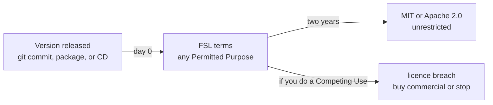

# The Functional Source License

## TL;DR

- FSL is a source-available licence with exactly one restriction: you may not use the software to compete with its producer. Everything else, including commercial internal use, modification, and redistribution, is allowed.
- Each version converts to a permissive licence on a fixed date, two years after that version ships. The change licence is MIT (`FSL-1.1-MIT`) or Apache 2.0 (`FSL-1.1-ALv2`), and nothing else.
- The conversion is a present, irrevocable grant, not a promise: the text reads "We hereby irrevocably grant you an additional license ... effective on the second anniversary of the date we make the Software available."
- It is not OSI-approved open source. It is "Fair Source": source-available now, open source later.
- Compared with BSL, it removes the per-license variability that made BSL hard to reason about, and shortens the horizon from four years to two.

## The mechanics

The two-year clock runs per version, not per project. The FAQ spells out how to use an old version today: check out the last commit older than two years and, if its `LICENSE.md` says FSL, that version is already MIT or Apache 2.0.

## What you may do

The grant is broad: "use, copy, modify, create derivative works, publicly perform, publicly display and redistribute the Software for any Permitted Purpose". The licence then names four purposes that are always permitted:

1. your internal use and access,
2. non-commercial education,
3. non-commercial research,
4. professional services you provide to a licensee using the software.

So a company can run FSL software in production internally, fork it, patch it, and pay a contractor to support it. What it cannot do is ship it as the product.

## The one restriction

A "Competing Use" is making the software available to others in a commercial product or service that:

1. substitutes for the software,
2. substitutes for any other product or service the licensor offers using the software, as of the release date, or
3. offers the same or substantially similar functionality as the software.

Three limbs, and the second is the sharp one: you cannot clone a paid feature the licensor ships on top of the same code. That is the clause that stops "take the open core, host it, charge for it" without needing an open-core feature split.

## The clauses people miss

| Clause | What it says |
| --- | --- |
| Patents | A patent licence is included for Permitted Purposes, and it ends immediately if you sue anyone claiming the software infringes |
| Trademarks | "Except for displaying the License Details and identifying us as the origin of the Software, you have no right ... to use our trademarks, trade names, service marks or product names" |
| Redistribution | Terms travel with every copy, modification, and derivative; you must include or link the terms and keep copyright notices |
| Disclaimer | As-is, no warranty, no liability, with fitness, merchantability, title, and non-infringement all disclaimed |

The patent grant matters commercially. It puts FSL in the same family as Apache 2.0 on patent posture, which is why some adopters pick `FSL-1.1-ALv2` over `FSL-1.1-MIT` even though Apache is heavier.

## Compared with the other source-available families

| | FSL 1.1 | BSL 1.1 | Elastic License 2.0 | PolyForm Noncommercial 1.0.0 |
| --- | --- | --- | --- | --- |
| Conversion date | second anniversary, per version, fixed | Change Date, at most the fourth anniversary | none | none |
| What it becomes | MIT or Apache 2.0, no other choice | any Change License the licensor names | stays Elastic | stays noncommercial |
| Restriction now | Competing Use only | whatever the Additional Use Grant allows, plus the rest | no hosted or managed service, no disabling licence-key features | noncommercial purposes only |
| Variability between adopters | none, two variants exist | high, each implementation is effectively a new licence | none | none |
| Patent grant | yes, with retaliation | none stated | yes | none stated |
| OSI-approved open source | no | no | no | no |

The FSL FAQ is direct about why it exists. BSL's "Additional Use Grant is a serious flaw, because it creates too much variability. Each BSL implementation is essentially a new license. Also, four years is too long." On the other side, it rejects open core for restricting by feature, and AGPL for exposing users to copyleft risk.

## When it shows up in this repo

[Cua](./cua-computer-use-stack.md) is the live example: Cua Spaces and Cua Driver Bench are `FSL-1.1-MIT`, while Cua Driver, Lume, and the SDKs are plain MIT. The dependency you would redistribute, the driver, is MIT. The parts you would compete with, the desktop app and the benchmark, are FSL. The README of that project describes the split the same way, and notes that "each release becomes MIT two years after it ships", which is the conversion clause restated in one sentence.

Practical reading for a project like OpenMausBot: vendoring the driver is ordinary MIT compliance. Vendoring Spaces, or hosting it for paying users, is the thing FSL forbids until 2028-era dates arrive for whichever version you took.

## Gotchas

- **"Source available" is not "open source".** The OSI's definition forbids field-of-use restrictions, so FSL can never be OSI-approved. Distributions and compliance scanners will flag it, and some corporate policies block it for the same reason AGPL gets blocked, though for different reasons.
- **The clock is per version, and the version must exist.** A version never published never converts. The FAQ lists a git commit, a package, or a mailed CD as publication.
- **The future grant is written for the licensor's versions.** It grants a licence to use "the Software" under MIT from the second anniversary, and the Software is defined as each version the licensor makes available. Whether a third party's fork converts on the same date is not settled by the text, so do not assume your fork becomes MIT because upstream did.
- **The change licence is not negotiable.** The FAQ closes that door: "Okay, but I can use FSL with a different change license, right? No. If you do this, you'll have to call it something other than FSL."

## Open questions

- Whether `FSL-1.1-ALv2` differs from `FSL-1.1-MIT` anywhere beyond the change licence and its patent posture was not compared clause by clause here. The template names Apache 2.0 as the future licence, which carries an explicit patent grant of its own.
- Adoption counts and which notable projects use FSL beyond Sentry and Cua were not surveyed.

## Related

- [Cua — What trycua/cua Is](./cua-computer-use-stack.md) — the project that put FSL in front of this repo's research.
- [Grok Bot, OpenMausBot, OpenBot Compared](./grok-bot-openmausbot-openbot-compared.md) — a PolyForm Noncommercial project next to an Apache-2.0 one.
- [Open-Source Grok Bot Alternatives with First-Class Sandbox VMs](./open-source-grok-bot-alternatives.md) — licence column across the field.

## Changelog

- 2026-11-02 — created from `fsl.software` and both templates, the SPDX entry for `FSL-1.1-MIT`, the MariaDB BSL text, and the PolyForm and Elastic licence pages.
