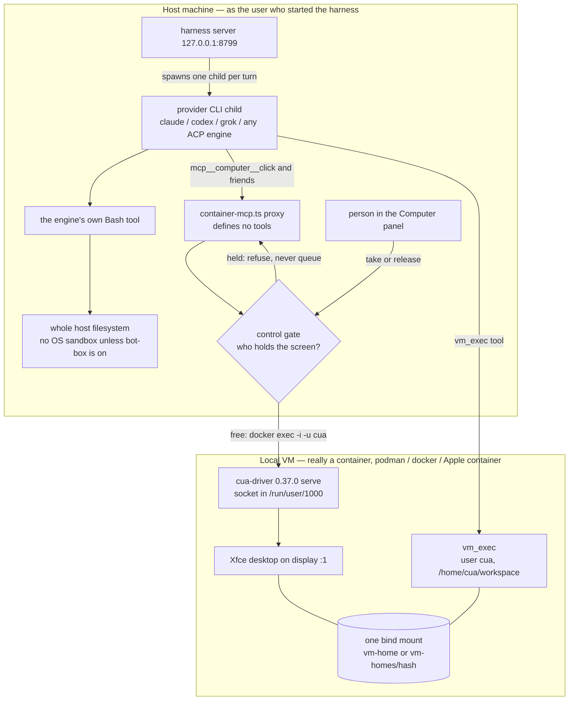
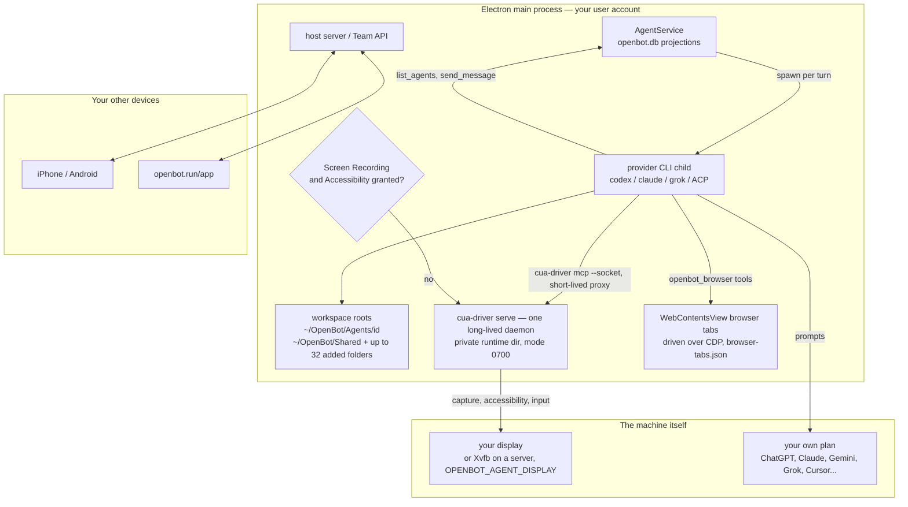
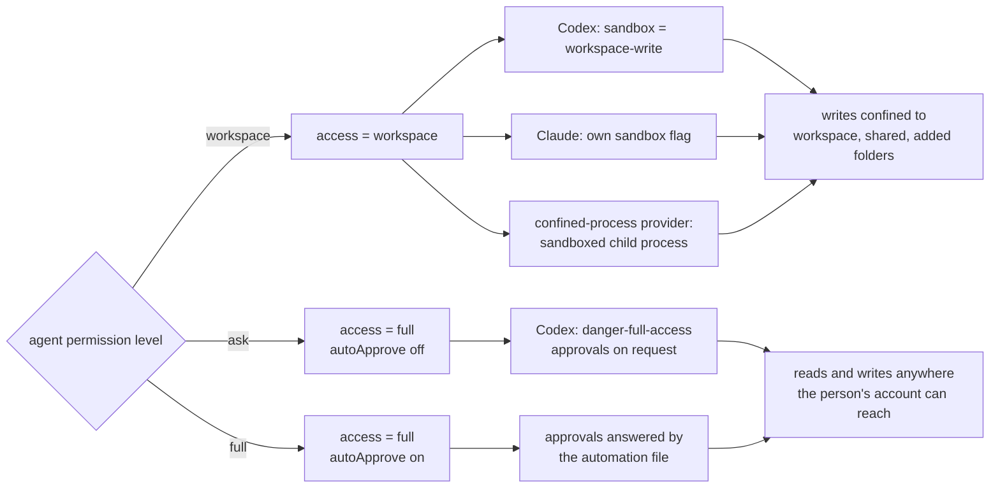

## Summary

Three products, one shared primitive and three incompatible answers to the same four questions.

The primitive is the one [The Bot as a Primitive](./bot-primitive.md) describes: a named agent with durable state that outlives any one conversation. All three ship it — a roster of named agents, per-agent instructions and memory, group conversations, scheduled work, MCP connectors, and a screen a person can take over.

Where they diverge is the part the primitive actually rests on:

| Question | Grok Bot | OpenMausBot | OpenBot |
|---|---|---|---|
| Whose machine is it? | xAI's cloud, shared by the account | Yours; per-bot only if asked | Yours, with a reason to be: no model of its own |
| Who decides an action? | The provider's permission mode | The provider's mode plus a two-rule floor | Two access modes, then the provider's approvals |
| What is a bot, concretely? | A product object | A JSON row + a CLI child + a folder | A SQLite row + a CLI child + `~/OpenBot/Agents/<id>/` |
| What runs the agent? | xAI's own | 25 engines, ACP-first | 11 CLIs and endpoints, all user-owned plans |

The three are not quality tiers of one design. They are three bets: Grok Bot bets a hosted appliance with one trusted machine per account beats isolation; OpenMausBot bets your machine plus engine choice is the product; OpenBot bets that the thing worth owning is **the account with the AI provider** — it sells no model and reuses the ChatGPT, Claude, Gemini or Grok plan you already pay for ([openbot.run](https://openbot.run/)).

The most useful finding is not in the columns. **All three put the person's security boundary above the bot**, and differ only in what holds it: an account (Grok Bot), a container (OpenMausBot), or an access level plus Electron's process isolation (OpenBot). None of them lets a bot be the boundary.

## Context

Asked on 2026-11-02: "compare primitive and architecture of grok bot, openbot, openmausbot". The repo already had Grok Bot ([what it is](./grok-bot.md), [the primitive](./bot-primitive.md), [its memory model](./grok-bot-memory.md), [its extensibility](./grok-bot-extensibility.md)) and OpenMausBot ([architecture](./openmausbot-architecture.md), [its computer](./openmausbot-computer-layer.md)). "OpenBot" was new, and the **first attempt at this file covered the wrong project** — see the naming table below and the changelog.

**Which OpenBot.** More than one project uses the name. Two matter here:

| Project | What it is | Covered here |
|---|---|---|
| **[nightly-labs/openbot](https://github.com/nightly-labs/openbot)** (openbot.run) | Local-first Electron desktop workspace for persistent agents on your own machine; 3,852 stars, PolyForm Noncommercial 1.0.0 | **Yes** |
| [ob-f/OpenBot](https://github.com/ob-f/OpenBot) | The pre-LLM robot that uses a phone as its brain | No |

The one covered here calls itself a "development preview" and runs its own `/compare/grok-bot` page, which is why it is the right third column.

**Two are read as source, one as documentation.** OpenBot is read at `5d30b66e330cf` (default-branch head on 2026-11-02) from a checkout at `~/.pi/source`; every OpenBot citation is that commit, anchored to a line. OpenMausBot is read across three commits already pinned in this repo (`cdbf1495d3f1`, `ac08cf72a70f`, `b1e0ba941e5c`). Grok Bot is closed: its structure is what xAI's docs disclose, cited as documentation, not source. That asymmetry is the biggest limit on this file.

## The primitive, item by item

### What the system is organized around

**Grok Bot.** A first-class product object, deliberately: "So the main objects in Grok Bot are Bots, not conversations" ([design](https://x.ai/news/designing-grok-bot)). A Bot has a name, a job, a memory, routines and its own chat; the primary Bot is the point of contact and coordinates the rest ([bots](https://docs.x.ai/grok-bot/bots.md)).

**OpenMausBot.** A record. A bot is a row in `bots.json` carrying persona, engine reference, workspace and approval level ([store](https://github.com/nightly-labs/openbot/blob/5d30b66e330cf5248bf44489c60be8131578f367/server/store.ts)). The tab you land on is a chat; the product is the harness.

**OpenBot.** A row plus a folder plus a process. The agent lives in SQLite `openbot.db` ([database-core](https://github.com/nightly-labs/openbot/blob/5d30b66e330cf5248bf44489c60be8131578f367/src/backend/database/database-core.ts#L57)), owns `~/OpenBot/Agents/<agentId>/` ([workspace-paths](https://github.com/nightly-labs/openbot/blob/5d30b66e330cf5248bf44489c60be8131578f367/src/backend/workspace-paths.ts#L51)), and runs as a provider CLI child of the Electron main process ([provider-runtime](https://github.com/nightly-labs/openbot/blob/5d30b66e330cf5248bf44489c60be8131578f367/src/backend/agent/provider-runtime.ts#L1474)). Legacy databases still spell the folder `~/OpenBot/Bots/<id>`, and the path resolver keeps both prefixes permanently rather than rewriting them ([legacy prefix](https://github.com/nightly-labs/openbot/blob/5d30b66e330cf5248bf44489c60be8131578f367/src/backend/workspace-paths.ts#L34)).

Identity is a prompt plus an avatar, not a config file: agents are created by describing the job in one message, then editing the generated instructions before saving ([README](https://github.com/nightly-labs/openbot/blob/5d30b66e330cf5248bf44489c60be8131578f367/README.md)).

### Whose machine the bot acts on

**Grok Bot.** One cloud computer, per account, shared by every Bot: shared cookies, files and command-line credentials, "one Bot can continue from work another Bot saved". Isolation is between users and is hardware-level; between Bots there is none — "the screens are separate work surfaces, not separate security boundaries" ([computer and apps](https://docs.x.ai/grok-bot/computer-and-apps.md)).

**OpenMausBot.** A per-bot computer is an option. `localVm.mode` is `shared`, `per-bot` (keyed by bot hash, ceiling two) or `pool` (N seats, 30-minute affinity, not assigned to a bot at all) ([computer layer](./openmausbot-computer-layer.md)). The host desktop is a fourth backend via a live Cua connection the Electron app passes to its server child.

**OpenBot.** The machine is the point. Workspaces, conversations, files and browser data stay on the computer that runs OpenBot, and the local-first claim is explicitly not offline-only: each provider still talks to its own vendor ([README](https://github.com/nightly-labs/openbot/blob/5d30b66e330cf5248bf44489c60be8131578f367/README.md)). Sharing is by design — `~/OpenBot/Shared/` is a common folder, and `~/OpenBot/Shared/Data/agent-data.db` is one SQLite file holding every table the agents create for themselves, which every agent can read and write ([structure](https://github.com/nightly-labs/openbot/blob/5d30b66e330cf5248bf44489c60be8131578f367/docs/architecture/structure.md)).

The agent's own folder is the only thing that is per-agent. There is no per-agent machine: no container, no VM, no second user account. On a server or in Docker, one Xvfb display serves every agent on that host ([computer-use](https://github.com/nightly-labs/openbot/blob/5d30b66e330cf5248bf44489c60be8131578f367/docs/architecture/computer-use.md)).

### What decides an action

**Grok Bot.** A per-Bot job description plus granted tools; the docs describe the Bot returning for approval and handing blocked steps to the person ([overview](https://docs.x.ai/grok-bot/overview.md)). No policy language is documented.

**OpenMausBot.** The provider's own permission mode passed through in five levels (`ask`, `edits`, `auto`, `full`, `custom`), with two deny rules (`safety-floor`, `outbound-guard`) and Full access propagating down a delegation tree ([architecture](./openmausbot-architecture.md)).

**OpenBot.** Three permission levels — `workspace`, `ask`, `full` ([levels](https://github.com/nightly-labs/openbot/blob/5d30b66e330cf5248bf44489c60be8131578f367/packages/contracts/src/ipc-agent-admin.ts#L44)) — and each maps onto two things at once. `workspace` sets access to `"workspace"`; anything else sets access `"full"` plus `autoApprove` only when the level is `full` (:71). Access then becomes the provider's own sandbox: Codex gets `workspace-write` when access is `workspace` and `danger-full-access` otherwise ([sandbox](https://github.com/nightly-labs/openbot/blob/5d30b66e330cf5248bf44489c60be8131578f367/src/backend/agent/workspace-sandbox.ts#L18), [access](https://github.com/nightly-labs/openbot/blob/5d30b66e330cf5248bf44489c60be8131578f367/packages/contracts/src/ipc-agents.ts#L89)).

The interesting part is that `workspace` is enforced three different ways depending on the engine: Codex takes a sandbox mode, Claude takes a flag and applies its own sandbox ([claude sandbox](https://github.com/nightly-labs/openbot/blob/5d30b66e330cf5248bf44489c60be8131578f367/src/backend/claude-workspace-sandbox.ts#L1)), and a provider whose `workspaceEnforcement` is `confined-process` gets a sandboxed child process instead ([confine](https://github.com/nightly-labs/openbot/blob/5d30b66e330cf5248bf44489c60be8131578f367/src/backend/agent/provider-runtime.ts#L2331)). One policy, three mechanisms, chosen by the adapter.

**The README's own warning is stale, and that is a finding.** It says agents "currently run with `danger-full-access` and `approvalPolicy: never`" ([README](https://github.com/nightly-labs/openbot/blob/5d30b66e330cf5248bf44489c60be8131578f367/README.md)). In source, Codex is held at `approvalPolicy: "on-request"` on the real turn paths ([thread](https://github.com/nightly-labs/openbot/blob/5d30b66e330cf5248bf44489c60be8131578f367/src/backend/agent/thread-lifecycle.ts#L623), [second path](https://github.com/nightly-labs/openbot/blob/5d30b66e330cf5248bf44489c60be8131578f367/src/backend/agent/thread-lifecycle.ts#L1222)), and `never` appears only in profile generation ([profile generation](https://github.com/nightly-labs/openbot/blob/5d30b66e330cf5248bf44489c60be8131578f367/src/backend/agent/profile-generation.ts#L183)). So the shipped behaviour is "full filesystem, approvals on request" for the default `ask` level, not the unconditional no-approval mode the warning describes. Treat the warning as a legacy sentence, not a spec.

This is the sharpest split of the three. Grok Bot governs by job description and grants; OpenMausBot delegates to the engine's permission model; **OpenBot delegates to the engine's sandbox** and only decides which of three levels you are on.

### Who the agent process is

**Grok Bot.** xAI's, hosted. No model setting on a Bot.

**OpenMausBot.** A spawned vendor CLI — 25 built-ins, 13 of them through one `createAcpDriver` body, plus a custom ACP command. It runs as a child of the harness on the host, outside the container, so its own Bash reaches the host unless `bot-box` is on ([computer layer](./openmausbot-computer-layer.md)).

**OpenBot.** Also a spawned CLI, and the roster is the product: Codex App Server, Claude Code, Grok CLI, Gemini via Google's Antigravity ACP server, Cursor CLI (`cursor-agent acp`), Cline, OpenCode, Muse Code, Pi, Inception's Mercury, any ACP agent, any OpenAI-compatible endpoint, and local models in Ollama or LM Studio ([providers doc](https://github.com/nightly-labs/openbot/blob/5d30b66e330cf5248bf44489c60be8131578f367/docs/architecture/providers.md)). OpenBot downloads and pins most of these itself, checks for upstream releases hourly, and prefers its managed copy over a system CLI ([README](https://github.com/nightly-labs/openbot/blob/5d30b66e330cf5248bf44489c60be8131578f367/README.md)).

The seam is thinner than OpenMausBot's, and the reason is structural: every provider is a child process on this machine, so the abstraction only has to cover a turn and a native session, not a remote host. What the adapters do share is a built-in tool catalog — eleven direct tools plus `tool_search`, `tool_describe` and `tool_call` — so a provider without native memory or teammate messaging still gets `remember`, `send_message` and `ask_user` ([tools](https://github.com/nightly-labs/openbot/blob/5d30b66e330cf5248bf44489c60be8131578f367/docs/architecture/providers.md)).

Model switching is where this design pays off, and it is the one thing here with real product teeth: an agent keeps its chat and workspace when you change provider, and can move to a backup model on another provider when a plan runs out or a vendor is down, with a note in the chat showing the switch ([openbot.run](https://openbot.run/)). Neither of the others can: Grok Bot has one model, and OpenMausBot's engine is fixed per bot.

### What survives a deletion

| | Grok Bot | OpenMausBot | OpenBot |
|---|---|---|---|
| Deleting the bot | Leaves files and sign-ins on the shared computer | Leaves `workspaces/<bot>` and `task-workspaces/<bot>/<thread>` | Leaves nothing of its own; workspace and agent tables are user-deleted |
| Resetting the chat | Memory and files survive, the log does not | Per-thread; memory is per-bot, in files | A `context-reset` system message ends the provider sessions; the thread and its messages stay ([reset](https://github.com/nightly-labs/openbot/blob/5d30b66e330cf5248bf44489c60be8131578f367/docs/architecture/servers.md)) |
| Resetting the computer | Manual cleanup | `remove` destroys the writable layer, the bind mount survives | No computer to reset — it is your machine |

OpenBot's split is unusual and worth copying: a **context reset is a message**, not a deletion. It writes a marker into the thread and ends the provider session, so the UI keeps the history and the next session only gets a handoff of what came after the marker ([reset](https://github.com/nightly-labs/openbot/blob/5d30b66e330cf5248bf44489c60be8131578f367/docs/architecture/servers.md)).

Grok Bot's doc says the quiet part: "Files and sign-ins on the shared computer aren't isolated per Bot and can remain there; clean them up separately" ([bots](https://docs.x.ai/grok-bot/bots.md)).

## Architecture, item by item

| Dimension | Grok Bot | OpenMausBot | OpenBot |
|---|---|---|---|
| Shape | Hosted appliance | Electron app + loopback Node harness | Electron desktop; the same code also runs as a headless server |
| Main processes | xAI's | Node on `127.0.0.1:8799` | Electron main (agent runtime, host server), renderer, one CLI child per agent turn |
| Client | Desktop, iOS, Android | Electron, browser, iOS sidecar | Electron, web `/app`, Expo iPhone and Android |
| State | Product-internal | SQLite WAL + JSON + NDJSON | `openbot.db` (node:sqlite), D1 for accounts, Stripe for billing |
| Transport | Product-internal | SSE, one-way | Typed IPC main↔renderer; Team API over WebRTC to remote hosts |
| Agent isolation | Account boundary | Container flags + optional `bot-box` | Access level → provider sandbox; Electron process isolation |
| Computer | xAI cloud, per account | Container / cloud / host / VPS | The host's own display via `cua-driver`; Xvfb on a server |
| Browser | In-product | noVNC / frame polling | Electron `WebContentsView` tabs driven over CDP, one profile per named session |
| Model choice | Cursor's | 25 engines | 11 CLIs and endpoints, per agent, switchable mid-life |
| License | Proprietary | Apache-2.0 | PolyForm Noncommercial 1.0.0 (≤0.1.11 Apache-2.0); commercial tier sold in Settings → Billing |
| Maturity | Shipped beta, 2026-08-11 | 10,476 stars, pushed 2026-11-01 | Development preview, 3,852 stars, 364 open issues |

The dependency direction in OpenBot is enforced rather than documented: `packages/contracts` may not import Electron, Node, SolidJS, a provider or Cloudflare, the renderer may not import `src/main` or `src/backend`, and `biome.json` `noRestrictedImports` overrides fail the build on a violation ([structure](https://github.com/nightly-labs/openbot/blob/5d30b66e330cf5248bf44489c60be8131578f367/docs/architecture/structure.md)). That is a stronger guarantee than either of the other two offers, and it is what makes "the same app runs as a desktop and as a headless server" credible.

### The computer, in detail

Both open projects reached for the same helper and then diverged completely.

**OpenMausBot** treats `cua-driver` as a **remote control plane**: a Node proxy `docker exec`s into the box, the same MCP contract serves four backends, and a person taking the screen makes the next bot call fail rather than queue, on a 5-second act window inside a 45-second wait ([computer layer](./openmausbot-computer-layer.md)).

**OpenBot** treats `cua-driver` as a **local daemon it owns**. One long-lived `cua-driver serve` is started by the main process; each provider CLI spawns its own short-lived `cua-driver mcp --socket` proxy against it, so all capture, accessibility reads and input posting happen in the daemon and the proxy's own identity does not matter ([cua](https://github.com/nightly-labs/openbot/blob/5d30b66e330cf5248bf44489c60be8131578f367/docs/architecture/computer-use.md)). Four details there are worth more than the summary:

- The daemon is spawned directly, never through `open(1)` or `NSWorkspace`, because macOS attributes Screen Recording and Accessibility to the top of the launch chain — so the user grants the app, not a helper, and `CUA_DRIVER_EMBEDDED=1` keeps it there.
- The control socket sits in the private per-user runtime directory at mode `0700`, not `/tmp`, "because whoever reaches it can drive the whole desktop"; Windows uses a random named pipe because a second process can add an instance to a guessable name.
- The endpoint and the command both have to hold still across launches: they fold into the stored Codex tool fingerprint, so a moving path would replace every session after a restart — an AppImage constraint that becomes a design rule.
- The cursor is the app's, not the driver's: `--no-overlay` disables the driver's single-display overlay and OpenBot draws per-display windows, then replays the driver's own `adaptive` motion (Fitts min-jerk, a wide swoop over 900 points) in the renderer, from 180 ms to about 1.1 s after the action lands.

On a server the design bends: two Xvfb displays, `OPENBOT_AGENT_DISPLAY` names the agents' one, Electron keeps its own so the built-in browser still renders, and `capture_screen` becomes unavailable because Electron's `desktopCapturer` sees only the app's display — agents screenshot through the driver instead ([agent display](https://github.com/nightly-labs/openbot/blob/5d30b66e330cf5248bf44489c60be8131578f367/docs/architecture/computer-use.md)).

The **embedded browser** is the more unusual piece: Electron `WebContentsView` tabs adopted through the window-creation hook so popups keep their opener, CDP behind every operation, and deliberate identity work — the `OpenBot/` and `Electron/` user-agent tokens are stripped, except for `accounts.google.com`, which rejects the account step without `Electron/`, and client-hint brands must match `navigator.userAgentData.brands` exactly or Cloudflare refuses the request ([browser](https://github.com/nightly-labs/openbot/blob/5d30b66e330cf5248bf44489c60be8131578f367/docs/architecture/browser.md)). Durable tab state lives in `browser-tabs.json` outside the database, re-validated on read, on the principle that losing a user's open tab is worse than losing an emulated viewport ([structure](https://github.com/nightly-labs/openbot/blob/5d30b66e330cf5248bf44489c60be8131578f367/docs/architecture/structure.md)).

### Delegation and collaboration

Grok Bot: a primary Bot coordinates the others, up to 6 Bots in a group chat ([design](https://x.ai/news/designing-grok-bot)).

OpenMausBot: rooms with `@everyone`, `@name`, a lead, or a decision model above a confidence threshold, with a coordinator resuming the caller ([architecture](./openmausbot-architecture.md)).

OpenBot: agents message each other through built-in tools (`list_agents`, `send_message`, `react_to_user_message`) offered to every adapter, and channels are the shared surface — a desktop channel chat has "one task owner, explicit delegation, shared history" plus Stop, Resume, Reassign, Archive and Restore ([README](https://github.com/nightly-labs/openbot/blob/5d30b66e330cf5248bf44489c60be8131578f367/README.md)). A channel message that runs in a task carries the task's id in its mailbox record, the way a channel message carries its channel ([task schema](https://github.com/nightly-labs/openbot/blob/5d30b66e330cf5248bf44489c60be8131578f367/src/backend/agent-tasks/agent-task-schema.ts#L13)), and only the agent's own chat starts a task ([task start](https://github.com/nightly-labs/openbot/blob/5d30b66e330cf5248bf44489c60be8131578f367/src/backend/agent-tasks/agent-tasks.ts#L61)).

The contrast with OpenMausBot is the direction of the decision: OpenMausBot picks the responder *before* a turn from the room's routing rules, while OpenBot lets the model delegate *inside* a turn and makes the app own the task record, its owner and its history.

### Routines

| | Grok Bot | OpenMausBot | OpenBot |
|---|---|---|---|
| Shape | 50 per Bot, ≥5 min apart, 20 run records | `RoutineManager` 10-second tick, no per-bot ceiling found | Per-agent routines, webhook triggers, and a flow canvas between agents |
| Extras | — | — | Quiet runs (`routine_no_update`), failure reporting (`routine_report_failure`), an iCalendar feed on loopback, and a routine handoff into a fresh session |

OpenBot's routine design is the most opinionated of the three and the place it most clearly out-engineers them: a routine run **does not resume the chat's provider session**. It starts an ephemeral one, seeds it with an 8,000-character handoff of the newest chat messages, and on completion appends a 1,500-character digest (6,000 total) to the chat's pending handoff so the next real turn knows what happened without inheriting the run ([routines](https://github.com/nightly-labs/openbot/blob/5d30b66e330cf5248bf44489c60be8131578f367/docs/architecture/agents.md)). That is the "bot as one unbounded thread" failure from [The Bot as a Primitive](./bot-primitive.md), solved explicitly rather than papered over.

## Drawn — where the agent runs, and what the machine is

The two open projects answer the same question in opposite orders, and one diagram each shows it. **OpenMausBot puts the agent outside the box and treats the box as a screen. OpenBot has no box at all: the agent is a child process of your app, and "the machine" is your own display.**

### OpenMausBot: the agent is on the host, the "VM" is only a desktop

Three things that diagram is saying, and none of them is obvious from the feature list:

1. **The container is not where the agent lives.** The model process is a sibling of the harness on the host, so `rm -rf ~` from the agent's own Bash reaches the host; `vm_exec` is a tool that goes *into* the container, not a transport the agent runs inside.
2. **Two folders, not one.** The engine's working directory is `task-workspaces/<bot>/<thread>` on the host; the container mounts `vm-home`, and nothing mounts the task workspace. A file the agent writes with its own tools is invisible to the desktop until `attach_file` moves it.
3. **The gate refuses rather than queues.** A person holding the screen makes the next bot action *fail* inside a 5-second act window, because a click composed before their hands moved must not land afterwards.

### OpenBot: there is no VM — the agent is a child of your app

Four consequences, and they explain most of the product:

1. **No container means no isolation to configure, and none to inherit.** What confines an agent is the provider's own sandbox, driven by one access level — see the next diagram. In full mode it is an ordinary process of yours.
2. **The screen is shared by construction.** One daemon serves every provider, so a bot moving between providers keeps seeing the same desktop; the same one Xvfb display serves every agent on a server host.
3. **The browser is not the computer.** Chromium tabs live inside the app and are driven over CDP, while `cua-driver` drives the OS. Both reach the same sites, through different seams.
4. **Remote does not move the agent.** The host server forwards events; the process stays on the machine you pointed at.

### One access level, three enforcement mechanisms

The shape of that graph is the finding: **the level is a policy input, and the enforcement is whichever engine you happen to be running.** `workspace` has three implementations because Codex, Claude and a `confined-process` provider each sandbox differently; `ask` and `full` differ only in whether a person answers the prompts. Nothing in the app fences the process itself — which is why the README's warning exists, and why the level enum in `packages/contracts` is the thing to read rather than the prose.

## What all three share

A roster of named agents, per-agent instructions and memory, group conversations, scheduled work with a floor and a cap, MCP connectors, bot-to-bot handoff, a live screen, and human takeover. The primitive is settled. Only its substrate is contested.

All three converge on the same inversion: **a person's security boundary is above the bot**. Grok Bot's is the account, OpenMausBot's is the container mode, OpenBot's is the access level plus Electron's process boundary. None makes a bot the unit of trust.

## Findings

### 1. Grok Bot's primitive is the strongest and its architecture is the thinnest

Identity, job, memory, routines, primary Bot: product-grade. Beneath it, a hosted appliance whose only bot-level separation is a screen. That is what makes handoff cheap and what makes a leaked credential account-wide. **The safer the primitive gets, the more it costs in isolation, and xAI chose isolation last.**

### 2. OpenMausBot's engine seam is the most serious engineering of the three, aimed at a different problem

Thirteen of 25 drivers are one `createAcpDriver` body, so a new agent CLI is a config file, and `customAcp` takes a whole command. That is a provider interface neither of the others has. Its cost is the host: the engine runs outside the container with no OS sandbox by default, so the Local VM confines the GUI, not the bot; `bot-box` (bubblewrap + seccomp) exists and is on only for cloud roles.

### 3. OpenBot's bet is the account, not the agent, and that is what makes it cheap

It sells no model. Every agent runs on a plan you already pay for, switching providers keeps the chat and workspace, and a backup model can take over mid-life. That one decision explains the rest: no hosted inference means no per-turn cost to recoup, hence a free app under a noncommercial licence with a paid commercial tier. **The primitive is the same; the business model is inverted.**

### 4. OpenBot's sandbox is real but delegated, so it is exactly as good as each provider

| Level | Codex | Claude | `confined-process` provider |
|---|---|---|---|
| `workspace` | `workspace-write` | own sandbox flag | sandboxed child process |
| `ask` / `full` | `danger-full-access` + approvals | native permission prompts | native permission prompts |

There is no kernel-level fence under any of the three: an agent in full mode is an ordinary process of yours. Grok Bot gets isolation by being somewhere else; OpenMausBot gets it from a container when you ask; **OpenBot has none beyond the prompt and the provider's own sandbox** — which is why the README carries that warning and why the licence sells commercial use rather than safety.

### 5. Its own README contradicts its source, which tells you what kind of project it is

The warning says `danger-full-access` and `approvalPolicy: never`; source holds Codex at `on-request` and leaves `never` only in profile generation. A development preview with 364 open issues can afford a stale sentence; a deployment cannot inherit one. Read the level enum in `packages/contracts`, not the README, before trusting a claim about what an agent may do.

### 6. The remote story is where OpenBot leaves both others behind, and where it gets complicated

A self-hosted server is the same Linux build on a VPS with no screen, installed by one `curl | sudo bash`, signed in with an email code, then used from desktop, iPhone or `openbot.run/app` ([self-hosted](https://github.com/nightly-labs/openbot/blob/5d30b66e330cf5248bf44489c60be8131578f367/docs/self-hosted-server.md)). Remote access is a Team API over authenticated WebRTC with a self-hosted Signal service, and the account layer is a Cloudflare Worker with D1 ([structure](https://github.com/nightly-labs/openbot/blob/5d30b66e330cf5248bf44489c60be8131578f367/docs/architecture/structure.md)).

That is a real distributed system where the other two have a server. It also puts an asterisk on the local-first promise: threads and files stay on your machine, but accounts, invitations, memberships and hosted sites live in D1, and the phone path goes through a Worker that builds the APNs payload itself ([push](https://github.com/nightly-labs/openbot/blob/5d30b66e330cf5248bf44489c60be8131578f367/docs/architecture/channels-and-messaging.md)). Locally-first is not locally-only, and the project says so.

### 7. One failure mode each

| Failure mode | Who has it | Why |
|---|---|---|
| Account-wide blast radius | Grok Bot | One shared machine; a bad action reaches every Bot's files and sessions |
| Host escape from the agent's own shell | OpenMausBot (defaults) | The engine is a host child; `bot-box` is off outside cloud |
| No fence at all, plus licence risk | OpenBot | Full mode is an ordinary process on your machine; noncommercial licence, preview maturity |

None is a drop-in for another. **OpenMausBot is closest to Grok Bot's product, OpenBot is closest to its economics, and Grok Bot is still the only one you do not have to run.**

## Where each actually wins

- **Want the product and no computer of your own:** Grok Bot. Nothing here rebuilds the mobile apps, the Vault/1Password/Secure Form ladder, or the email address per Bot.
- **Want your machine, your engine, and a container when you ask:** OpenMausBot. Apache-2.0, a provider interface, host-desktop control, pooled or per-bot containers.
- **Want to stop paying twice and keep your plans:** OpenBot. Eleven providers on plans you own, switchable mid-life, remote access to your own server, iPhone and Android apps — at the cost of a noncommercial licence and a preview's edges.

## Open questions

- Grok Bot's column is documentation-only; every line anchor here belongs to the two open projects.
- OpenBot's three levels against each provider's own permission UI is documented per provider, not tested here for the `confined-process` class; the mechanism is at [provider-runtime](https://github.com/nightly-labs/openbot/blob/5d30b66e330cf5248bf44489c60be8131578f367/src/backend/agent/provider-runtime.ts#L2331).
- Whether OpenMausBot's `bot-box` is usable outside cloud roles, and how it compares with a separate OS user per tenant on a shared macOS host ([multi-tenant](https://github.com/nightly-labs/openbot/blob/5d30b66e330cf5248bf44489c60be8131578f367/docs/multi-tenant-hosting.md)), was not measured.
- No latency, cost or reliability numbers exist for any of the three on a common workload.
- The licence line matters more than it looks: the commercial tier is sold in Settings → Billing, and everything up to 0.1.11 stays Apache-2.0 ([LICENSE](https://github.com/nightly-labs/openbot/blob/5d30b66e330cf5248bf44489c60be8131578f367/LICENSE)).

## Related
- [Agent Memory — How Grok Bot, OpenMausBot, and OpenBot Store, Retrieve, and Forget](./agent-memory-grok-bot-openmausbot-openbot.md) — three media for one job: an opaque store, a Markdown notebook with a four-stage model pipeline, and SQLite rows split into an 8 KB essential block and tool-searched entries.

- [Cua — What It Is and What "Cua Sandbox" Means](./cua-computer-use-stack.md) — the driver both products embed, and its licence.

- [The Bot as a Primitive — Why the Bot, Not the Chat, Is the Unit](./bot-primitive.md) — the abstraction all three implement, and its failure mode.
- [Grok Bot — What It Is, and How a Bot Works](./grok-bot.md) — the closed product this comparison's first column describes.
- [OpenMausBot Architecture](./openmausbot-architecture.md) and [its bot computer](./openmausbot-computer-layer.md) — the second column in full.
- [Open-Source Grok Bot Alternatives with First-Class Sandbox VMs](./open-source-grok-bot-alternatives.md) — the wider field, including Rakazo, which none of these covers.
- [Hermes Agent vs Grok Bot](./hermes-agent-vs-grok-bot.md) — a fourth answer: the MIT harness that already ships the roster shape.
- [Claude Duet vs Grok Bot](./claude-duet-vs-grok-bot.md) — the counter-position, one assistant and no roster.

## Changelog

- 2026-11-02 — added three diagrams: how OpenMausBot separates the agent from the container, how OpenBot has no container to separate, and how one access level reaches three enforcement mechanisms.
- 2026-11-02 — created, then **corrected the same day** when the wrong project of that name was still in the first draft. Rewritten against [nightly-labs/openbot](https://github.com/nightly-labs/openbot) at `5d30b66e330cf` (checkout `~/.pi/source/github.com-nightly--labs-openbot@5d30b66e…`, read 2026-11-02), with a naming table so the three colliding projects stay apart. Added source-level findings the docs alone would not give: the three permission levels and their mapping to access and `autoApprove`, the stale `approvalPolicy: never` warning, and the per-provider workspace enforcement split. All external reads via TinyFish; the OpenMausBot column is unchanged.
