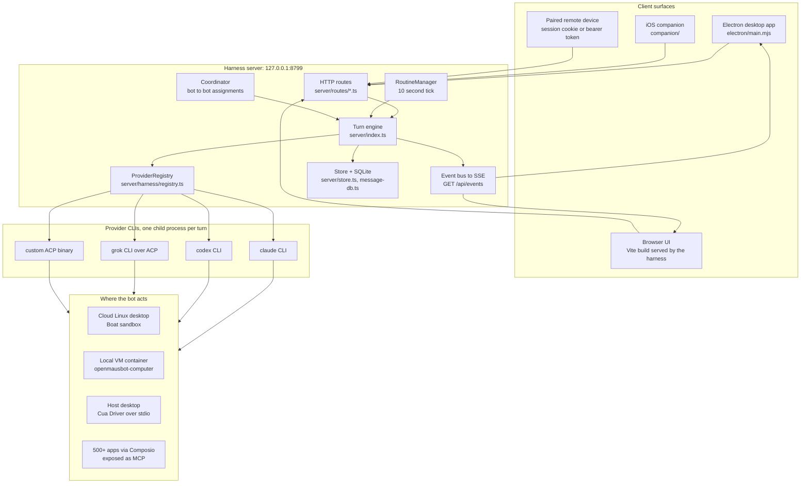
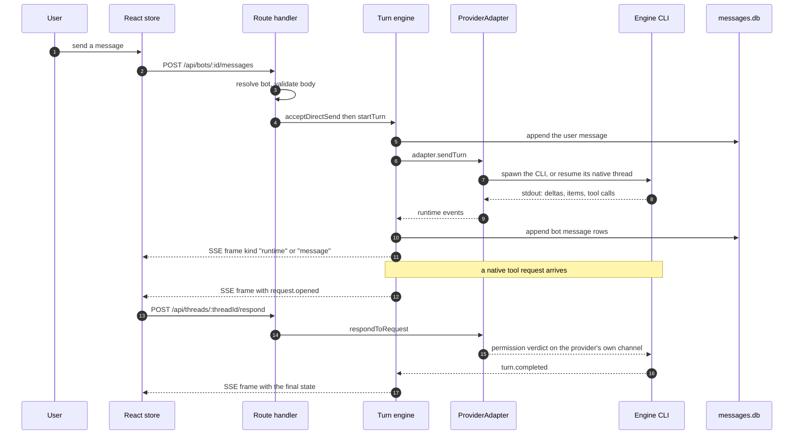
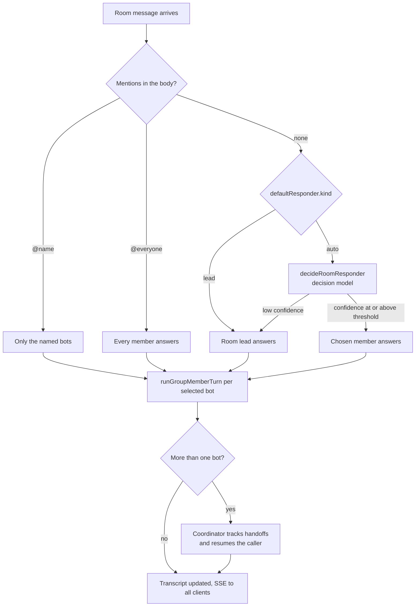
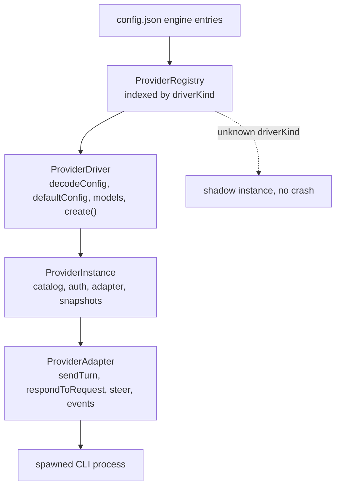
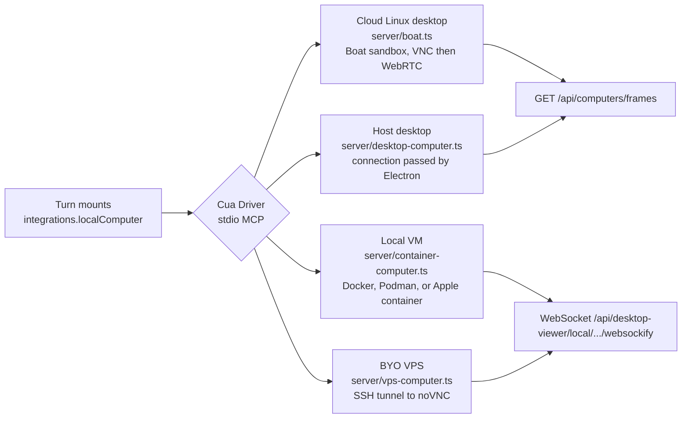
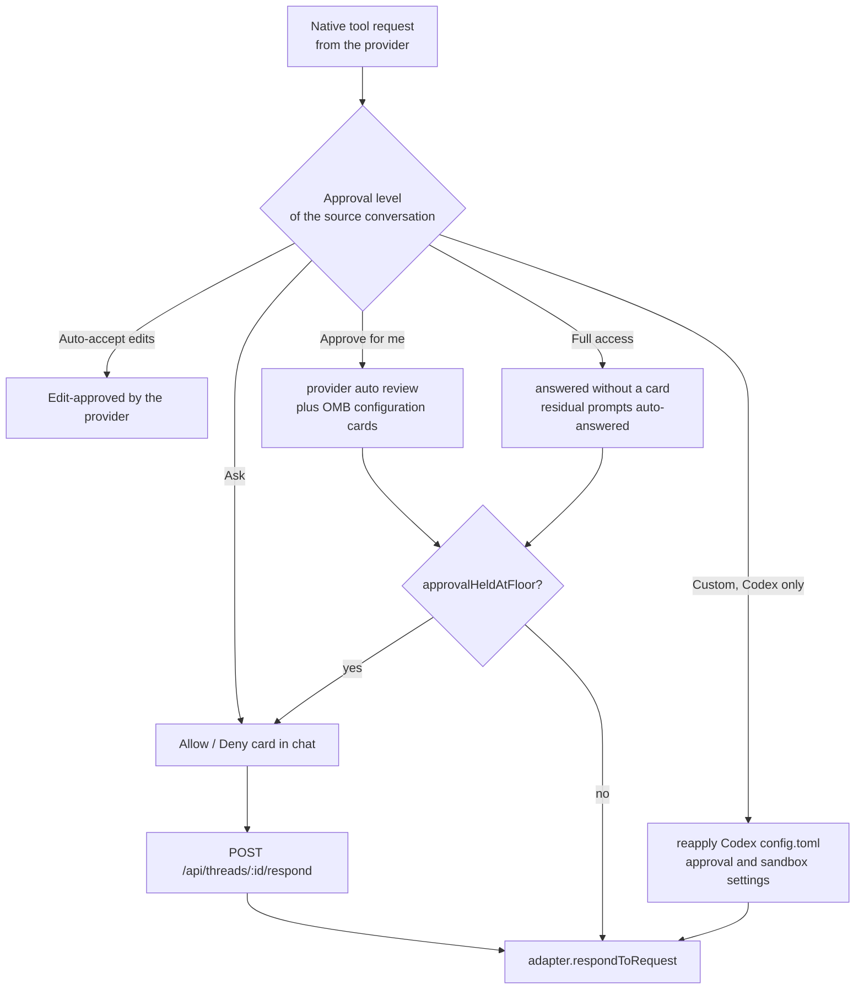
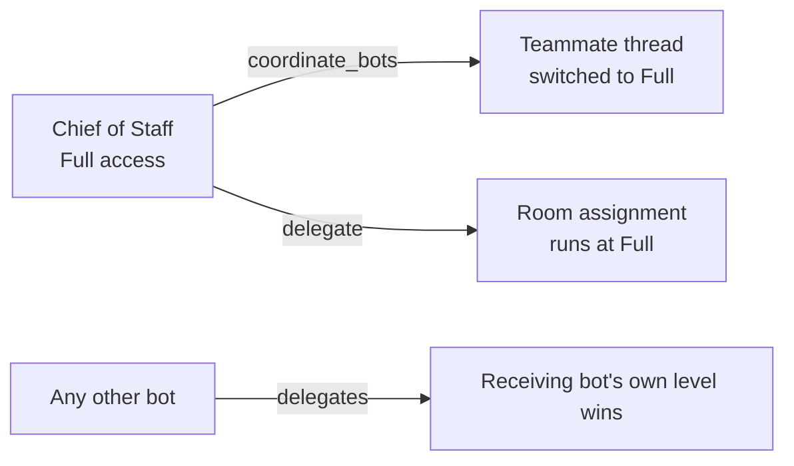
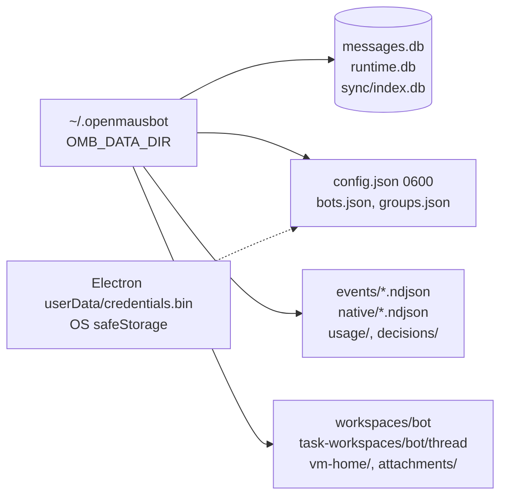

# OpenMausBot architecture

Read at commit [`cdbf1495d3f1`](https://github.com/milind-soni/OpenMausBot/blob/cdbf1495d3f1b6951bfa702d20663a11a3bf67f4) on 2026-11-01, default branch `main`. Every path below is pinned to that commit.

## TL;DR

- OpenMausBot is a chat app with a Node harness server behind it. The server owns every agent process, every credential, and every transcript. The UI only sends commands and renders events.
- A bot is not a model. It is a row in `bots.json` plus a provider CLI child process (`claude`, `codex`, `grok`, or any ACP-speaking binary), plus a workspace folder and an approval level.
- The provider layer is three server-side contracts: `ProviderDriver` for registration, `ProviderInstance` for a configured engine, `ProviderAdapter` for running one turn. There is no shared `Driver` interface in `shared/`; only wire shapes cross to the browser.
- State moves one way. Provider output becomes runtime events, the harness rebroadcasts them over SSE at `/api/events`, and a single React reducer turns each frame into UI state.
- "The bot's computer" is one Cua Driver stdio MCP contract with three backends: a Boat cloud sandbox, a local container named `openmausbot-computer`, or the host desktop passed in by Electron. Same tool surface, same approval cards, three places the pixels live.
- Approval is the provider's own permission mode, passed through. [`docs/approval-levels.md`](https://github.com/milind-soni/OpenMausBot/blob/cdbf1495d3f1b6951bfa702d20663a11a3bf67f4/docs/approval-levels.md) says it plainly: "OpenMausBot does not judge an action itself: there is no app-side allowlist, classifier, or pattern rule."

## Context

The repo is the leading open-source answer to Grok Bot: a roster of agents in a messaging UI, each with its own model, memory, computer, and apps. That product shape is now well documented elsewhere in this repo ([Grok Bot](./grok-bot.md), [its extensibility model](./grok-bot-extensibility.md), [the sandbox-VM alternatives](./open-source-grok-bot-alternatives.md)). What those files do not answer is how one of these things is actually built. This file is the structural map: processes, contracts, event flow, storage, and the seams where the project made a decision worth copying or avoiding.

## Findings

### 1. Process topology

One Node server, one SQLite file per concern, provider CLIs as child processes, and screens on the far side of an MCP connection.

The server binds `127.0.0.1` only, default port `8799` ([`server/index.ts`](https://github.com/milind-soni/OpenMausBot/blob/cdbf1495d3f1b6951bfa702d20663a11a3bf67f4/server/index.ts), `server.listen(PORT, "127.0.0.1")`). [`docs/self-hosting.md`](https://github.com/milind-soni/OpenMausBot/blob/cdbf1495d3f1b6951bfa702d20663a11a3bf67f4/docs/self-hosting.md) states the consequence: "any process that can reach `127.0.0.1:8799` has full control, including the shell your bots can use."

Remote access is a second door, not a different server. Pairing issues a one-use 12-character code with a five-minute life; the browser trades it for a 30-day session cookie. Native clients send `Authorization: Bearer`, and because `EventSource` cannot set headers they mint a five-minute ticket from `POST /api/auth/stream-ticket` and connect with `GET /api/events?ticket=`.

### 2. What a bot actually is

A bot is a record, not an object graph. [`server/store.ts`](https://github.com/milind-soni/OpenMausBot/blob/cdbf1495d3f1b6951bfa702d20663a11a3bf67f4/server/store.ts) keeps bots and rooms in `bots.json` and `groups.json`, including `approvalMode`, the legacy `autoApprove` flag, and the `alwaysAllow` list. The store is 2,323 lines and is the real schema of the product; the TypeScript types are derived from it, not the reverse.

The four things attached to a bot:

| Piece | Lives in | Decides |
| --- | --- | --- |
| Persona | bot profile fields in `bots.json` | name, avatar, instructions injected per turn |
| Model | `config.json` engine instances | which provider CLI and which model string |
| Workspace | `~/.openmausbot/workspaces/<bot>` | the folder the agent treats as its cwd |
| Approval level | `shared/approval-mode.ts` | which of the provider's permission modes the next turn runs in |

Channels (`groups.json`) are the room layer. A channel carries its own transcript, shared instructions, working folder, responder rules, and an editable roster, which is how one bot can sit in "Work" and "Personal" without being cloned ([README](https://github.com/milind-soni/OpenMausBot/blob/cdbf1495d3f1b6951bfa702d20663a11a3bf67f4/README.md)).

### 3. The turn lifecycle

Every message, whether typed in a chat, fired by a routine, posted by a webhook, or sent by another bot, lands in the same place.

The details that matter:

- The route is `POST /api/bots/:id/messages`, handled by `createBotMessageRoutes` in [`server/routes/bot-messages.ts`](https://github.com/milind-soni/OpenMausBot/blob/cdbf1495d3f1b6951bfa702d20663a11a3bf67f4/server/routes/bot-messages.ts). No model picks the bot. The URL does.
- Rooms are where selection happens. `roomResponders` in [`server/store.ts`](https://github.com/milind-soni/OpenMausBot/blob/cdbf1495d3f1b6951bfa702d20663a11a3bf67f4/server/store.ts) resolves `@everyone`, explicit `@name` mentions, the configured lead, or the auto fallback. For `defaultResponder.kind === "auto"` with several members, `decideRoomResponder` in [`server/decider/room-routing.ts`](https://github.com/milind-soni/OpenMausBot/blob/cdbf1495d3f1b6951bfa702d20663a11a3bf67f4/server/decider/room-routing.ts) asks the decision model and applies a confidence threshold; low confidence drops back to the room lead. That is the Jev / OpenRouter "Decision model" setting in README.
- Transport is SSE, not WebSocket. `broadcast` in [`server/index.ts`](https://github.com/milind-soni/OpenMausBot/blob/cdbf1495d3f1b6951bfa702d20663a11a3bf67f4/server/index.ts) writes `id:` and `data:` frames; the browser opens `EventSource("/api/events")` from [`src/lib/live-events.ts`](https://github.com/milind-soni/OpenMausBot/blob/cdbf1495d3f1b6951bfa702d20663a11a3bf67f4/src/lib/live-events.ts).
- Frame kinds are small: `message`, `message.patch`, and `runtime` (which wraps a typed runtime event such as `turn.started`, `content.delta`, `item.started`, `request.opened`, `turn.completed` from [`shared/runtime-events.ts`](https://github.com/milind-soni/OpenMausBot/blob/cdbf1495d3f1b6951bfa702d20663a11a3bf67f4/shared/runtime-events.ts)).
- The browser reconnects by asking for a snapshot. The store clears buffered frames and rehydrates, which is why a long-running turn can survive a page reload without replaying history.

### 4. Room routing

Goal mode is a separate path: `selectGroupGoalCoordinator` picks the mentioned lead or a coordinator, and the coordinator drives members.

### 5. The provider layer

The abstraction is server-side only, in three pieces in [`server/contracts.ts`](https://github.com/milind-soni/OpenMausBot/blob/cdbf1495d3f1b6951bfa702d20663a11a3bf67f4/server/contracts.ts):

`BUILT_IN_DRIVERS` in [`server/drivers/builtIn.ts`](https://github.com/milind-soni/OpenMausBot/blob/cdbf1495d3f1b6951bfa702d20663a11a3bf67f4/server/drivers/builtIn.ts) is a static array: Claude, Codex, and the ACP drivers (Grok and a generic `customAcp`). `customAcp` takes the whole command in `config.cli` and speaks ACP over stdio, so a versioned build or wrapper binary is a first-class engine without a code change.

Two strengths here. Unknown engines degrade to a shadow instance instead of crashing the registry, so a bad config entry does not take the server down. And the ACP path is a real protocol boundary rather than argv scraping, which is what lets Grok and third-party engines share one driver body ([`server/drivers/acp/core.ts`](https://github.com/milind-soni/OpenMausBot/blob/cdbf1495d3f1b6951bfa702d20663a11a3bf67f4/server/drivers/acp/core.ts), 1,755 lines).

The weakness is size. `server/` is roughly 518,000 lines of TypeScript including tests, and [`server/index.ts`](https://github.com/milind-soni/OpenMausBot/blob/cdbf1495d3f1b6951bfa702d20663a11a3bf67f4/server/index.ts) alone is 15,793. Turn orchestration, SSE, room fan-out, the runtime subscription, and dozens of internal routes live in that one file. It is a working design that will make a contribution expensive for anyone who has not memorized it.

### 6. The computer, one contract three backends

This is the part worth copying. Every bot computer is reached through **Cua Driver over stdio MCP** ([`server/contracts.ts`](https://github.com/milind-soni/OpenMausBot/blob/cdbf1495d3f1b6951bfa702d20663a11a3bf67f4/server/contracts.ts)). A turn mounts that connection as an MCP server and the agent sees ordinary tools. What sits behind the connection is a deployment decision, not an agent decision.

The Local VM is a container, not a virtual machine. It runs image `localhost/openmausbot/cua-local-vm:driver-0.37.0-v6` built over `trycua/xfce-cua`, named `openmausbot-computer`, with noVNC inside on port 6901 published to loopback and proxied to the UI by [`server/routes/desktop-viewer.ts`](https://github.com/milind-soni/OpenMausBot/blob/cdbf1495d3f1b6951bfa702d20663a11a3bf67f4/server/routes/desktop-viewer.ts). This matches what [the alternatives comparison](./open-source-grok-bot-alternatives.md) found by reading the same code.

The host mode is the strangest and the most interesting. The desktop app passes a live Cua Driver stdio connection to its own server child process. Nothing on disk or in the environment supplies it, which means a headless deployment physically cannot offer host control, and the capability is scoped by the app being the parent process rather than by a policy flag.

### 7. Approval is a pass-through, with a safety floor

The levels are `ask`, `edits`, `auto`, `full`, `custom` in [`shared/approval-mode.ts`](https://github.com/milind-soni/OpenMausBot/blob/cdbf1495d3f1b6951bfa702d20663a11a3bf67f4/shared/approval-mode.ts), resolved per turn by `approvalModeFor`. Each maps to the provider's own permission mode, so the card a user sees is a request the provider genuinely left open, not a re-implementation of one.

Two rules keep this from being a rubber stamp:

1. **`approvalHeldAtFloor`** in [`server/auto-approve.ts`](https://github.com/milind-soni/OpenMausBot/blob/cdbf1495d3f1b6951bfa702d20663a11a3bf67f4/server/auto-approve.ts) refuses to auto-answer a class of destructive actions even under Full access.
2. **Full access and Custom can only be set from a packaged desktop app**, where the choice crosses a private process channel rather than the bot-accessible HTTP API. They are hidden in development, standalone web, and remote pages ([`docs/approval-levels.md`](https://github.com/milind-soni/OpenMausBot/blob/cdbf1495d3f1b6951bfa702d20663a11a3bf67f4/docs/approval-levels.md)).

The delegation rule is the one that surprises people. A Chief of Staff bot with Full access passes that level to work it delegates, so a teammate's own Ask setting does not stop the work:

### 8. Storage layout

Transcripts are SQLite through `node:sqlite` in WAL mode ([`server/message-db.ts`](https://github.com/milind-soni/OpenMausBot/blob/cdbf1495d3f1b6951bfa702d20663a11a3bf67f4/server/message-db.ts)). Configuration is JSON. Logs are NDJSON, one file per thread, which is what makes tailing an agent turn possible without a log pipeline. Key material splits three ways, and the split is the honest part of the design:

| Secret | Where | Protection |
| --- | --- | --- |
| Provider API keys, desktop | Electron `userData/credentials.bin` | Electron `safeStorage`, OS keychain-backed |
| Provider API keys, headless | `config.json` | file mode 0600 only |
| Saved website logins | `logins.json.enc` plus `logins-key` | AES-256-GCM, both files 0600 |
| Credential-card refs | memory, one use | owner- and thread-bound, never written |

### 9. Frontend shape

[`src/state/store.tsx`](https://github.com/milind-soni/OpenMausBot/blob/cdbf1495d3f1b6951bfa702d20663a11a3bf67f4/src/state/store.tsx) is 3,379 lines: one reducer, one context, one `useStore`. SSE frames arrive through `openLiveEvents` and are dispatched as `messageAdded`, `messagePatched`, `threadActive`, `bot`, `group`, and runtime status actions. There is no client-side store library and no query cache. The server is the only source of truth, and the client is a projection of a frame stream plus one snapshot.

That choice keeps the client simple and moves all of the complexity into the two big files. `src/` is roughly 237,000 lines, and the heaviest single components are the Computer panel (1,821 lines) and the Sidebar (1,745), both of which hold per-feature state the reducer does not.

## Where things live

| Path | Owns |
| --- | --- |
| `server/index.ts` | turn orchestration, SSE, room fan-out, internal routes |
| `server/routes/` | public HTTP surface, one file per resource |
| `server/drivers/` | Claude, Codex, ACP cores, agents MCP bridge |
| `server/harness/` | registry, event bus, engine adapters |
| `server/decider/` | room routing decisions |
| `server/store.ts` | bots, rooms, tasks, transcripts index |
| `server/boat.ts`, `container-computer.ts`, `desktop-computer.ts`, `vps-computer.ts` | the four computer backends |
| `server/auto-approve.ts`, `server/secret-vault.ts` | approval floor and credential handling |
| `shared/` | wire shapes and shared policy used by both sides |
| `src/state/store.tsx` | the whole client state machine |
| `electron/main.mjs` | window, updater, native secrets, host Cua connection |
| `companion/`, `connector/`, `cloudflare/` | phone sidecar, BYO host connector, control plane |

Workspace boundaries are plain pnpm workspaces, no Turbo or Nx. `pnpm-workspace.yaml` lists the root, `apps/docs`, and `cloudflare/control-plane`. `companion/` and `connector/` carry their own `package.json` and sit outside that list.

## Gotchas

- **Loopback is the authentication.** Reaching port 8799 is equivalent to owning the machine's bot shells. Anything that fronts it must forward the real `Host`, set `X-Forwarded-Proto`, and refuse to buffer the event stream.
- **Headless loses three things.** The built-in browser panel, the skill recorder and dictation, and host desktop control all need the desktop app. Cloud and container computers work on a server because the bot's computer runs server-side anyway.
- **In-flight turns die on restart, routines do not.** `docs/self-hosting.md` tells you to update between runs for that reason.
- **Full access propagates down a delegation tree** when the delegator is a Chief of Staff. It is the most surprising permission rule in the product and it exists because per-card approvals were the whole cost of running a team.
- **Mock engines are hidden, not removed.** Full and Custom only enable through the packaged desktop, so a web deployment cannot escalate a bot above Auto by design.
- **The monolith is the contribution cost.** A change to turn sequencing, SSE framing, or room fan-out lands in a 15,793-line file. Read `server/index.test.ts` (14,188 lines) before assuming a behavior is untested.

## Open questions

- Which runtime backs the Boat cloud sandbox is not named in the repo. [`server/boat.ts`](https://github.com/milind-soni/OpenMausBot/blob/cdbf1495d3f1b6951bfa702d20663a11a3bf67f4/server/boat.ts) mints a desktop URL over VNC with WebRTC fallback, and the repo calls it a disposable VM without naming a microVM technology. Establishing whether it is Firecracker-class or a container would need either Boat's own docs or a live instance.
- `companion/` and `connector/` sitting outside the pnpm workspace list may be intentional (they ship separately) or drift. Not verified.
- The decision model's threshold in `decideRoomResponder` is a fixed constant in code. Whether it is tuned per deployment or exposed as a setting was not traced.

## Related

- [Open-Source Grok Bot Alternatives with First-Class Sandbox VMs](./open-source-grok-bot-alternatives.md) — the sibling comparison this file feeds; its container verdict for the Local VM is confirmed here.
- [Grok Bot](./grok-bot.md) and [Grok Bot Extensibility](./grok-bot-extensibility.md) — the closed product this rebuilds.
- [Bot Primitive](./bot-primitive.md) — the abstraction both share.
- [T3 Code — Server, Desktop, Web, and Mobile Architecture](./t3-code-client-server-architecture.md) — a second Electron-plus-server design with the same event-log/stream shape and a much smaller server.

## Changelog

- 2026-11-01 — created from a read of `main` at `cdbf1495d3f1`, plus the project's `docs/self-hosting.md` and `docs/approval-levels.md`.
