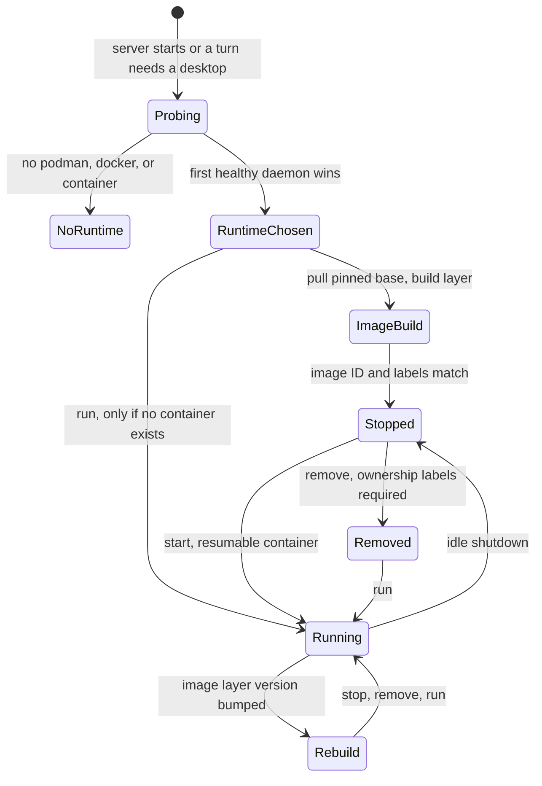
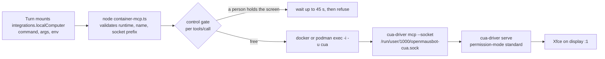
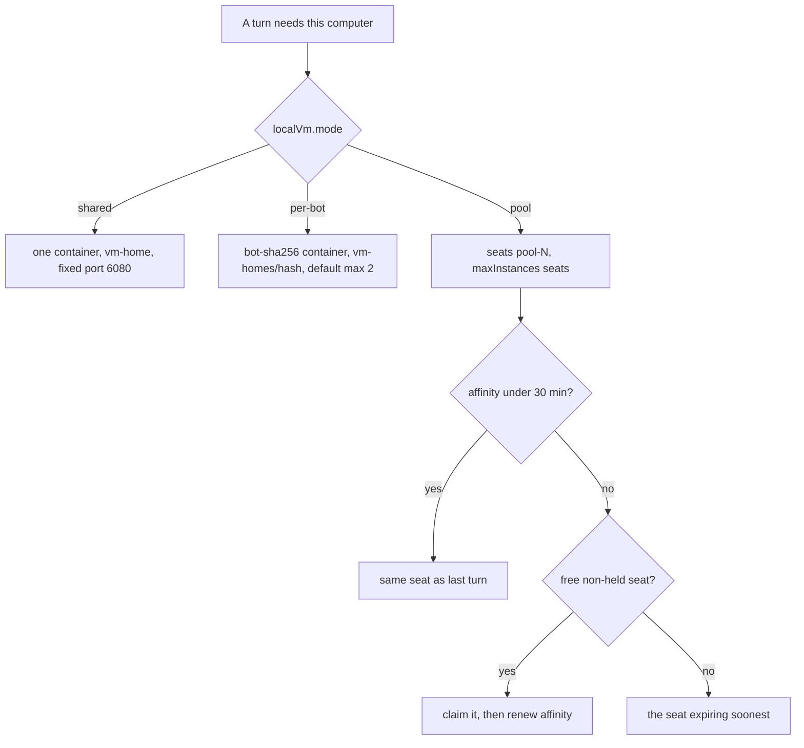
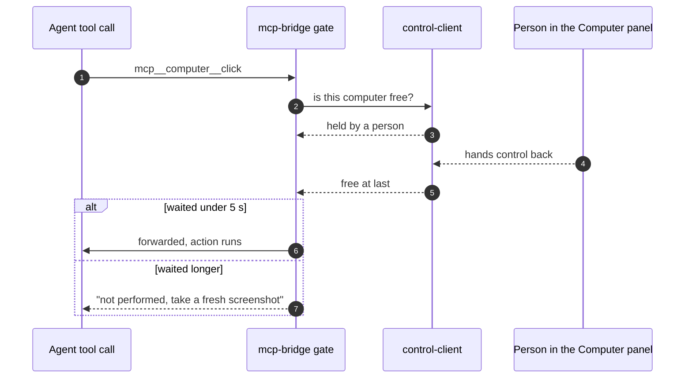
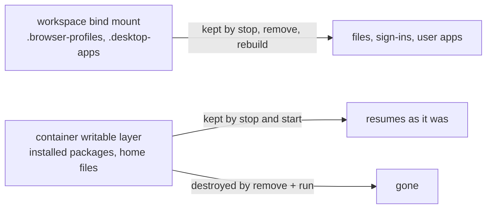

# OpenMausBot's bot computer, layer by layer

Read at `ac08cf72a70f` on 2026-11-01. `main` moved between this read and [the architecture file](./openmausbot-architecture.md) (which pins `cdbf1495d3f1`); the numbers below are the later commit, and `server/index.ts` measured 15,793 lines at both.

## TL;DR

- The "Local VM" is a container, not a virtual machine. Apple's `container` runtime is the one exception, and it is a lightweight VM underneath.
- The agent never talks to the desktop. It talks to `cua-driver` over stdio MCP, and a Node proxy in the harness turns that into `docker exec -i -u cua ... cua-driver mcp --socket /run/user/1000/openmausbot-cua.sock`.
- Isolation is a flag set, not a runtime: `--cap-drop ALL` plus three caps, no privileged mode, no host namespaces, default seccomp, one bind mount, one loopback port.
- Exactly one host folder is mounted, so a rebuild keeps files, browser sign-ins, and user-installed desktop apps, but not system packages.
- A person can take the screen at any time. The bot's next action is refused rather than queued, because an action that lands late could double a click the engine already retried.

## Context

[The architecture file](./openmausbot-architecture.md) said the computer is one Cua Driver contract behind four backends. That sentence hides the part that matters when you are building one of these: how the container is created, what stops it escaping, how the agent's clicks actually arrive, and what happens when a human and a bot want the same screen. This file answers those four.

## The lifecycle



Runtime detection is ordered and honest about failure. Candidates are `podman`, `docker`, and Apple's `container` on macOS only; Windows prefers Podman. Each candidate is probed with `which` or `where.exe` and then a daemon check (`podman info`, `docker info`, `container system status`), and the first healthy one wins ([`server/container-computer.ts`](https://github.com/milind-soni/OpenMausBot/blob/ac08cf72a70f4d334ea39e9044ecc514c0c1056c/server/container-computer.ts)). On macOS, Apple `container` can only run the shared desktop, not a per-bot one.

The commands are guarded rather than blindly re-run. `run` is rejected when a container already exists, `start` only resumes a stopped one, and `remove` refuses a container that lacks the OpenMausBot ownership labels, so a name collision with someone else's container cannot destroy their work. A turn wakes the desktop through `localVmWakeAction` (`server/index.ts:11809`) into `containerComputerAction("run" | "start")` (`:11820`). Idle shutdown calls `stop`, which keeps the writable layer.

## The flag set is the security model

`containerRunArgs` ([`server/container-computer.ts`](https://github.com/milind-soni/OpenMausBot/blob/ac08cf72a70f4d334ea39e9044ecc514c0c1056c/server/container-computer.ts), around line 849) assembles a defensive posture that a container engine would not give you by default:

| Flag | Value | Why it is there |
| --- | --- | --- |
| `--cap-drop ALL` | then `--cap-add SETUID`, `SETGID` | the supervisor must drop to user `cua`; nothing else |
| `--cap-add SYS_CHROOT` | Podman only | Firefox's chroot sandbox needs it |
| `--userns keep-id:uid=1000,gid=1000` | Podman only, with `--user 0:0` | rootless mapping so the mounted workspace owner matches guest `cua` |
| `--memory 4g`, `--memory-swap 4g` | 4 GB | hard ceiling, no swap escape |
| `--cpus 2` | 2 | a runaway render cannot eat the host |
| `--pids-limit 4096` | 4,096 | a fork bomb is bounded |
| `--shm-size 512m` | 512 MB | Chrome and Electron need shared memory |
| `--ipc private`, `--cgroupns private` | on | no host IPC or cgroup view |
| `-p 127.0.0.1:<port>:6901` | loopback only | the screen is never on a LAN interface |
| `type=bind,source=<workspace>,target=/home/cua/workspace` | one mount | the only host path inside |

No `--privileged`, no device passthrough, no host PID/IPC/UTS namespaces, and no `--security-opt` at all, so seccomp stays the engine's default profile and never becomes `unconfined`. Container reuse re-validates this: a candidate is only reused when `Privileged === false`, ports are loopback-only, and hardening passes. `AutoRemove` and restart policies are rejected outright, because a container that deletes itself breaks the stop/start persistence story.

The `pids-limit` number carries its own archaeology. [`server/container-limits.ts`](https://github.com/milind-soni/OpenMausBot/blob/ac08cf72a70f4d334ea39e9044ecc514c0c1056c/server/container-limits.ts) records that the old 512 cap killed desktops: "Firefox alone runs about 430 threads with seven tabs open (Debian 12, Oct 2026): under a 512 cap its next tab, and every `docker exec` into the desktop, fail to fork." The module raises existing containers in place with `docker update --pids-limit`, which works on running containers, so nobody has to recreate a desktop to get the fix.

One gap worth naming. Apple's `container` path only checks 4 GB and 2 CPUs on reuse, not the capability set, and the code comments that the runtime already places each Linux container in a lightweight VM. That is a defensible trade, but it means the isolation story on macOS is Apple's, not OpenMausBot's.

## The tool seam



The container installs Cua Driver 0.37.0 from a SHA-256-pinned manylinux wheel, puts the binary at `/usr/local/libexec/openmausbot/cua-driver`, and asserts its `--version` at build time. The image supervisor runs `start-openmausbot-cua-driver.sh` as user `cua` with `autorestart=true` and `startsecs=2`; that script waits for X display `:1` and then runs:

```sh
cua-driver serve --socket /run/user/1000/openmausbot-cua.sock \
  --permission-mode standard --cursor-reduced-motion on
```

[`server/container-mcp.ts`](https://github.com/milind-soni/OpenMausBot/blob/ac08cf72a70f4d334ea39e9044ecc514c0c1056c/server/container-mcp.ts) is the whole client side, and its opening comment states the design: "It defines no tools; the shared bridge only answers ping, makes tool schemas provider-safe and keeps error results text-only." The proxy validates its three argv values (runtime must be one of the three engines, the container name must match `^[a-zA-Z0-9_.-]+$`, the socket must start with `/run/user/1000/`) and then forwards MCP over `exec`. Two details are deliberate:

1. The who-is-driving pair travels in `OMB_CONTROL_URL` and `OMB_CONTROL_TOKEN` env vars, not argv, because argv is visible to every process in `ps`.
2. There is no liveness watchdog. The runtime CLI talks to a local daemon and fails fast on its own.

Because the proxy is generic, the agent sees Cua Driver's own catalog: `click`, `double_click`, `right_click`, `drag`, `scroll`, `type_text`, `press_key`, `hotkey`, `move_cursor`, `get_window_state`, `get_desktop_state`, `get_accessibility_tree`, `list_windows`, `list_apps`, `launch_app`, `bring_to_front`, `check_permissions`, `get_screen_size`, `zoom`, `screenshot`, `start_session` ([`docs/computer-use-integration.md`](https://github.com/milind-soni/OpenMausBot/blob/ac08cf72a70f4d334ea39e9044ecc514c0c1056c/docs/computer-use-integration.md)). The harness declares none of them. They surface to the model under the `computer` MCP namespace as `mcp__computer__click` and friends.

A read and a write take the same path. `get_desktop_state` and `screenshot` are ordinary `tools/call` frames, and so is `click`. The harness does implement one separate read path, and only for itself: preview and readiness probe `get_desktop_state` with `--screenshot-out-file`, read the file back as base64, and reject a PNG or JPEG that arrives short or truncated.

## Four backends, one descriptor

| | Local VM | Cloud (Boat) | This computer | BYO VPS |
| --- | --- | --- | --- | --- |
| Runtime | container via podman, docker, or Apple container | provider sandbox | your own desktop | container on your server |
| Isolation | cap-drop ALL plus three caps, default seccomp, one mount | provider's, off-machine | none, it is the real seat | same flags as Local VM, remote |
| Tool surface | Cua Driver, 21 tools, passthrough | fixed 10-tool xdotool set, ajv-validated | Cua Driver, host-only rules | Cua Driver |
| Screen transport | noVNC on 6901, RFB proxied to loopback | frame polling, plus provider join URL | Cua, local | SSH forwards one loopback port to noVNC |
| Persistence | one bind mount | per-turn box | the machine | server-side volume |
| Works headless | yes | yes | no, needs the desktop app | yes |

Every backend returns the same `integrations.localComputer` descriptor ([`server/contracts.ts`](https://github.com/milind-soni/OpenMausBot/blob/ac08cf72a70f4d334ea39e9044ecc514c0c1056c/server/contracts.ts)), which each adapter mounts as the `computer` MCP server. That is the seam. The differences are deployment facts, and two of them leak:

- The cloud surface is smaller and stricter. `CLOUD_COMPUTER_TOOLS` in [`server/cloud-computer-tools.ts`](https://github.com/milind-soni/OpenMausBot/blob/ac08cf72a70f4d334ea39e9044ecc514c0c1056c/server/cloud-computer-tools.ts) is a hand-written list of ten tools (`screenshot`, `get_screen_size`, `click`, `move`, `drag`, `type_text`, `key_press`, `scroll`, `open_url`, `exec`) with ajv schemas, coordinates bounded to 32767, and a Reddit refusal because a data-centre address is not a person. It is served at `POST /api/internal/computer/mcp` behind a turn-scoped capability so the Boat credential never leaves the server.
- The host desktop is the only backend that can move a person's real focus, so it is the only one where `integrations.localComputer.scope` is set to `"local-computer"`, and the only one where host-only approval rules exist. Consent gates first use.

The BYO VPS path is the Local VM flags run against a remote engine: `docker` with `-H ssh://<alias>`, where Docker's SSH transport uses the app's own `ssh` shim and never publishes the port. [`server/vps-computer.ts`](https://github.com/milind-soni/OpenMausBot/blob/ac08cf72a70f4d334ea39e9044ecc514c0c1056c/server/vps-computer.ts) states the rule: "SSH forwards one loopback port to noVNC, and every caller-controlled part is validated before argv."

## Sharing one screen



Three modes, one container contract. `shared` is a singleton with workspace `DATA_DIR/vm-home` and a fixed host port 6080, so every bot in shared mode resolves to the same desktop and shares files and browser state. `per-bot` keys by `bot:<sha256>` with workspace `vm-homes/<first-16-hex>` and a default ceiling of two containers. `pool` runs `maxInstances` seats named `openmausbot-computer-pN`, each with its own workspace.

The seat pool is the interesting one, because a seat is not assigned to a bot. A thread asks `LocalVmSeatPool.assign`: it keeps its previous seat while that affinity is under 30 minutes, otherwise it prefers a free seat that is not soft-held, and failing that takes the seat expiring soonest. Affinity is renewed only after the turn wins the seat, so a losing turn does not extend its claim.

The control gate is not a lock. [`server/computer-control.ts`](https://github.com/milind-soni/OpenMausBot/blob/ac08cf72a70f4d334ea39e9044ecc514c0c1056c/server/computer-control.ts) is an in-memory per-computer flag. Only the person's routes call `take` or `acquireLease`; a bot has no control verb at all. `control-client.ts` is the bridge-side reader: each `tools/call` is checked once, serialized in arrival order, through a cached GET of the harness control endpoint with a turn-scoped bearer, cached 750 ms and failing closed as "unconfirmed" on timeout or malformed state.



Two numbers make that work. A call may wait up to 45 seconds for the computer to free up, including a lazy start. But the action window is 5 seconds measured from frame arrival: if the computer only frees after that, the call is refused instead of performed, because a stale click could land after the engine already retried it and double the action. Nothing is queued or replayed, and a turn waits at most 30 minutes for a person before the wait ends (`COMPUTER_WAIT_MAX_MS`).

The refusal strings are written for the model, not for a person. [\`server/control-client.ts\`](https://github.com/milind-soni/OpenMausBot/blob/ac08cf72a70f4d334ea39e9044ecc514c0c1056c/server/control-client.ts) carries four of them, each ending in the next action: \"A person has taken control of this computer, so this call was NOT performed ... To wait for them, take a screenshot ... Meanwhile you may work on anything that does not need this computer.\" The handed-back text adds the reason a retry is unsafe: a click composed before the person's hands moved must not land on whatever is under it now.

The live screen is a thin proxy. `/api/desktop-viewer/local/{shared|bot-<sha256>|pool-N}[/websockify]` returns only the VNC password on a plain GET and upgrades to a fixed `127.0.0.1:<managed port>/websockify` on a WebSocket request, never a browser-supplied URL. Auth is three layers: admin scope and same-origin at the HTTP boundary, a live session, and an RFB password generated per container run and carried in `VNC_PW`. The upstream handshake forwards no cookie, bearer token, query, or forwarded header, only that password. The phone join route is stricter still: it demands per-bot mode and a valid `controlLeaseId`, refuses shared and pool desktops with 409, and rechecks the lease every five seconds.

## What survives a rebuild



Exactly one host directory is mounted, at `/home/cua/workspace`, created 0700. Its path is `vm-home` for the shared desktop, `vm-homes/<hash>` per bot, or `vm-homes/pool-<n>` per seat. `stop` and `start` keep the container's writable layer, so installed packages and home files come back. `remove` plus `run` destroys that layer, and only the mount survives.

The mount is arranged so that wipe still hurts less than it sounds. [`server/container-workspace.ts`](https://github.com/milind-soni/OpenMausBot/blob/ac08cf72a70f4d334ea39e9044ecc514c0c1056c/server/container-workspace.ts) migrates the Chrome, Chromium, and Firefox profiles into `<workspace>/.browser-profiles` and symlinks them back, and symlinks `~/.local` to `<workspace>/.desktop-apps/local`. A rebuild therefore keeps browser sign-ins and any AppImage or desktop tool the person installed under the workspace, while losing `apt install` packages. Legacy desktops get their profiles rescued before removal.

The image itself is built, not pulled from a registry you do not control. `prepareManagedImage` pulls the pinned base `docker.io/trycua/xfce-cua@sha256:274eb6…be9b`, writes a generated Dockerfile into a temp directory, and runs `build -t localhost/openmausbot/cua-local-vm:driver-0.37.0-v6`. Reuse requires the image ID and four labels to match. `IMAGE_LAYER_VERSION` is the revision of that Dockerfile layer, and bumping it is what makes old containers fail `imageMatches` so the updater recreates them.

## Gotchas

- **The driver refuses unsafe input before any approval card exists.** Inside the container there is no `/dev/uinput`, so background X11 key injection is unavailable and the system prompt requires `delivery_mode: "foreground"` for keys, typing, scroll, and pixel clicks. Pixel clicks are also refused on a window this session has not read, so `get_window_state` has to come first. Accessibility targets are preferred over coordinates.
- **The mount is the only durable thing.** Anything a user installs outside `/home/cua/workspace` disappears at the next rebuild, which happens on every layer bump.
- **Host control cannot work headless.** Electron passes a live Cua connection to its server child and nothing on disk or in the environment supplies one, so a Docker or systemd deployment silently has no host desktop.
- **The TCC grant follows the spawning process, not the binary.** [`docs/computer-use-integration.md`](https://github.com/milind-soni/OpenMausBot/blob/ac08cf72a70f4d334ea39e9044ecc514c0c1056c/docs/computer-use-integration.md) is explicit: spawn `cua-driver` from the Electron main process, never from the server or a gateway daemon, or macOS attributes the permission to the gateway and `check_permissions` cannot detect the misattribution.
- **Ubuntu Wayland host control is disabled on purpose**, fail-closed, while the real-seat input-safety gate in issue #345 is open ([`docs/linux-desktop.md`](https://github.com/milind-soni/OpenMausBot/blob/ac08cf72a70f4d334ea39e9044ecc514c0c1056c/docs/linux-desktop.md)). Local VM and cloud computers are unaffected, because they do not touch the real seat.
- **Waiting costs a screenshot, not a poll.** The gateway gives the bot no wait verb; it waits by calling a read tool such as `screenshot`, because each computer call itself blocks up to 45 seconds. A turn that ends instead of calling again loses its place in line.
- **The viewer has no connection cap.** Every WebSocket opens its own upstream and closing one does not close the others. Only the UI limits panes, and only the control gate limits who can act.

## Open questions

- Apple `container` reuse validates 4 GB and 2 CPUs only. Whether the capability set is enforced at create time the way Docker and Podman are was not traced, and the code comment says the runtime's own lightweight VM carries the isolation argument.
- The cloud sandbox's underlying microVM technology is still not named anywhere in the repo. [`server/boat.ts`](https://github.com/milind-soni/OpenMausBot/blob/ac08cf72a70f4d334ea39e9044ecc514c0c1056c/server/boat.ts) mints a desktop URL over VNC with WebRTC fallback and the repo calls it a disposable VM.
- `maxInstances` bounds per-bot desktops and pool seats, but the default of two for every deployment is a product choice, not a measured limit. No benchmark of simultaneous desktops on one host appears in the repo.

## Related

- [OpenMausBot Architecture](./openmausbot-architecture.md) — the whole-system map this file drills into.
- [Open-Source Grok Bot Alternatives with First-Class Sandbox VMs](./open-source-grok-bot-alternatives.md) — the comparison that first established the Local VM is a container.
- [Linux Desktop in gVisor](./linux-desktop-in-gvisor.md) and [The Computer-Use Stack for Agents on gVisor](./computer-use-stack-for-agents-on-gvisor.md) — the alternative isolation story this design did not take.
- [Grok Bot Extensibility](./grok-bot-extensibility.md) — what the closed product exposes on the same seam.

## Changelog

- 2026-11-01 — created from a read of `main` at `ac08cf72a70f`, plus the project's `docs/computer-use-integration.md` and `docs/linux-desktop.md`.
