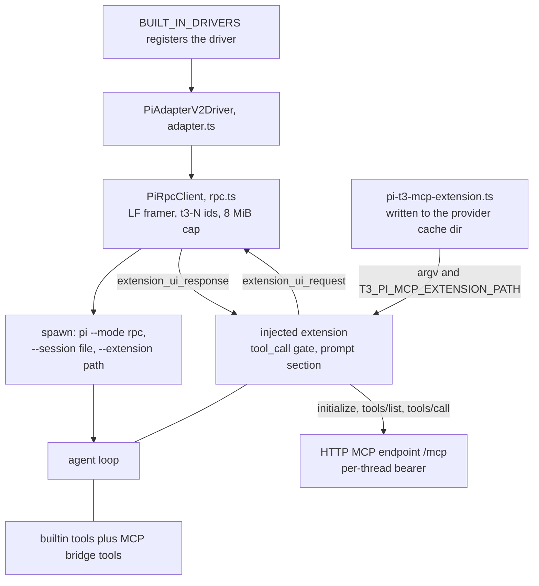
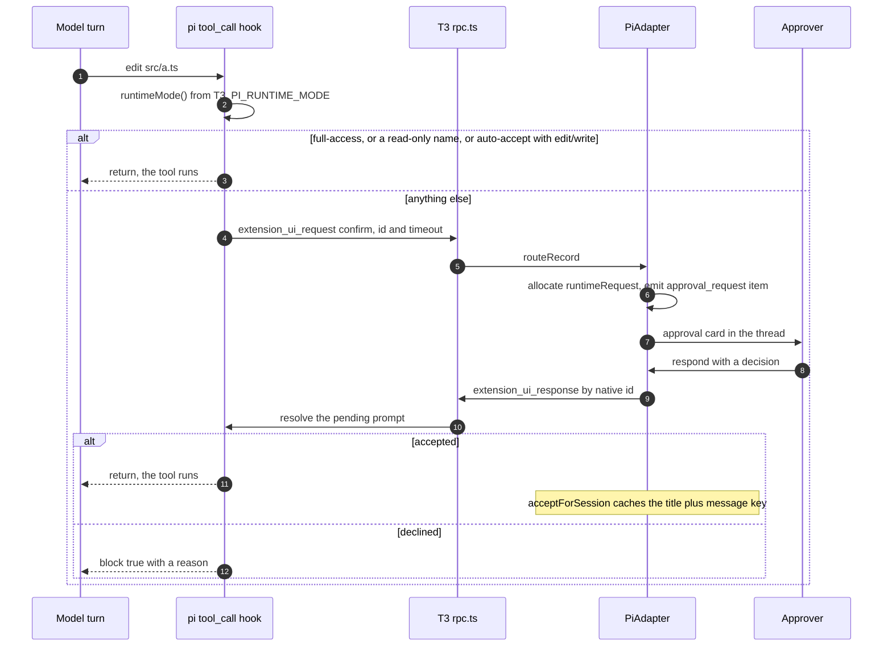
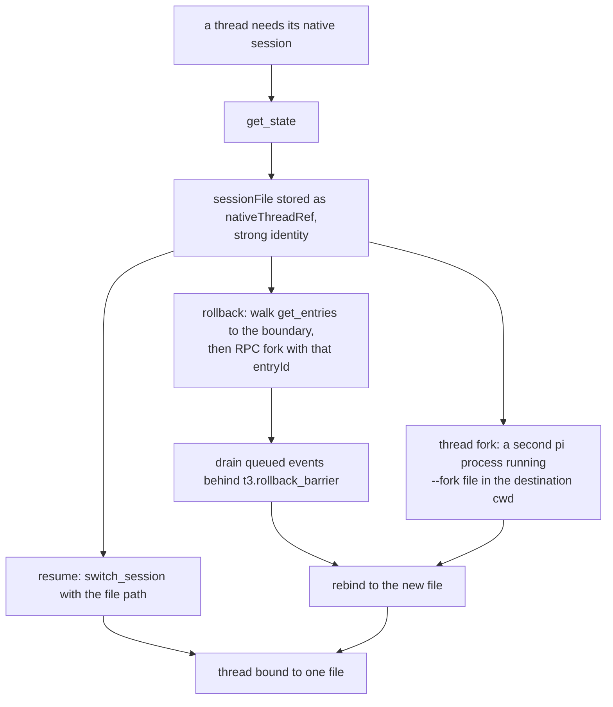
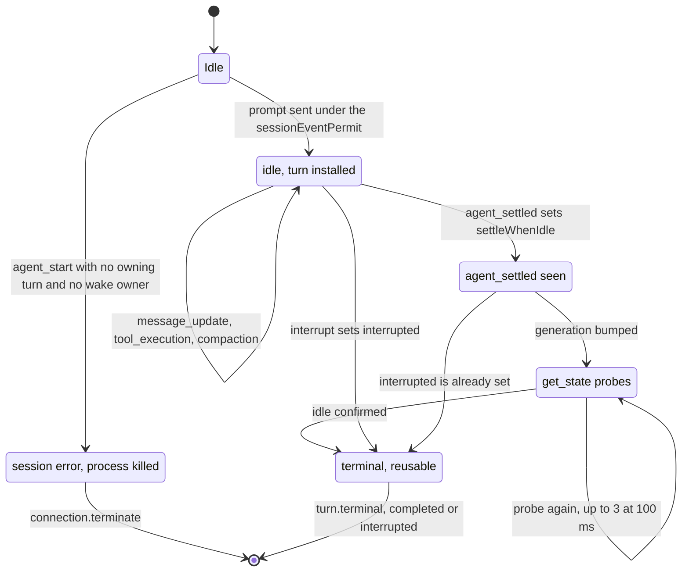

# T3 Code × pi — How an Orchestrator Drives the pi Coding Agent Over RPC, and What It Has to Build Itself

## TL;DR

- **The boundary is a process, not an import.** `@t3tools/provider-pi` depends on nothing from pi
  (`packages/provider-pi/package.json`), and every session is `pi --mode rpc` as a detached child.
  The only pi code T3 links is the version probe `pi --version` and the string it writes into a
  generated extension ([adapter.ts:464](https://github.com/pingdotgg/t3code/blob/32ecd71726fee16f335484c1f95cbce126d461f6/packages/provider-pi/src/server/adapter.ts#L464),
  [status.ts:211](https://github.com/pingdotgg/t3code/blob/32ecd71726fee16f335484c1f95cbce126d461f6/packages/provider-pi/src/server/status.ts#L211)).
- **T3 hand-rolls the JSONL client instead of using pi's `RpcClient`** — its own framer, its own
  `t3-N` request ids, and an **8 MiB-plus record cap pi does not have**
  ([rpc.ts:93-125](https://github.com/pingdotgg/t3code/blob/32ecd71726fee16f335484c1f95cbce126d461f6/packages/provider-pi/src/server/rpc.ts#L93-L125),
  [jsonl.ts:31-42](https://github.com/earendil-works/pi/blob/7d75a0e3eb273dff753d49c066ea29fbe7b3b6f6/packages/coding-agent/src/modes/rpc/jsonl.ts#L31-L42)).
- **The hard parts are not in the protocol.** Permission gating, the MCP tool bridge, skill-chip
  expansion, and the orchestration system prompt all live in one generated TypeScript extension that
  T3 writes into its own cache dir and passes with `--extension`
  ([mcpInjection.ts:223-281](https://github.com/pingdotgg/t3code/blob/32ecd71726fee16f335484c1f95cbce126d461f6/packages/provider-pi/src/server/mcpInjection.ts#L223-L281),
  [mcpExtensionSource.ts:317-381](https://github.com/pingdotgg/t3code/blob/32ecd71726fee16f335484c1f95cbce126d461f6/packages/provider-pi/src/server/mcpExtensionSource.ts#L317-L381)).
- **pi's own event model fights the turn model.** `agent_settled` only counts as a settle
  *hint*: T3 re-probes `get_state` up to three times, and treats agent activity with no T3 turn
  owning it as an error and kills the process
  ([adapter.ts:1575-1600](https://github.com/pingdotgg/t3code/blob/32ecd71726fee16f335484c1f95cbce126d461f6/packages/provider-pi/src/server/adapter.ts#L1575-L1600),
  [adapter.ts:1676-1679](https://github.com/pingdotgg/t3code/blob/32ecd71726fee16f335484c1f95cbce126d461f6/packages/provider-pi/src/server/adapter.ts#L1676-L1679)).

## Context

pi ships three host integrations: the in-process SDK, the exported `RpcClient`, and raw RPC. Its docs
rank them explicitly — SDK first, `RpcClient` for a typed subprocess, raw RPC last
([rpc.md:5-9](https://github.com/earendil-works/pi/blob/7d75a0e3eb273dff753d49c066ea29fbe7b3b6f6/packages/coding-agent/docs/rpc.md#L5-L9),
[cli-integration.md:5-9](https://github.com/earendil-works/pi/blob/7d75a0e3eb273dff753d49c066ea29fbe7b3b6f6/packages/coding-agent/docs/cli-integration.md#L5-L9)).
T3 Code is the largest host reading pi's wire directly that this research found [unverified as a
global claim], and its choices show what the bottom rung actually costs: every capability the protocol
leaves to the host becomes host code.

This file reads both pinned trees — t3code at `32ecd71726fee16f335484c1f95cbce126d461f6`
(2026-10-30), pi at `7d75a0e3eb273dff753d49c066ea29fbe7b3b6f6` (2026-10-12) — and maps the seam
direction by direction.

**Version skew to keep in view.** T3 refuses anything below pi 0.80.5
([status.ts:64](https://github.com/pingdotgg/t3code/blob/32ecd71726fee16f335484c1f95cbce126d461f6/packages/provider-pi/src/server/status.ts#L64));
the pi tree read here is `1.2.0` while the machine's installed CLI is 1.5.1. T3's extension source
already branches on a 0.99 capability (`registerMcpServer`, exposing deferred tool registration)
([mcpExtensionSource.ts:352-356](https://github.com/pingdotgg/t3code/blob/32ecd71726fee16f335484c1f95cbce126d461f6/packages/provider-pi/src/server/mcpExtensionSource.ts#L352-L356)),
so the two versions are not interchangeable at the extension layer.

## Findings

### 1. Transport: a detached child, spawned per session, retired per session

The adapter opens a session by materializing the extension, resolving user launch args, building argv,
wrapping the process in an "agent scope", and only then spawning
([adapter.ts:456-506](https://github.com/pingdotgg/t3code/blob/32ecd71726fee16f335484c1f95cbce126d461f6/packages/provider-pi/src/server/adapter.ts#L456-L506)).
The spawn uses `detached: true` off Windows so the process group can be signalled as a unit
([rpc.ts:180-190](https://github.com/pingdotgg/t3code/blob/32ecd71726fee16f335484c1f95cbce126d461f6/packages/provider-pi/src/server/rpc.ts#L180-L190),
[rpc.ts:196](https://github.com/pingdotgg/t3code/blob/32ecd71726fee16f335484c1f95cbce126d461f6/packages/provider-pi/src/server/rpc.ts#L196)).
Notably the spawn **runs through a shell** (`shell: spawnCommand.shell`) so a configured binary path can
be a command line, not just a path.

The whole seam in one picture — two processes, one socket-free HTTP channel, and a file on disk as the only shared artifact:

The final argv is fixed in one place and is deliberately ordered so the user cannot undo T3's
restrictions ([mcpInjection.ts:262-281](https://github.com/pingdotgg/t3code/blob/32ecd71726fee16f335484c1f95cbce126d461f6/packages/provider-pi/src/server/mcpInjection.ts#L262-L281)):

1. `--mode rpc`
2. `--no-session` (ephemeral callers) or `--session <file>`
3. the user's `launchArgs`
4. `--no-extensions` / `--no-tools` last, so user flags cannot re-enable unattended tools
5. `--extension <generated file>`, unless the user already named it

| Flag | Definition | Who sets it |
|---|---|---|
| `--mode rpc` | JSONL in/out mode | T3, always ([args.ts:99-111](https://github.com/earendil-works/pi/blob/7d75a0e3eb273dff753d49c066ea29fbe7b3b6f6/packages/coding-agent/src/cli/args.ts#L99-L111)) |
| `--session <path\|id>` | resume a native session | T3 ([adapter.ts:2158](https://github.com/pingdotgg/t3code/blob/32ecd71726fee16f335484c1f95cbce126d461f6/packages/provider-pi/src/server/adapter.ts#L2158)) |
| `--extension/-e` | extra extension file | T3's bridge, or the user ([args.ts:186-190](https://github.com/earendil-works/pi/blob/7d75a0e3eb273dff753d49c066ea29fbe7b3b6f6/packages/coding-agent/src/cli/args.ts#L186-L190)) |
| `--provider` / `--model` | model default | user, must be paired |
| `--no-extensions` / `--no-tools` | drop discovery | T3 for background calls |

Reserved args are rejected before launch, with a ready-made message
([mcpInjection.ts:13-27](https://github.com/pingdotgg/t3code/blob/32ecd71726fee16f335484c1f95cbce126d461f6/packages/provider-pi/src/server/mcpInjection.ts#L13-L27),
validation at [mcpInjection.ts:103-127](https://github.com/pingdotgg/t3code/blob/32ecd71726fee16f335484c1f95cbce126d461f6/packages/provider-pi/src/server/mcpInjection.ts#L103-L127)).
`--mode`, `--session`, `--continue`, `--fork`, `--print`, `--version` and a positional prompt are all
"controlled by T3 Code". The user-facing doc states the rule and its reason — T3 owns the process
lifecycle ([providers-pi.md:20-24](https://github.com/pingdotgg/t3code/blob/32ecd71726fee16f335484c1f95cbce126d461f6/docs/user/providers-pi.md#L20-L24)).

Env is rebuilt, not inherited: `T3_MCP_URL`, `T3_MCP_BEARER_TOKEN` and
`T3_PI_MCP_EXTENSION_PATH` are deleted from the inherited environment first, so a parent process
cannot pass stale credentials to a child ([mcpInjection.ts:282-287](https://github.com/pingdotgg/t3code/blob/32ecd71726fee16f335484c1f95cbce126d461f6/packages/provider-pi/src/server/mcpInjection.ts#L282-L287)).
pi's own `PI_CODING_AGENT=true` / `AI_AGENT=pi` child markers are pi-side
([environment-variables.md:15-18](https://github.com/earendil-works/pi/blob/7d75a0e3eb273dff753d49c066ea29fbe7b3b6f6/packages/coding-agent/docs/environment-variables.md#L15-L18)).

### 2. Wire protocol: a hand-rolled client, and four record types pi never defined

`rpc.ts` is T3's own client. It frames on LF, strips one trailing CR, drops lines that fail JSON
parse with a debug log, correlates responses by a `t3-<n>` id, and caps a buffered record at
`8 MiB + 2 × images` — a limit pi's own reader does not enforce
([rpc.ts:93-125](https://github.com/pingdotgg/t3code/blob/32ecd71726fee16f335484c1f95cbce126d461f6/packages/provider-pi/src/server/rpc.ts#L93-L125),
[rpc.ts:283-300](https://github.com/pingdotgg/t3code/blob/32ecd71726fee16f335484c1f95cbce126d461f6/packages/provider-pi/src/server/rpc.ts#L283-L300),
[jsonl.ts:31-42](https://github.com/earendil-works/pi/blob/7d75a0e3eb273dff753d49c066ea29fbe7b3b6f6/packages/coding-agent/src/modes/rpc/jsonl.ts#L31-L42)).
Overrunning the cap drops the record rather than truncating it.

Commands sent — 16 of pi's 33
([rpc-types.ts:20-74](https://github.com/earendil-works/pi/blob/7d75a0e3eb273dff753d49c066ea29fbe7b3b6f6/packages/coding-agent/src/modes/rpc/rpc-types.ts#L20-L74)
is the full set):

| Group | Commands T3 sends |
|---|---|
| Turn | `prompt` (with `streamingBehavior: "steer"` and `images`), `abort` |
| Session | `new_session`, `switch_session`, `fork`, `set_session_name` |
| Read | `get_state`, `get_entries`, `get_messages`, `get_session_stats`, `get_last_assistant_text` |
| Model / thinking | `get_available_models`, `set_model`, `set_thinking_level` |
| Misc | `compact`, `get_commands` |

Unused: `steer`, `follow_up`, `clear_queue`, `cycle_model`, `cycle_thinking_level`,
`get_available_thinking_levels`, `set_steering_mode`, `set_follow_up_mode`, `set_auto_compaction`,
`set_auto_retry`, `abort_retry`, `bash`, `abort_bash`, `export_html`, `clone`,
`get_fork_messages`, `get_tree`. Steering goes through `prompt` with `streamingBehavior` rather
than `steer` ([adapter.ts:2582-2600](https://github.com/pingdotgg/t3code/blob/32ecd71726fee16f335484c1f95cbce126d461f6/packages/provider-pi/src/server/adapter.ts#L2582-L2600)).

Events consumed cover pi's session-event union — `agent_start`, `message_start/update/end`,
`tool_execution_*`, `compaction_*`, `auto_retry_*`, `extension_ui_request`, `extension_error`,
`agent_settled` — in one switch
([adapter.ts:1637-2018](https://github.com/pingdotgg/t3code/blob/32ecd71726fee16f335484c1f95cbce126d461f6/packages/provider-pi/src/server/adapter.ts#L1637-L2018)).
`extension_ui_response` goes back for dialogs
([adapter.ts:1172](https://github.com/pingdotgg/t3code/blob/32ecd71726fee16f335484c1f95cbce126d461f6/packages/provider-pi/src/server/adapter.ts#L1172)).

**Four event types do not exist in pi.** T3 enqueues its own records alongside the transport queue —
`t3.settle_probe`, `t3.rollback_barrier`, `t3.ui_request_expired`, `t3.flush_extension_errors` — so a
settle probe, a rollback fence, a dialog timeout and a deferred extension-error drain all arrive on the
same serialized pump as pi's events and get ordered against them ([adapter.ts:1367](https://github.com/pingdotgg/t3code/blob/32ecd71726fee16f335484c1f95cbce126d461f6/packages/provider-pi/src/server/adapter.ts#L1367),
[adapter.ts:1586](https://github.com/pingdotgg/t3code/blob/32ecd71726fee16f335484c1f95cbce126d461f6/packages/provider-pi/src/server/adapter.ts#L1586-L1600),
[adapter.ts:2013](https://github.com/pingdotgg/t3code/blob/32ecd71726fee16f335484c1f95cbce126d461f6/packages/provider-pi/src/server/adapter.ts#L2013),
[adapter.ts:2537](https://github.com/pingdotgg/t3code/blob/32ecd71726fee16f335484c1f95cbce126d461f6/packages/provider-pi/src/server/adapter.ts#L2537)).
That is the single clearest "you are alone at this layer" marker in the codebase.

### 3. adapter.ts: the translation layer, and what it refuses to mirror

3,339 lines translate pi's records into `@t3tools/contracts` types —
`OrchestrationV2ProviderSession`, `…ProviderThread`, `…ProviderTurn`, `…TurnItem`,
`…RuntimeRequest`, `…ProviderFailure`, `…ProviderTurnTokenUsage`
([orchestrationV2.ts:918-1560](https://github.com/pingdotgg/t3code/blob/32ecd71726fee16f335484c1f95cbce126d461f6/packages/contracts/src/orchestrationV2.ts#L918)),
emitted as `ProviderAdapterV2Event` variants
([ProviderAdapter.ts:78-166](https://github.com/pingdotgg/t3code/blob/32ecd71726fee16f335484c1f95cbce126d461f6/packages/provider-core/src/server/ProviderAdapter.ts#L78-L166)).

It is not a mirror. pi tool names are reclassified into contract turn-item types — `command_execution`,
`file_change`, `dynamic_tool`, `subagent`, `compaction`, `approval_request` — and T3 mints its own
ids for every item ([adapter.ts:1026-1151](https://github.com/pingdotgg/t3code/blob/32ecd71726fee16f335484c1f95cbce126d461f6/packages/provider-pi/src/server/adapter.ts#L1026-L1151)).
Where pi has no signal, the capability table declares the gap rather than faking it
([adapter.ts:90-182](https://github.com/pingdotgg/t3code/blob/32ecd71726fee16f335484c1f95cbce126d461f6/packages/provider-pi/src/server/adapter.ts#L90-L182)):

| Capability | Value | Effect |
|---|---|---|
| `emitsPlanUpdated`, `emitsTodoList`, `emitsProposedPlan` | `false` | no plan pane |
| `supportsStructuredQuestions` | `true` | dialogs still render |
| `supportsRuntimeModeSwitchInSession` | `false` | a mode change restarts the process |
| `exposesNativeTurnId` | `false` | synthetic turn ids only |
| `approvalsHaveNativeRequestIds` | `true`, `approvalCallbacksAreLiveOnly` | dialogs are authorized by pi's id, and expire with the process |
| `supportsProviderSwitchingViaHandoff` | `true` | provider switch carries a summary, not a session |

Turns are synthetic by construction: the id is
`<providerThreadId>:attempt:<attemptId>`, registered as a **weak** native ref
([adapter.ts:2431-2441](https://github.com/pingdotgg/t3code/blob/32ecd71726fee16f335484c1f95cbce126d461f6/packages/provider-pi/src/server/adapter.ts#L2431-L2441)).
Only `sessionFile`, `sessionId`, tool call ids and dialog ids are treated as **strong** identities
([adapter.ts:176-181](https://github.com/pingdotgg/t3code/blob/32ecd71726fee16f335484c1f95cbce126d461f6/packages/provider-pi/src/server/adapter.ts#L176-L181)).

### 4. The injected extension is where the product lives

One file, `pi-t3-mcp-extension.ts`, is stored as a template string in T3's source and written to the
provider status cache dir — only when the bytes differ — then passed with `--extension` and exported
as `T3_PI_MCP_EXTENSION_PATH` ([mcpExtensionSource.ts:4](https://github.com/pingdotgg/t3code/blob/32ecd71726fee16f335484c1f95cbce126d461f6/packages/provider-pi/src/server/mcpExtensionSource.ts#L4),
[mcpInjection.ts:223-237](https://github.com/pingdotgg/t3code/blob/32ecd71726fee16f335484c1f95cbce126d461f6/packages/provider-pi/src/server/mcpInjection.ts#L223-L237),
[mcpInjection.ts:277-291](https://github.com/pingdotgg/t3code/blob/32ecd71726fee16f335484c1f95cbce126d461f6/packages/provider-pi/src/server/mcpInjection.ts#L277-L291)).
It is never installed into `~/.pi`, and it is never deleted — the cache file is overwritten in place.
Because the file lives outside the T3 workspace, nothing from T3 is importable inside it: it imports
`@earendil-works/pi-coding-agent` and `typebox` **from the user's own pi install** at runtime
(`mcpExtensionSource.ts:1-2`, and the comment there says so).

The extension then uses five hooks inside that runtime:

| Hook | What it does | Anchor |
|---|---|---|
| `input` | expands every `$skill` chip the user typed into a `<skill>` block, because pi only expands one leading `/skill:` | [mcpExtensionSource.ts:244-274](https://github.com/pingdotgg/t3code/blob/32ecd71726fee16f335484c1f95cbce126d461f6/packages/provider-pi/src/server/mcpExtensionSource.ts#L244-L274) |
| `before_provider_request` | clamps OpenRouter `max_tokens` to 32,768 as a workaround for a pi-ai context-budgeting bug, marked "remove when Pi accounts for the current request prefix" | [mcpExtensionSource.ts:276-295](https://github.com/pingdotgg/t3code/blob/32ecd71726fee16f335484c1f95cbce126d461f6/packages/provider-pi/src/server/mcpExtensionSource.ts#L276-L295) |
| `tool_call` | the permission gate: read-only tools and read-annotated MCP tools pass, edits pass in auto-accept, everything else opens `ctx.ui.confirm`; deny returns `{block: true, reason}` | [mcpExtensionSource.ts:317-333](https://github.com/pingdotgg/t3code/blob/32ecd71726fee16f335484c1f95cbce126d461f6/packages/provider-pi/src/server/mcpExtensionSource.ts#L317-L333) |
| `session_start` / `model_select` | MCP handshake (`initialize`, `tools/list` paginated) and tool (re)registration | [mcpExtensionSource.ts:439-449](https://github.com/pingdotgg/t3code/blob/32ecd71726fee16f335484c1f95cbce126d461f6/packages/provider-pi/src/server/mcpExtensionSource.ts#L439-L449) |
| `before_agent_start` | injects the orchestration instructions into `systemPromptOptions.sections`, or appends if the prompt is a full override | [mcpExtensionSource.ts:452-461](https://github.com/pingdotgg/t3code/blob/32ecd71726fee16f335484c1f95cbce126d461f6/packages/provider-pi/src/server/mcpExtensionSource.ts#L452-L461) |

The permission hook exists **even with no MCP credentials**, because otherwise Supervised would silently
become unrestricted ([adapter.ts:456-459](https://github.com/pingdotgg/t3code/blob/32ecd71726fee16f335484c1f95cbce126d461f6/packages/provider-pi/src/server/adapter.ts#L456-L459)).
The mode arrives as `T3_PI_RUNTIME_MODE`, with T3's `auto` collapsed to `approval-required` since pi
has no approval reviewer ([mcpInjection.ts:292-296](https://github.com/pingdotgg/t3code/blob/32ecd71726fee16f335484c1f95cbce126d461f6/packages/provider-pi/src/server/mcpInjection.ts#L292-L296)).
Read-only matching is name-based, and the code admits the limit: only pi's own `tool_search` is known
to be read-only, and an extension that replaces it keeps the name without the behavior
([mcpExtensionSource.ts:300-321](https://github.com/pingdotgg/t3code/blob/32ecd71726fee16f335484c1f95cbce126d461f6/packages/provider-pi/src/server/mcpExtensionSource.ts#L300-L321)),
plus an ownership check so a user extension cannot borrow the read-only annotation by name
([mcpExtensionSource.ts:308-314](https://github.com/pingdotgg/t3code/blob/32ecd71726fee16f335484c1f95cbce126d461f6/packages/provider-pi/src/server/mcpExtensionSource.ts#L308-L314)).
pi's own model is that a throwing `tool_call` handler blocks the tool as a fail-safe
([extensions.md:263](https://github.com/earendil-works/pi/blob/7d75a0e3eb273dff753d49c066ea29fbe7b3b6f6/packages/coding-agent/docs/extensions.md#L263)),
so an extension crash fails closed.

The gate, end to end. Nothing here is pi policy — it is T3 policy expressed through
pi's hook, which is why an irreversible decision rides a dialog:

**The MCP bridge is the second half.** T3 issues a per-thread bearer credential
([McpSessionRegistry.ts:86-96](https://github.com/pingdotgg/t3code/blob/32ecd71726fee16f335484c1f95cbce126d461f6/apps/server/src/mcp/McpSessionRegistry.ts#L86-L96),
issued from [ProviderSessionManager.ts:455-505](https://github.com/pingdotgg/t3code/blob/32ecd71726fee16f335484c1f95cbce126d461f6/apps/server/src/orchestration-v2/ProviderSessionManager.ts#L455-L505)),
and the extension turns **the entire T3 MCP catalog** — 68 tools across orchestrator, thread, preview,
device, worktree and pull-request toolkits — into pi tools named `mcp__t3-code__<tool>`, calling back
over HTTP JSON-RPC `tools/call`
([mcpExtensionSource.ts:359-381](https://github.com/pingdotgg/t3code/blob/32ecd71726fee16f335484c1f95cbce126d461f6/packages/provider-pi/src/server/mcpExtensionSource.ts#L359-L381)).
`mcp__t3-code__delegate_task` is what the pi session calls to spawn a T3 child thread. On pi ≥ 0.99
the extension switches to `registerMcpServer` exposure instead of hand-registering each tool, keeps a
hidden `mcp__t3_code__` alias to reserve the names, and defers all but three tools.

The catalog is also the capability gate: preview tools are only added when the user granted browser
access, device tools when a device is attached ([`ProviderSessionManager.ts:456-462`](https://github.com/pingdotgg/t3code/blob/32ecd71726fee16f335484c1f95cbce126d461f6/apps/server/src/orchestration-v2/ProviderSessionManager.ts#L456-L462)).

### 5. Session identity, resume, rollback, and walking the tree

T3 does not use pi session *ids*; it uses the session **file**. `get_state` returns `sessionFile`,
which becomes the thread's `nativeId`, and resume replays it through `switch_session`
([adapter.ts:2190-2197](https://github.com/pingdotgg/t3code/blob/32ecd71726fee16f335484c1f95cbce126d461f6/packages/provider-pi/src/server/adapter.ts#L2190-L2197),
[adapter.ts:2155-2160](https://github.com/pingdotgg/t3code/blob/32ecd71726fee16f335484c1f95cbce126d461f6/packages/provider-pi/src/server/adapter.ts#L2155-L2160)).
A comment records the reason: `switch_session` takes a path, not pi's display UUID.

Four operations hang off that one stored identity, and each has its own rules:

Rollback is a fork. The adapter reads entries, walks the branch to find the boundary entry, sends
`fork` with that `entryId`, and asserts the result is a *different* file
([adapter.ts:2830-2890](https://github.com/pingdotgg/t3code/blob/32ecd71726fee16f335484c1f95cbce126d461f6/packages/provider-pi/src/server/adapter.ts#L2830-L2890)).
Before swapping the binding it drains already-queued events behind a `t3.rollback_barrier`, since RPC
responses bypass the pump and would otherwise let old native events land on the new session
([adapter.ts:2868-2875](https://github.com/pingdotgg/t3code/blob/32ecd71726fee16f335484c1f95cbce126d461f6/packages/provider-pi/src/server/adapter.ts#L2868-L2875)).
Turn-level rollback needs the entry ids captured at turn start, so they are captured on interrupt too,
before the process is terminated ([adapter.ts:1423-1445](https://github.com/pingdotgg/t3code/blob/32ecd71726fee16f335484c1f95cbce126d461f6/packages/provider-pi/src/server/adapter.ts#L1423-L1445),
[adapter.ts:2647-2652](https://github.com/pingdotgg/t3code/blob/32ecd71726fee16f335484c1f95cbce126d461f6/packages/provider-pi/src/server/adapter.ts#L2647-L2652)).

Forking a whole thread goes through the **CLI**, not RPC: a second `pi` process runs with
`--fork <sourceFile>` in the destination cwd, because `switch_session` would retain the source cwd
([adapter.ts:2957-2975](https://github.com/pingdotgg/t3code/blob/32ecd71726fee16f335484c1f95cbce126d461f6/packages/provider-pi/src/server/adapter.ts#L2957-L2975),
rationale in [providers.md:32-37](https://github.com/pingdotgg/t3code/blob/32ecd71726fee16f335484c1f95cbce126d461f6/docs/internals/providers.md#L32-L37)).
A fork launched with `--no-extensions --no-tools` exists only to mint the file.

The same `get_entries` walk backs thread snapshots, but handoff snapshots read `get_messages` instead,
because that returns only the active branch while `get_entries` would leak abandoned branches into a
portable summary ([adapter.ts:2755-2756](https://github.com/pingdotgg/t3code/blob/32ecd71726fee16f335484c1f95cbce126d461f6/packages/provider-pi/src/server/adapter.ts#L2755-L2756)).

### 6. Models, thinking, and modes are discovered, then normalized

Discovery spawns an **ephemeral** pi (`--no-session`) and calls `get_state`,
`get_available_models` and `get_commands`, with a 30 s timeout
([status.ts:137-196](https://github.com/pingdotgg/t3code/blob/32ecd71726fee16f335484c1f95cbce126d461f6/packages/provider-pi/src/server/status.ts#L137-L196)).
Models become `provider/id` slugs with `subProvider` set; the active model's configured thinking level
is marked as its default
([status.ts:104-125](https://github.com/pingdotgg/t3code/blob/32ecd71726fee16f335484c1f95cbce126d461f6/packages/provider-pi/src/server/status.ts#L104-L125)).
When discovery fails, the provider stays usable with a synthetic `default` model named "Pi default"
([status.ts:66-69](https://github.com/pingdotgg/t3code/blob/32ecd71726fee16f335484c1f95cbce126d461f6/packages/provider-pi/src/server/status.ts#L66-L69)).

Thinking levels are advertised per model but `xhigh` and `max` need an explicit `thinkingLevelMap`
opt-in, because global advertising makes `set_thinking_level` fail
([thinkingCapabilities.ts:5-7](https://github.com/pingdotgg/t3code/blob/32ecd71726fee16f335484c1f95cbce126d461f6/packages/provider-pi/src/server/thinkingCapabilities.ts#L5-L7)).
Choosing "Pi default" restores the recorded baseline model and thinking level instead of leaving the
previous selection in place ([adapter.ts:2244-2268](https://github.com/pingdotgg/t3code/blob/32ecd71726fee16f335484c1f95cbce126d461f6/packages/provider-pi/src/server/adapter.ts#L2244-L2268)).

Runtime modes map onto pi's three: `approval-required` → Supervised, `auto-accept-edits` → auto-accept,
`full-access` → unrestricted; T3's `auto` is hidden for pi
([status.ts:54-55](https://github.com/pingdotgg/t3code/blob/32ecd71726fee16f335484c1f95cbce126d461f6/packages/provider-pi/src/server/status.ts#L54-L55),
[providers-pi.md:54-66](https://github.com/pingdotgg/t3code/blob/32ecd71726fee16f335484c1f95cbce126d461f6/docs/user/providers-pi.md#L54-L66)).
Because the hook holds one immutable policy per process, a mode change **restarts pi and resumes the
same session file** ([adapter.ts:96-100](https://github.com/pingdotgg/t3code/blob/32ecd71726fee16f335484c1f95cbce126d461f6/packages/provider-pi/src/server/adapter.ts#L96-L100)).
The doc is honest about scope: the policy covers pi tool calls, not the OS, and a trusted extension
acting outside a tool call is governed by pi's own trust model
([providers-pi.md:66-68](https://github.com/pingdotgg/t3code/blob/32ecd71726fee16f335484c1f95cbce126d461f6/docs/user/providers-pi.md#L66-L68),
[extensions.md:5](https://github.com/earendil-works/pi/blob/7d75a0e3eb273dff753d49c066ea29fbe7b3b6f6/packages/coding-agent/docs/extensions.md#L5)).

### 7. Metering: live usage from the stream, cost from the transcript

Two sources, two purposes:

- **Context meter.** `message_update` carries cumulative usage per streaming update (documented as
  0.84.2+), and T3 reports `totalTokens` against a remembered per-model `contextWindow`
  ([adapter.ts:691-720](https://github.com/pingdotgg/t3code/blob/32ecd71726fee16f335484c1f95cbce126d461f6/packages/provider-pi/src/server/adapter.ts#L691-L720)).
  On settle, `get_session_stats` supplies `contextUsage.tokens / contextWindow` as the authoritative
  figure ([adapter.ts:656-680](https://github.com/pingdotgg/t3code/blob/32ecd71726fee16f335484c1f95cbce126d461f6/packages/provider-pi/src/server/adapter.ts#L656-L680)).
- **Cost at rest.** The usage reader scans pi's JSONL sessions under
  `PI_CODING_AGENT_SESSION_DIR` or `$PI_CODING_AGENT_DIR/sessions`, decodes `message`, `usage`,
  `compaction` and `branch_summary` records, and takes a positive `usage.cost.total` as
  `reportedCostUsd`; otherwise the shared pricing layer prices the tokens
  ([usage.ts:127-146](https://github.com/pingdotgg/t3code/blob/32ecd71726fee16f335484c1f95cbce126d461f6/packages/provider-pi/src/server/usage.ts#L127-L146),
  [usage.ts:84-99](https://github.com/pingdotgg/t3code/blob/32ecd71726fee16f335484c1f95cbce126d461f6/packages/provider-pi/src/server/usage.ts#L84-L99)).
  Dedupe keys are `[pi, id, timestamp, model]`.

Sessions land at `<agentDir>/sessions/--<sanitized-cwd>--/<timestamp>_<uuid>.jsonl`
([session-manager.ts:589-593](https://github.com/earendil-works/pi/blob/7d75a0e3eb273dff753d49c066ea29fbe7b3b6f6/packages/coding-agent/src/core/session-manager.ts#L589-L593)),
and `--session-dir` outranks the env var ([sessions.md:50](https://github.com/earendil-works/pi/blob/7d75a0e3eb273dff753d49c066ea29fbe7b3b6f6/packages/coding-agent/docs/sessions.md#L50)).

### 8. Everything background is a one-shot with tools and extensions off

Titles, branch names, commit messages, PR content and review guides all run through
`textGeneration.ts`: one ephemeral pi with `--mode rpc --no-session --no-extensions --no-tools`, a
`set_model`, a prompt, a wait for `agent_settled`, then `get_last_assistant_text` decoded against a
schema with a 180 s timeout
([textGeneration.ts:35-58](https://github.com/pingdotgg/t3code/blob/32ecd71726fee16f335484c1f95cbce126d461f6/packages/provider-pi/src/server/textGeneration.ts#L35-L58),
[textGeneration.ts:81-96](https://github.com/pingdotgg/t3code/blob/32ecd71726fee16f335484c1f95cbce126d461f6/packages/provider-pi/src/server/textGeneration.ts#L81-L96)).
The pinned reason is explicit — background naming must never mutate the workspace
([textGeneration.ts:40-43](https://github.com/pingdotgg/t3code/blob/32ecd71726fee16f335484c1f95cbce126d461f6/packages/provider-pi/src/server/textGeneration.ts#L40-L43)).

The cost is a class of model that silently cannot be used: a model registered by a pi extension is
invisible to `--no-extensions`, and `set_model` fails with a message naming that cause
([textGeneration.ts:59-79](https://github.com/pingdotgg/t3code/blob/32ecd71726fee16f335484c1f95cbce126d461f6/packages/provider-pi/src/server/textGeneration.ts#L59-L79)).

### 9. Turn control: probe, adopt, or kill

pi's `agent_settled` means "no remaining automatic work through retries, compaction recovery, or
queued messages", and pi's docs say to prefer it over `agent_end`
([json.md:48-56](https://github.com/earendil-works/pi/blob/7d75a0e3eb273dff753d49c066ea29fbe7b3b6f6/packages/coding-agent/docs/json.md#L48-L56)).
T3 still does not trust it as a settle: it sets `settleWhenIdle` and runs a `get_state` probe up to
three times at 100 ms spacing to absorb late extension and compaction activity
([adapter.ts:1890-1905](https://github.com/pingdotgg/t3code/blob/32ecd71726fee16f335484c1f95cbce126d461f6/packages/provider-pi/src/server/adapter.ts#L1890-L1905),
[adapter.ts:1575-1600](https://github.com/pingdotgg/t3code/blob/32ecd71726fee16f335484c1f95cbce126d461f6/packages/provider-pi/src/server/adapter.ts#L1575-L1600)).

Three distinct outcomes follow, and they are not all "stop". A turn reaches a terminal state either way,
but only two of the paths are graceful:

The three paths in words:

| Situation | T3's response |
|---|---|
| `agent_settled` with `interrupted` set | finalize immediately ([adapter.ts:1891-1894](https://github.com/pingdotgg/t3code/blob/32ecd71726fee16f335484c1f95cbce126d461f6/packages/provider-pi/src/server/adapter.ts#L1891-L1894)) |
| Agent activity, no T3 turn owns it | mark the session `error` and **terminate** — "invisible tool execution" ([adapter.ts:1676-1679](https://github.com/pingdotgg/t3code/blob/32ecd71726fee16f335484c1f95cbce126d461f6/packages/provider-pi/src/server/adapter.ts#L1676-L1679)) |
| Agent activity before a turn, own thread | buffer as a "wake" and adopt it when the turn starts ([adapter.ts:1645-1660](https://github.com/pingdotgg/t3code/blob/32ecd71726fee16f335484c1f95cbce126d461f6/packages/provider-pi/src/server/adapter.ts#L1645-L1660), [adapter.ts:2493](https://github.com/pingdotgg/t3code/blob/32ecd71726fee16f335484c1f95cbce126d461f6/packages/provider-pi/src/server/adapter.ts#L2493)) |

Cancel sends `abort` with a 2 s budget only when a restart is wanted; manual compaction, a pending
settle and recovery *terminate the process* instead, because "generic abort misses manual compaction"
([adapter.ts:2636-2665](https://github.com/pingdotgg/t3code/blob/32ecd71726fee16f335484c1f95cbce126d461f6/packages/provider-pi/src/server/adapter.ts#L2636-L2665)).
Turn start, steer and every native event are serialized behind one permit so dialogs cannot deadlock a
send ([adapter.ts:2539-2541](https://github.com/pingdotgg/t3code/blob/32ecd71726fee16f335484c1f95cbce126d461f6/packages/provider-pi/src/server/adapter.ts#L2539-L2541),
[adapter.ts:2582-2584](https://github.com/pingdotgg/t3code/blob/32ecd71726fee16f335484c1f95cbce126d461f6/packages/provider-pi/src/server/adapter.ts#L2582-L2584)).
Images are base64 into `prompt.images`; other attachments become paths plus extracted text
([adapter.ts:2301-2325](https://github.com/pingdotgg/t3code/blob/32ecd71726fee16f335484c1f95cbce126d461f6/packages/provider-pi/src/server/adapter.ts#L2301-L2325)).

### 10. Dialogs, slash commands, subagents

Extension dialogs (`select`, `confirm`, `input`, `editor`) become T3 runtime requests with a real
expiry fiber; `notify` becomes a work-log item instead
([adapter.ts:1215-1385](https://github.com/pingdotgg/t3code/blob/32ecd71726fee16f335484c1f95cbce126d461f6/packages/provider-pi/src/server/adapter.ts#L1215-L1385)).
"Accept for session" is remembered by a title+message key, not by tool or path, so it only replays for
byte-identical confirmations ([adapter.ts:1248-1258](https://github.com/pingdotgg/t3code/blob/32ecd71726fee16f335484c1f95cbce126d461f6/packages/provider-pi/src/server/adapter.ts#L1248-L1258),
test at [adapter.test.ts:3172](https://github.com/pingdotgg/t3code/blob/32ecd71726fee16f335484c1f95cbce126d461f6/packages/provider-pi/src/server/adapter.test.ts#L3172)).

`/compact` is intercepted before the prompt and mapped to the RPC `compact`; the only pi builtin slash
command T3 re-adds by hand is `compact`, and skill commands are re-scoped to user/project
([commands.ts:5-35](https://github.com/pingdotgg/t3code/blob/32ecd71726fee16f335484c1f95cbce126d461f6/packages/provider-pi/src/server/commands.ts#L5-L35)).
Subagents are only observed: pi's `subagent` tool result is parsed into `subagent.updated` events with
derived ids, and the capability table marks them non-forkable and non-waitable
([adapter.ts:1070-1093](https://github.com/pingdotgg/t3code/blob/32ecd71726fee16f335484c1f95cbce126d461f6/packages/provider-pi/src/server/adapter.ts#L1070-L1093)).
The doc states the consequence — pi's subagent children run without a session, so they cannot be opened
or resumed as T3 threads ([providers-pi.md:70-73](https://github.com/pingdotgg/t3code/blob/32ecd71726fee16f335484c1f95cbce126d461f6/docs/user/providers-pi.md#L70-L73)).
Durable children come from T3's own `delegate_task` MCP tool instead.

### Where the seam costs the most

| Pressure | pi's design | T3's workaround |
|---|---|---|
| Settle signal | `agent_settled`, plus deferred prompt re-runs ([agent-session.ts:2054-2056](https://github.com/earendil-works/pi/blob/7d75a0e3eb273dff753d49c066ea29fbe7b3b6f6/packages/coding-agent/src/core/agent-session.ts#L2054-L2056)) | probe generation + 3 retries + synthetic `t3.*` records |
| Sessions | id or path, cwd-bound ([args.ts:134-137](https://github.com/earendil-works/pi/blob/7d75a0e3eb273dff753d49c066ea29fbe7b3b6f6/packages/coding-agent/src/cli/args.ts#L134-L137)) | session *file* only; fork via a second CLI process |
| Tools over RPC | none — 33 commands, no execute-tool ([rpc-types.ts:20-74](https://github.com/earendil-works/pi/blob/7d75a0e3eb273dff753d49c066ea29fbe7b3b6f6/packages/coding-agent/src/modes/rpc/rpc-types.ts#L20-L74)) | all orchestration tools arrive as pi tools through the injected extension |
| Permissions | left to extensions by design | a generated `tool_call` hook, name-based read-only matching |
| Context budgeting | pi-ai estimation | OpenRouter `max_tokens` clamp in the extension |
| Prompt control | one `/skill:` prefix, section hooks | `$chip` expansion, section injection |

## Open Questions

- **Does the permission gate survive a user extension that shadows a read-only name?** The ownership
  check resolves `sourceInfo.path` against the injected file
  ([mcpExtensionSource.ts:308-314](https://github.com/pingdotgg/t3code/blob/32ecd71726fee16f335484c1f95cbce126d461f6/packages/provider-pi/src/server/mcpExtensionSource.ts#L308-L314)),
  but a *builtin* replaced by an extension under the name `read`/`grep` is still matched by name.
  Probe: register `read` from a project extension that runs `bash`.
- **`registerMcpServer` path is untested here.** At pi ≥ 0.99 T3 defers and hides tools through the
  exposure API; the 1.2.0 tree read does not prove the deferred set is callable, only that the code
  assumes it.
- **What breaks at the 8 MiB record cap?** A large image in tool output drops the whole record with a
  debug log, so a >8 MiB `mcp__t3-code__preview_screenshot` result would vanish rather than fail.
  Probe: a screenshot at high DPR.
- **Unauthenticated discovery.** Discovery runs with `--no-session` and no extension, so a pi install
  whose only models come from an extension advertises none, and only the synthetic `default` remains.
- **`agent_settled` timing with an extension-driven abort.** T3 reads `event["aborted"]`; an extension
  calling `ctx.abort()` instead of the RPC `abort` is not exercised, and would take the "adopted wake"
  branch rather than the immediate finalize.

## Related

- [T3 Code turn storage and pi's turn — two records that never meet](./t3-code-turn-storage-vs-pi-turn.md) — what row T3 writes per turn, and why pi has no turn to point at
- [Pi RPC Mode — Driving the Coding Agent as a JSONL Subprocess](./pi-rpc-mode.md) — the protocol this
  provider is built on, command family by command family.
- [Hosting Many pi Sessions From One Program](./hosting-many-pi-sessions.md) — the general
  many-session topology this adapter's one-child-per-session rule is an instance of, with the
  measured per-child cost.
- [T3 Code — Server, Desktop, Web, and Mobile Architecture](./t3-code-client-server-architecture.md) —
  where the provider registry sits in the server, and why provider work is a websocket method.
- [T3 Code — Context Handoff When Switching CLI Providers](./t3-code-provider-switch-context-handoff.md) —
  the `supportsProviderSwitchingViaHandoff` capability in practice.
- [Packaging pi Into Your App — SDK Dependency, Spawned CLI, or Single Binary](./pi-packaging-into-your-app.md) —
  why a host picks the subprocess rung T3 picked.
- [pi-coding-agent Sessions in Your Own Store](./pi-session-persistence-external-store.md) — the session
  JSONL format T3's usage reader parses.
- [pi-agent-core vs pi-coding-agent — The Loop and the Product](./pi-agent-core-vs-pi-coding-agent.md) —
  which layer a host would import if it chose in-process.

## Changelog

- 2026-11-10 — created, from t3code `32ecd717` and pi `7d75a0e3` plus both trees' docs. No TinyFish
  lookup: both sources are checkouts read through the scout/cloner path.
- 2026-11-10 — added four diagrams (process topology, the approval handshake, the identity operations,
  the turn state machine) and verified all four parse and render under mermaid 11.
