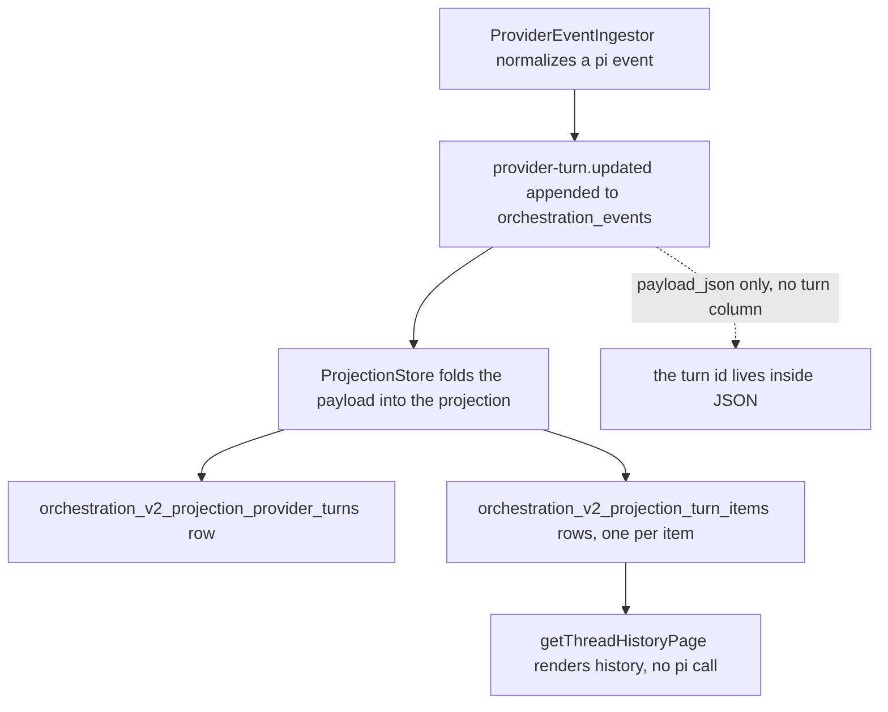
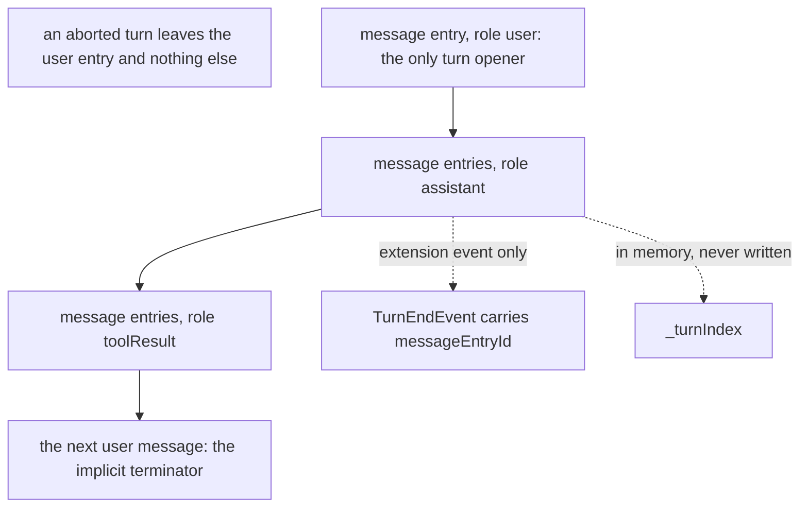
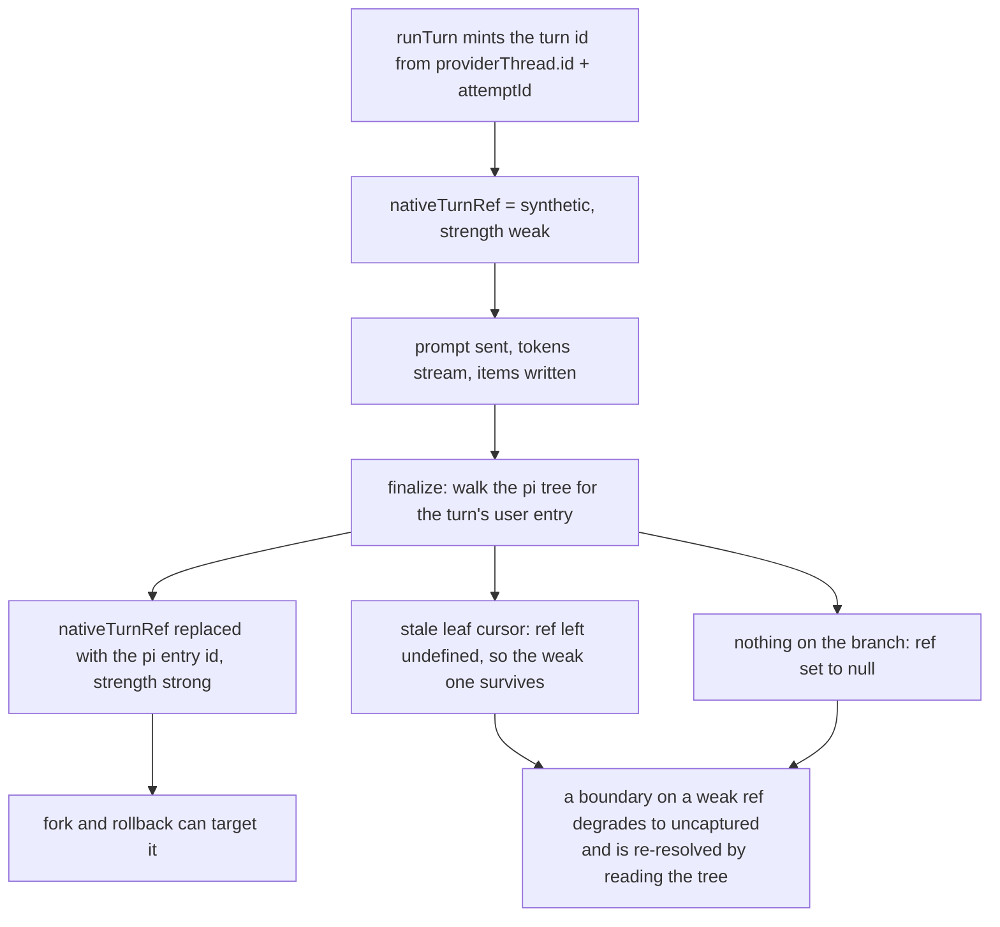
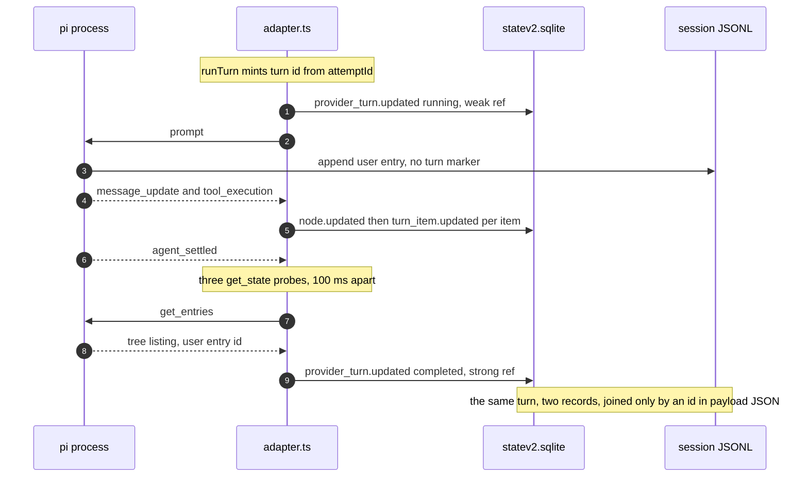

# T3 Code turn storage vs. pi's turn: two records that never meet

## TL;DR

- T3 Code gives every turn a real, persisted identity: a `row` in
  `orchestration_v2_projection_provider_turns` with that id as primary key
  ([055_OrchestrationV2.ts:161-173](https://github.com/pingdotgg/t3code/blob/32ecd71726fee16f335484c1f95cbce126d461f6/apps/server/src/persistence/Migrations/055_OrchestrationV2.ts#L161-L173)).
- pi has no turn at all on disk. It has 11 session-entry kinds and none is a turn
  ([session-manager.ts:182-196](https://github.com/pingdotgg/pi/blob/7d75a0e3eb273dff753d49c066ea29fbe7b3b6f6/packages/coding-agent/src/core/session-manager.ts#L182-L196));
  `turnIndex` is an in-memory counter that never reaches the JSONL.
- The correlation is **backwards from what "turn id" implies**: T3 mints the id from its own
  `attemptId`, not from pi
  ([adapter.ts:2431-2444](https://github.com/pingdotgg/t3code/blob/32ecd71726fee16f335484c1f95cbce126d461f6/packages/provider-pi/src/server/adapter.ts#L2431-L2444)),
  and only *afterwards* does a settled turn get pi's user-entry id attached as a strong ref.
- Both sides store the same conversation in full, independently. Neither is authoritative when
  they disagree, because nothing ever compares them.

## Context

The previous file in this family documented how the two processes talk
([t3-code-pi-coding-agent-integration.md](./t3-code-pi-coding-agent-integration.md)). This file
answers a narrower question that file only touched: when a turn happens, what row does T3 write,
what does pi write, and what joins them.

The question matters for three concrete jobs: rendering history after a server restart, resolving a
rollback or fork boundary to an entry, and reconstructing what happened from a bug report. Each one
either needs a join key or does without — and the difference is the point.

Everything below reads two pinned trees: t3code at `32ecd71726fee16f335484c1f95cbce126d461f6`
(2026-10-30) and pi at `7d75a0e3eb273dff753d49c066ea29fbe7b3b6f6` (2026-10-12). Version skew
applies as in the previous file: the installed `pi` here is 1.5.1, the pinned tree is 1.2.0.

## Findings

### 1. T3's turn row: a projection table, keyed by a derived id

Turns live in SQLite under `<baseDir>/userdata/statev2.sqlite`
([config.ts:144-148](https://github.com/pingdotgg/t3code/blob/32ecd71726fee16f335484c1f95cbce126d461f6/apps/server/src/config.ts#L144-L148)),
WAL mode with `synchronous=NORMAL`
([Sqlite.ts:25-35](https://github.com/pingdotgg/t3code/blob/32ecd71726fee16f335484c1f95cbce126d461f6/apps/server/src/persistence/Sqlite.ts#L25-L35)).
The table is a *projection*: it is folded from `provider-turn.updated` events, never written by the
driver directly
([ProjectionStore.ts:2292-2320](https://github.com/pingdotgg/t3code/blob/32ecd71726fee16f335484c1f95cbce126d461f6/apps/server/src/orchestration-v2/ProjectionStore.ts#L2292-L2320)).

| Column | Holds |
|---|---|
| `provider_turn_id` | primary key, the derived composite (below) |
| `thread_id`, `provider_thread_id`, `node_id` | the owning thread, provider session, plan node |
| `run_attempt_id` | which attempt of which run produced it |
| `ordinal` | per-thread position, unique with `provider_thread_id` |
| `status` | `running`, `completed`, `interrupted`, `failed`, `cancelled` |
| `started_at`, `completed_at` | wall clock, ISO |
| `payload_json` | the full turn record, including `nativeTurnRef` |

([055_OrchestrationV2.ts:161-173](https://github.com/pingdotgg/t3code/blob/32ecd71726fee16f335484c1f95cbce126d461f6/apps/server/src/persistence/Migrations/055_OrchestrationV2.ts#L161-L173)).
The row is created in `runTurn` under a permit, status `running`, *before* any token streams
([adapter.ts:2494-2521](https://github.com/pingdotgg/t3code/blob/32ecd71726fee16f335484c1f95cbce126d461f6/packages/provider-pi/src/server/adapter.ts#L2492-L2518)),
and closed by exactly one terminal write carrying `completedAt` and a final status
([adapter.ts:1495-1506](https://github.com/pingdotgg/t3code/blob/32ecd71726fee16f335484c1f95cbce126d461f6/packages/provider-pi/src/server/adapter.ts#L1490-L1503)).
A failure path appends an `error` item at a sentinel ordinal before that terminal write
([adapter.ts:1525-1559](https://github.com/pingdotgg/t3code/blob/32ecd71726fee16f335484c1f95cbce126d461f6/packages/provider-pi/src/server/adapter.ts#L1531-L1560)).

A second, V1-era `projection_turns` table with its own keyset index also still exists
([005_Projections.ts:75](https://github.com/pingdotgg/t3code/blob/32ecd71726fee16f335484c1f95cbce126d461f6/apps/server/src/persistence/Migrations/005_Projections.ts#L75)),
so "the turn table" is ambiguous in a live database.

### 2. The turn id is derived from T3's own attempt, not from pi

`derive.providerTurn` joins a prefix with the driver and a caller-supplied `nativeTurnId`
([IdAllocator.ts:279-282](https://github.com/pingdotgg/t3code/blob/32ecd71726fee16f335484c1f95cbce126d461f6/packages/provider-core/src/server/IdAllocator.ts#L279-L282)),
producing `provider-turn:provider:pi:native-turn:<nativeTurnId>` with each part percent-encoded
([IdAllocator.ts:193-194](https://github.com/pingdotgg/t3code/blob/32ecd71726fee16f335484c1f95cbce126d461f6/packages/provider-core/src/server/IdAllocator.ts#L193-L194)).
The pi adapter then passes a **synthetic** `nativeTurnId`:
`${providerThread.id}:attempt:${attemptId}`
([adapter.ts:2431](https://github.com/pingdotgg/t3code/blob/32ecd71726fee16f335484c1f95cbce126d461f6/packages/provider-pi/src/server/adapter.ts#L2431)).
No pi identifier appears anywhere in the result. The field is called `nativeTurnId` and is not one.

The only reason the id is session-specific is transitive: `providerThread.id` is itself derived from
pi's `sessionFile`
([adapter.ts:2210-2213](https://github.com/pingdotgg/t3code/blob/32ecd71726fee16f335484c1f95cbce126d461f6/packages/provider-pi/src/server/adapter.ts#L2210-L2213)),
so the turn id inherits the session file as a component. A retry inside the same turn creates a new
`attemptId` and therefore a **new turn id**
([IdAllocator.ts:270-271](https://github.com/pingdotgg/t3code/blob/32ecd71726fee16f335484c1f95cbce126d461f6/packages/provider-core/src/server/IdAllocator.ts#L270-L271)).

### 3. A pi turn has no persisted identity at all

pi's session file is a tree of 11 entry kinds — `message`, `thinking_level_change`, `model_change`,
`usage`, `compaction`, `branch_summary`, `custom`, `custom_message`, `context_edit`, `label`,
`session_info` — and no `turn` entry
([session-manager.ts:182-196](https://github.com/pingdotgg/pi/blob/7d75a0e3eb273dff753d49c066ea29fbe7b3b6f6/packages/coding-agent/src/core/session-manager.ts#L182-L196)).
Entry ids identify entries, never turns
([session-manager.ts:53-58](https://github.com/pingdotgg/pi/blob/7d75a0e3eb273dff753d49c066ea29fbe7b3b6f6/packages/coding-agent/src/core/session-manager.ts#L53-L58)).

`turn_start` / `turn_end` are in-process `AgentEvent`s from the core loop, doc-commented as "a turn
is one assistant response + any tool calls/results"
([types.ts:520-522](https://github.com/pingdotgg/pi/blob/7d75a0e3eb273dff753d49c066ea29fbe7b3b6f6/packages/agent/src/types.ts#L520-L522)).
They are emitted by the loop, not persisted. The turn counter `_turnIndex` increments on `turn_end`
and resets on `agent_start`
([agent-session.ts:1300-1304](https://github.com/pingdotgg/pi/blob/7d75a0e3eb273dff753d49c066ea29fbe7b3b6f6/packages/coding-agent/src/core/agent-session.ts#L1300-L1304)),
and appears in no entry interface
([extensions/types.ts:1056-1071](https://github.com/pingdotgg/pi/blob/7d75a0e3eb273dff753d49c066ea29fbe7b3b6f6/packages/coding-agent/src/core/extensions/types.ts#L1056-L1071)
exposes it to extensions only).

On disk a turn is only *structural*: a `role:"user"` message, then assistant and toolResult
messages, terminated by the next user message or EOF. Every entry is one `appendFileSync`
([session-manager.ts:1187](https://github.com/pingdotgg/pi/blob/7d75a0e3eb273dff753d49c066ea29fbe7b3b6f6/packages/coding-agent/src/core/session-manager.ts#L1187)).
An aborted turn leaves its user entry and nothing else, because pending assistant messages are never
persisted — so on disk an aborted turn and a one-line turn look identical.

A turn on pi's side, where every box is an ordinary entry and none of them says turn:

### 4. The bridge is a weak ref at start, replaced by a strong ref at finalize

The two records meet exactly twice, and both are late.

At `runTurn` the adapter stamps `nativeTurnRef` with the synthetic id at `strength: "weak"`, because
it has nothing real yet
([adapter.ts:2433-2440](https://github.com/pingdotgg/t3code/blob/32ecd71726fee16f335484c1f95cbce126d461f6/packages/provider-pi/src/server/adapter.ts#L2433-L2440)).
At finalize it walks the session tree for the turn's user entry and *merges* a strong ref over the
running payload
([adapter.ts:1441-1453](https://github.com/pingdotgg/t3code/blob/32ecd71726fee16f335484c1f95cbce126d461f6/packages/provider-pi/src/server/adapter.ts#L1441-L1453),
[adapter.ts:1495-1499](https://github.com/pingdotgg/t3code/blob/32ecd71726fee16f335484c1f95cbce126d461f6/packages/provider-pi/src/server/adapter.ts#L1496-L1498)).
Only then is the ref a pi entry id.

The adapter states the asymmetry in its own capability matrix: `nativeThreadIds: "strong"`,
`nativeTurnIds: "weak"`, `nativeItemIds: "strong"`
([adapter.ts:176-180](https://github.com/pingdotgg/t3code/blob/32ecd71726fee16f335484c1f95cbce126d461f6/packages/provider-pi/src/server/adapter.ts#L176-L180)).
Only strong refs are actionable for fork and rollback; a weak one degrades to a tree re-scan
([adapter.ts:3152-3165](https://github.com/pingdotgg/t3code/blob/32ecd71726fee16f335484c1f95cbce126d461f6/packages/provider-pi/src/server/adapter.ts#L3152-L3165)).

Three states, not two. The middle third is the whole argument:

The weak ref is a placeholder that is *correct by construction* only because the finalize walk would
rather return `undefined` than guess: a stale cursor keeps the synthetic ref
([adapter.ts:1449-1456](https://github.com/pingdotgg/t3code/blob/32ecd71726fee16f335484c1f95cbce126d461f6/packages/provider-pi/src/server/adapter.ts#L1449-L1456)),
and a turn that left nothing sets `null`.

### 5. Events carry no turn id: the join lives inside JSON

The event table has `sequence INTEGER PRIMARY KEY AUTOINCREMENT`, `thread_id`, `run_id`, `node_id`,
`event_type`, and `payload_json` — and no turn column
([055_OrchestrationV2.ts:19-31](https://github.com/pingdotgg/t3code/blob/32ecd71726fee16f335484c1f95cbce126d461f6/apps/server/src/persistence/Migrations/055_OrchestrationV2.ts#L19-L31)).
The turn id exists only inside the payload as `OrchestrationV2ProviderTurn.id`.

That has a concrete cost: **no query can join events to a turn without parsing JSON**, and an event
for a turn is not orderable per turn by anything but `sequence`, which is global. Per-turn ordering is
recovered downstream by item `ordinal`, a separate monotonic counter seeded at
`providerTurnOrdinal * 100 + 1`
([adapter.ts:612-618](https://github.com/pingdotgg/t3code/blob/32ecd71726fee16f335484c1f95cbce126d461f6/packages/provider-pi/src/server/adapter.ts#L612-L618),
[adapter.ts:2448](https://github.com/pingdotgg/t3code/blob/32ecd71726fee16f335484c1f95cbce126d461f6/packages/provider-pi/src/server/adapter.ts#L2448)),
The turn's own `ordinal` is not minted by the adapter either: the server computes it as `max(existing ordinals on that provider thread) + 1` before dispatch ([ProviderTurnStartService.ts:1496-1501](https://github.com/pingdotgg/t3code/blob/32ecd71726fee16f335484c1f95cbce126d461f6/apps/server/src/orchestration-v2/ProviderTurnStartService.ts#L1496-L1501)), and a unique `(provider_thread_id, ordinal)` index keeps it that way ([055_OrchestrationV2.ts:175](https://github.com/pingdotgg/t3code/blob/32ecd71726fee16f335484c1f95cbce126d461f6/apps/server/src/persistence/Migrations/055_OrchestrationV2.ts#L175)).

### 6. Both sides keep a full copy of the conversation

T3 does not treat the pi transcript as its record. Assistant text, reasoning, tool calls with their
full output, file diffs, and MCP results are all written as turn items
([adapter.ts:871-884](https://github.com/pingdotgg/t3code/blob/32ecd71726fee16f335484c1f95cbce126d461f6/packages/provider-pi/src/server/adapter.ts#L871-L884),
[adapter.ts:1019-1031](https://github.com/pingdotgg/t3code/blob/32ecd71726fee16f335484c1f95cbce126d461f6/packages/provider-pi/src/server/adapter.ts#L1019-L1031),
[adapter.ts:1040-1065](https://github.com/pingdotgg/t3code/blob/32ecd71726fee16f335484c1f95cbce126d461f6/packages/provider-pi/src/server/adapter.ts#L1040-L1065))
into `orchestration_v2_projection_turn_items`
([055_OrchestrationV2.ts:225-238](https://github.com/pingdotgg/t3code/blob/32ecd71726fee16f335484c1f95cbce126d461f6/apps/server/src/persistence/Migrations/055_OrchestrationV2.ts#L225-L238)).

History load reads those rows and never calls pi
([ProjectionStore.ts:5483-5493](https://github.com/pingdotgg/t3code/blob/32ecd71726fee16f335484c1f95cbce126d461f6/apps/server/src/orchestration-v2/ProjectionStore.ts#L5483-L5493));
so does turn-start context
([ProviderTurnStartService.ts:1016](https://github.com/pingdotgg/t3code/blob/32ecd71726fee16f335484c1f95cbce126d461f6/apps/server/src/orchestration-v2/ProviderTurnStartService.ts#L1016)).
The one pi re-read, `readThreadSnapshot`, is lossy by design — it keeps only user and assistant text and
returns `providerTurns: []`
([adapter.ts:2761-2799](https://github.com/pingdotgg/t3code/blob/32ecd71726fee16f335484c1f95cbce126d461f6/packages/provider-pi/src/server/adapter.ts#L2761-L2799)).
Nothing reconciles the two copies.

### 7. Lifecycle: turns are soft-deleted, never pruned

Deleting a thread is a `thread.deleted` event with a `deletedAt`, not a row delete
([ThreadDeletion.ts:56-67](https://github.com/pingdotgg/t3code/blob/32ecd71726fee16f335484c1f95cbce126d461f6/apps/server/src/orchestration-v2/ThreadDeletion.ts#L56-L67)).
Active turns are cancelled in place
([ThreadDeletion.ts:75-119](https://github.com/pingdotgg/t3code/blob/32ecd71726fee16f335484c1f95cbce126d461f6/apps/server/src/orchestration-v2/ThreadDeletion.ts#L75-L119)).

Nothing deletes the pi session file: the cleanup effect list is attachments, schedules, terminals,
previews
([ThreadDeletion.ts:216-237](https://github.com/pingdotgg/t3code/blob/32ecd71726fee16f335484c1f95cbce126d461f6/apps/server/src/orchestration-v2/ThreadDeletion.ts#L216-L237)),
and `storageCleanup` ages worktrees, browser artifacts and logs only
([storageCleanup.ts:1146-1158](https://github.com/pingdotgg/t3code/blob/32ecd71726fee16f335484c1f95cbce126d461f6/apps/server/src/storageCleanup.ts#L1146-L1158)).
A deleted thread's pi session stays resumable by path, while its rows stay readable but hidden from
history.

Event-store compaction deletes superseded events and receipts, keeping the first and latest per key,
then vacuums
([ProjectionMaintenance.ts:231-344](https://github.com/pingdotgg/t3code/blob/32ecd71726fee16f335484c1f95cbce126d461f6/apps/server/src/orchestration-v2/ProjectionMaintenance.ts#L231-L344)).
Turn rows are upserts, one row per turn, effectively permanent.

### 8. Crash recovery terminalizes; it does not resume

`ProviderRuntimeRecoveryService` collects nonterminal runs on startup, skipping `waiting` runs that
still have a replayable checkpoint
([ProviderRuntimeRecoveryService.ts:208-228](https://github.com/pingdotgg/t3code/blob/32ecd71726fee16f335484c1f95cbce126d461f6/apps/server/src/orchestration-v2/ProviderRuntimeRecoveryService.ts#L208-L228)),
then emits the same terminal write with `status: "cancelled"`
([ProviderRuntimeRecoveryService.ts:439-451](https://github.com/pingdotgg/t3code/blob/32ecd71726fee16f335484c1f95cbce126d461f6/apps/server/src/orchestration-v2/ProviderRuntimeRecoveryService.ts#L439-L451)).
Resumption is a separate opt-in per project
([ProviderRuntimeRecoveryService.ts:754-758](https://github.com/pingdotgg/t3code/blob/32ecd71726fee16f335484c1f95cbce126d461f6/apps/server/src/orchestration-v2/ProviderRuntimeRecoveryService.ts#L754-L758)),
gated on a strong `nativeThreadRef`, the same provider instance, and a run in a resumable state
([RestartContinuation.ts:113-157](https://github.com/pingdotgg/t3code/blob/32ecd71726fee16f335484c1f95cbce126d461f6/apps/server/src/orchestration-v2/RestartContinuation.ts#L113-L157)).

Consequence for the join: a turn killed before finalize keeps its weak ref forever. It is a turn row
that pi cannot be pointed at, and any rollback to it takes the tree-scan path.

The two records, side by side, at every moment of a turn:

### 9. Re-derivation is safe, because the id is not reused

The `(provider_thread_id, ordinal)` unique index means a turn id never collides with another turn
([055_OrchestrationV2.ts:175](https://github.com/pingdotgg/t3code/blob/32ecd71726fee16f335484c1f95cbce126d461f6/apps/server/src/persistence/Migrations/055_OrchestrationV2.ts#L175)).
Upsert keys on `turn.id`
([ProjectionStore.ts:678-690](https://github.com/pingdotgg/t3code/blob/32ecd71726fee16f335484c1f95cbce126d461f6/apps/server/src/orchestration-v2/ProjectionStore.ts#L678-L690)).

The same pi entry id can appear in two turns' `nativeTurnRef`. The ref is not unique, is not a
column, and lives only inside *payload_json* — so no index can find it. The schema does not care,
because the ref is never the key. That is the design working as intended, and also the reason a
lookup by pi entry id is a table scan plus JSON parse.

## Open Questions

- Are pi entry ids unique across session files? They are used as `nativeTurnRef.nativeId` with no
  session qualifier
  ([adapter.ts:1453](https://github.com/pingdotgg/t3code/blob/32ecd71726fee16f335484c1f95cbce126d461f6/packages/provider-pi/src/server/adapter.ts#L1453)).
  Probe: dump `get_entries` from two sessions and diff the id sets.
- Does compaction ever delete a `provider-turn.updated` payload and orphan its row? Probe: read the
  `compactEventStore` predicate at
  [ProjectionMaintenance.ts:245-340](https://github.com/pingdotgg/t3code/blob/32ecd71726fee16f335484c1f95cbce126d461f6/apps/server/src/orchestration-v2/ProjectionMaintenance.ts#L245-L340)
  and check whether turn-scoped types are retained.
- Crash between the tree capture and the terminal write leaves `running` plus a strong ref, and
  recovery then writes `cancelled` over it. Probe: kill the process inside `finalizeTurn` and
  inspect the surviving row.
- `readThreadSnapshot` has no non-test caller in `apps/server/src`. Is it dead surface, or reachable
  through provider handoff? Probe: grep the handoff path for `readThreadSnapshot`.
- The web client reads `nativeItemRef` in one place, matching a background-subagent task id against an
  item ([ThreadActivityBanners.tsx:167](https://github.com/pingdotgg/t3code/blob/32ecd71726fee16f335484c1f95cbce126d461f6/apps/web/src/components/chat/ThreadActivityBanners.tsx#L167)).
  Timeline rows still key on `TurnItemId`, and whether that read is the only provider-native id the UI
  ever touches is unconfirmed.
- `_turnIndex` is invisible to any external reader, so a pi-side turn counter cannot be reconstructed
  from a transcript. Whether that matters for replay fidelity is unmeasured.

## Related

- [T3 Code × pi — How an Orchestrator Drives the pi Coding Agent Over RPC](./t3-code-pi-coding-agent-integration.md)
- [T3 Code — client-server architecture](./t3-code-client-server-architecture.md)
- [pi RPC mode](./pi-rpc-mode.md)
- [pi session persistence to an external store](./pi-session-persistence-external-store.md)
- [pi custom session store](./pi-custom-session-store.md)

## Changelog

- 2026-11-10 — created, from t3code `32ecd717` and pi `7d75a0e3` read through the scout.
