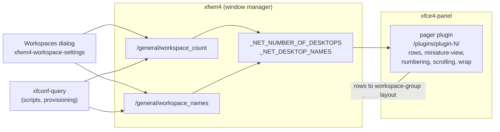

# XFCE Workspace Switcher — The `pager` Plugin, Its Settings, and the Workspaces Behind It

## TL;DR

- **"Workspace Switcher" is the panel plugin with the internal module name `pager`**, and it only *displays and activates* workspaces — it does not create them. The count and the names belong to xfwm4, in the `xfwm4` xfconf channel ([plugin desktop file](https://github.com/xfce-mirror/xfce4-panel/blob/xfce4-panel-4.20.0/plugins/pager/pager.desktop.in.in), [workspace dialog source](https://github.com/xfce-mirror/xfwm4/blob/30eb3437bb9d410eeb17b22412c53505d26e3176/settings-dialogs/workspace-settings.c)).
- **One plugin, two looks, five settings.** Appearance is a two-entry combo — *Buttons* or *Miniature View* — beside a number toggle, mouse-wheel switching, wrap, and number-of-rows. All five live in the `xfce4-panel` channel under `/plugins/plugin-N/…` with the exact names `rows`, `miniature-view`, `workspace-scrolling`, `wrap-workspaces`, `numbering` ([pager.c](https://github.com/xfce-mirror/xfce4-panel/blob/xfce4-panel-4.20.0/plugins/pager/pager.c), [pager-dialog.glade](https://github.com/xfce-mirror/xfce4-panel/blob/xfce4-panel-4.20.0/plugins/pager/pager-dialog.glade)).
- **On Wayland the plugin degrades to buttons and then has nothing to show.** Miniature view resolves to `miniature_view = WINDOWING_IS_X11()`, and Xfce 4.20's own tour lists "Workspace support is missing (ext-workspace protocol was just merged)" ([pager.c](https://github.com/xfce-mirror/xfce4-panel/blob/xfce4-panel-4.20.0/plugins/pager/pager.c), [4.20 tour](https://www.xfce.org/about/tour420/)).
- **The whole configuration layer is scriptable without a desktop session** — verified below: `xfconf-query` against a standalone `xfconfd` writes both the panel plugin block and the xfwm4 workspace keys, while `xfce4-panel --add=pager` adds the plugin to a *running* panel over D-Bus.

## Context

The question behind this file is the one the plugin's own name invites: *what is the Xfce workspace switcher, where do its settings live, and how do I drive it without clicking?* It sits between two existing files — [KDE Plasma vs Xfce](./kde-vs-xfce.md) records that Xfce's Wayland session ships without workspace support, and [Windows-Like Linux Desktops](./windows-like-linux-desktops.md) treats Xfce as a shell that reproduces Windows. This is the component-level answer those two leave out.

Three surfaces share the word "workspace" in Xfce, and mixing them up is the usual source of lost time:

1. **The panel plugin** — `Workspace Switcher`, module name `pager`, `X-XFCE-Internal=TRUE`, comment "Switch between virtual desktops" ([pager.desktop.in.in](https://github.com/xfce-mirror/xfce4-panel/blob/xfce4-panel-4.20.0/plugins/pager/pager.desktop.in.in)).
2. **The Workspaces settings dialog** — `xfwm4-workspace-settings`, "Configure layout, names and margins" ([desktop file](https://github.com/xfce-mirror/xfwm4/blob/30eb3437bb9d410eeb17b22412c53505d26e3176/settings-dialogs/xfwm4-workspace-settings.desktop.in)).
3. **The window manager's shortcuts** — `Ctrl+Alt+arrow`, `Ctrl+F1..F12`, and `Alt+Insert`/`Alt+Delete` ([xfwm4 keyboard shortcuts](https://docs.xfce.org/xfce/xfwm4/4.20/keyboard_shortcuts)).

**Evidence scope.** No Xfce session was available on the research machine (Ubuntu 24.04, GNOME session, `xfwm4` not installed), so plugin *behaviour* is read from source at pinned revisions plus the official docs, and every claim about the *configuration layer* was executed. Probe method: unpack `xfconf` 4.18.1 and `libxfconf-0-3` from the Ubuntu `noble` archive, run `xfconfd` inside `dbus-run-session` with a throwaway `HOME` — no X server, no session manager.

## What the plugin actually is

The plugin ships as an internal panel plugin, so there is nothing to install: it appears in *Add New Items…* as **Workspace Switcher**, next to Window Buttons and Clock ([panel docs](https://docs.xfce.org/xfce/xfce4-panel/start)). Its two renderers are different widgets in the same process:

- **Miniature View** — `WnckPager` from libwnck3, a proportionally scaled map of the workspaces with window rectangles inside them; dragging a window between cells moves it (the drag handlers sit inside `#ifdef ENABLE_X11` in [pager.c](https://github.com/xfce-mirror/xfce4-panel/blob/xfce4-panel-4.20.0/plugins/pager/pager.c)).
- **Buttons** — `PagerButtons`, an Xfce-authored grid of toggle buttons labelled from the workspace name, falling back to `Workspace N`, and prefixed `N - ` when numbering is on ([pager-buttons.c](https://github.com/xfce-mirror/xfce4-panel/blob/xfce4-panel-4.20.0/plugins/pager/pager-buttons.c)).

Both read workspaces through `libxfce4windowing`, the abstraction library new in Xfce 4.20 that maps X11 onto libwnck and Wayland onto protocol extensions ([4.20 tour](https://www.xfce.org/about/tour420/)). That library is why the plugin runs at all under Wayland — and why the miniature view is the part that does not.

One structural oddity matters before configuring anything: **the plugin does not own the layout.** Whichever pager instance is the "master" pushes its row count into the workspace group itself — `xfw_workspace_group_set_layout (…, rows, 0, NULL)` in the buttons path, `wnck_pager_set_n_rows` in the miniature path — and every other pager on the screen is re-synced from it ([pager.c](https://github.com/xfce-mirror/xfce4-panel/blob/xfce4-panel-4.20.0/plugins/pager/pager.c), [pager-buttons.c](https://github.com/xfce-mirror/xfce4-panel/blob/xfce4-panel-4.20.0/plugins/pager/pager-buttons.c)). The source says it in a comment: *"synchronize plugin with master plugin which manages workspace layout"*. A Red Hat bug (728975) reports the visible symptom of getting this wrong — a second pager in the same panel and rows silently not applying ([bugzilla 728975](https://bugzilla.redhat.com/show_bug.cgi?id=728975)).

## The five settings, and where the docs drift

The 4.20 settings dialog, read from the glade file, holds exactly this ([pager-dialog.glade](https://github.com/xfce-mirror/xfce4-panel/blob/xfce4-panel-4.20.0/plugins/pager/pager-dialog.glade)):

| Control | xfconf key (under `/plugins/plugin-N/`) | Type | Default | Effect |
|---|---|---|---|---|
| Appearance: Buttons / Miniature View | `miniature-view` | bool | `true` on X11 | Live map vs labelled buttons |
| Show workspace number | `numbering` | bool | `false` | Prefixes `N - ` to the name |
| Switch workspaces using the mouse wheel | `workspace-scrolling` | bool | `true` | Scroll over the plugin changes workspace |
| Wrap around workspaces | `wrap-workspaces` | bool | `false` | Last → first instead of stopping |
| Number of rows | `rows` | uint, 1–50 | `1` | Grid shape, applied workspace-wide |

Defaults and ranges come from the `g_param_spec_*` block and the bitfield initialisers in [pager.c](https://github.com/xfce-mirror/xfce4-panel/blob/xfce4-panel-4.20.0/plugins/pager/pager.c). The dialog also carries a **Workspace _Settings…** button that only spawns `xfwm4-workspace-settings` — the plugin hands off rather than editing the count itself, and on Wayland that menu item is not built at all.

**The published documentation is behind the code.** [docs.xfce.org's Workspace Switcher page](https://docs.xfce.org/xfce/xfce4-panel/pager) (last modified 2024-12-11) describes appearance as a *"Show miniature view"* checkbox and lists three properties plus one behaviour; it has no entry for `wrap-workspaces` or `numbering`, both of which exist in the 4.20 dialog. Treat the code as the spec and that page as a partial summary.

A practical corollary from the forums: the most common preference is *Buttons* over *Miniature View*, because a labelled button is legible at a glance where a map at panel height is not ([r/xfce thread](https://www.reddit.com/r/xfce/comments/1h1vdii/xfce_work_space_switching/)).

## Where the workspaces themselves live

Count and names are xfwm4's, stored in the `xfwm4` channel:

| Key | Type | Default | Set by |
|---|---|---|---|
| `/general/workspace_count` | int | `4` | Workspaces dialog, `xfconf-query`, or `Alt+Insert` / `Alt+Delete` |
| `/general/workspace_names` | string array | empty → `Workspace N` | Workspaces dialog name column, `xfconf-query` |

The default of 4 is in xfwm4's shipped defaults file ([defaults/defaults](https://github.com/xfce-mirror/xfwm4/blob/30eb3437bb9d410eeb17b22412c53505d26e3176/defaults/defaults)); a live `xfwm4` reacts to `workspace_count` changes immediately through its xfconf property callback ([settings.c](https://github.com/xfce-mirror/xfwm4/blob/30eb3437bb9d410eeb17b22412c53505d26e3176/src/settings.c)). `workspace_names` is different: the WM publishes `_NET_DESKTOP_NAMES` and `_NET_NUMBER_OF_DESKTOPS`, and the panel plugin reads them back through libwnck / libxfce4windowing ([workspaces.c](https://github.com/xfce-mirror/xfwm4/blob/30eb3437bb9d410eeb17b22412c53505d26e3176/src/workspaces.c), [workspace-settings.c](https://github.com/xfce-mirror/xfwm4/blob/30eb3437bb9d410eeb17b22412c53505d26e3176/settings-dialogs/workspace-settings.c)).



Read the last edge twice: the plugin writes the *layout* back into the workspace group, so rows are shared state between panel and WM rather than a per-plugin cosmetic.

## Driving it from a terminal

Add the plugin to a running panel — the option exists, but it is a D-Bus call to the running instance, so it fails with "No running instance of xfce4-panel was found" when nothing is up ([main.c](https://github.com/xfce-mirror/xfce4-panel/blob/1b5f1e848414a4435817134195984e3114177706/panel/main.c), [panel-dbus-client.c](https://github.com/xfce-mirror/xfce4-panel/blob/1b5f1e848414a4435817134195984e3114177706/panel/panel-dbus-client.c)):

```bash
xfce4-panel --add=pager        # append a Workspace Switcher to the panel
xfce4-panel --add-items        # open the Add New Items dialog instead
xfce4-panel --save             # persist panel config after scripting it
```

Set the count and name the workspaces ([forum recipe](https://forum.xfce.org/viewtopic.php?id=11025), [xfconf-query manual](https://docs.xfce.org/xfce/xfconf/xfconf-query)):

```bash
# count: one int, create if absent
xfconf-query -c xfwm4 -p /general/workspace_count -n -t int -s 6

# names: an array needs -a and one -t per value
xfconf-query -c xfwm4 -p /general/workspace_names -n -a -t string -s Dev -t string -s Web -t string -s Chat -t string -s Media -t string -s Ops -t string -s Scratch

# read an array back (-l -v cannot render one, see Gotchas)
xfconf-query -c xfwm4 -p /general/workspace_names -v -a
```

Configure the plugin block itself — the same path the dialog writes:

```bash
xfconf-query -c xfce4-panel -p /plugins/plugin-7 -n -t string -s pager
xfconf-query -c xfce4-panel -p /plugins/plugin-7/rows             -n -t uint -s 2
xfconf-query -c xfce4-panel -p /plugins/plugin-7/miniature-view   -n -t bool -s false
xfconf-query -c xfce4-panel -p /plugins/plugin-7/numbering        -n -t bool -s true
xfconf-query -c xfce4-panel -p /plugins/plugin-7/wrap-workspaces  -n -t bool -s true
```

### What the probe actually measured

Run against `xfconf-query` 4.18.1 with a standalone `xfconfd`, isolated `HOME`, no X server:

| Probe | Result |
|---|---|
| `xfconf-query -l` with no `xfconfd` running | Empty `Channels:`, exit 1 |
| any write with no `xfconfd` | `Failed to set property.`, exit 1 |
| the same commands with `xfconfd` up under `dbus-run-session` | All succeed, exit 0 |
| `-n -t int -s 4` | Creates `/general/workspace_count` as `int` |
| `-n -a -t string -s A -t string -s B` | Accepted, creates a two-item string array |
| `-n -t string -s A -s B -s C -s D` (no `-a`) | `There are 4 new values, but only 1 types could be determined.`, exit 1 |
| `xfconf-query -c xfce4-panel -l -v` with an array present | Array value prints `<<UNSUPPORTED>>` |
| 5 names with `workspace_count` = 4 | Accepted silently; the extra name persists but is inert |
| on-disk result | `~/.config/xfce4/xfconf/xfce-perchannel-xml/xfwm4.xml` and `xfce4-panel.xml`, plain XML, no daemon needed to author |

The XML shape it writes — what an image build or a dotfiles repo should carry:

```xml
<channel name="xfwm4" version="1.0">
  <property name="general" type="empty">
    <property name="workspace_count" type="int" value="4"/>
    <property name="workspace_names" type="array">
      <value type="string" value="One"/>
      <value type="string" value="Two"/>
    </property>
  </property>
</channel>
```

## Keyboard, because the plugin is not the only switcher

The plugin is optional; the WM's shortcuts work with no panel at all ([xfwm4 4.20 shortcuts](https://docs.xfce.org/xfce/xfwm4/4.20/keyboard_shortcuts)):

| Shortcut | Action |
|---|---|
| `Ctrl+Alt+Left/Right/Up/Down` | Switch to the workspace in that direction |
| `Ctrl+F1` … `Ctrl+F12` | Switch to workspace 1–12 |
| `Ctrl+Alt+Home` / `Ctrl+Alt+End` | Move the focused window to previous / next workspace |
| `Ctrl+Alt+Keypad 1–9` | Move the focused window to workspace 1–9 |
| `Alt+Insert` / `Alt+Delete` | **Add** a workspace / delete the last one |
| `Ctrl+Alt+d` | Toggle Show Desktop |

Those last two are the trap: `Alt+Insert` and `Alt+Delete` mutate `workspace_count` with no confirmation, which is how "the number of workspaces changes unexpectedly" becomes a support question ([ArchWiki Xfwm](https://wiki.archlinux.org/title/Xfwm)).

## Wayland

| Aspect | X11 | Wayland (4.20) |
|---|---|---|
| Miniature view | `WnckPager`, drag windows between cells | Unavailable — demoted to buttons |
| Buttons view | Works | Code exists; no workspaces are published |
| Workspaces exist at all | xfwm4 owns them | Missing; ext-workspace "was just merged" |
| Workspaces dialog | Spawns `xfwm4-workspace-settings` | Not available (xfwm4 does not run) |
| Count / names keys | Live | Nothing writes them, nothing reads them |

Sources: [4.20 tour](https://www.xfce.org/about/tour420/) for the gap list and for xfwm4 not running under Wayland; [Wayland roadmap](https://wiki.xfce.org/releng/wayland_roadmap) for the sequencing; [pager.c](https://github.com/xfce-mirror/xfce4-panel/blob/xfce4-panel-4.20.0/plugins/pager/pager.c) for the `WINDOWING_IS_X11()` gate.

## Gotchas

1. **`rows` is global state.** It changes the layout the window manager uses for every pager and for window placement, not just the plugin's drawing ([pager-buttons.c](https://github.com/xfce-mirror/xfce4-panel/blob/xfce4-panel-4.20.0/plugins/pager/pager-buttons.c)).
2. **Two pagers in one panel fight.** Only the master's rows win, and the non-master can report the change as failed ([bugzilla 728975](https://bugzilla.redhat.com/show_bug.cgi?id=728975)).
3. **`-l -v` cannot show an array** — it prints `<<UNSUPPORTED>>` in 4.18.1. Read the property by name with `-p … -v`, adding `-a` to force array formatting.
4. **An array with more names than workspaces is accepted.** No warning; the surplus sits inert until the count grows.
5. **Omitting `-a` collapses the array.** Without it, an array of one string becomes a plain `string` property ([xfconf-query manual](https://docs.xfce.org/xfce/xfconf/xfconf-query)).
6. **Fewer `-t` than `-s` is a hard error**, not a coercion: `There are 4 new values, but only 1 types could be determined.` Give one type per value.
7. **`Alt+Insert` / `Alt+Delete` silently change the count**, so a "keeps resetting" report usually starts here ([ArchWiki](https://wiki.archlinux.org/title/Xfwm)).
8. **Setting the count too early in the session does not stick.** The ArchWiki recipe waits for the WM — `(sleep 3 && xfconf-query -v -c xfwm4 -p /general/workspace_count -s N) &` before `exec xfwm4`, or the same line in `~/.config/autostart/workspace.desktop`.
9. **Names come from the display server, not the panel.** Editing `/general/workspace_names` during a WM shutdown gets overwritten on the next start.
10. **`--add=pager` is a D-Bus request**, so it needs a live panel ([main.c](https://github.com/xfce-mirror/xfce4-panel/blob/1b5f1e848414a4435817134195984e3114177706/panel/main.c)).
11. **There is no cross-workspace switch animation.** The community answer for "make switching visible" is a notification script ([wsp_notify, via r/xfce](https://www.reddit.com/r/xfce/comments/1h1vdii/xfce_work_space_switching/)) — and per-workspace wallpapers come from Desktop Settings → Background with *Apply to all workspaces* unchecked, not from the panel plugin.
12. **The miniature view is silently demoted, not rejected**: `miniature_view = g_value_get_boolean (value) && WINDOWING_IS_X11()`, so a config that says `true` on Wayland renders buttons.

## Alternatives

There is no second workspace switcher in Xfce; the honest option list is about shape, not competing plugins.

| Need | Answer | Does it exist |
|---|---|---|
| A legacy applet called "workplace/workspace switcher" | Misremembered name for this plugin | No separate plugin |
| Text-only indicator | `pager` with Buttons + numbering | Yes, same plugin |
| Window list instead of workspaces | Window Buttons / Window Menu | Yes, different plugins |
| Modern docked taskbar | `xfce4-docklike-plugin` (third-party, GPL-3.0) | Yes, but a taskbar, not a pager |
| Workspace overview/dashboard | `xfdashboard` | Not on Wayland, shows no workspace number |
| Scripted switch feedback | Notify script bound to the switch shortcuts | Community recipe only |

## Open Questions

- **What bounds the workspace count?** No `MAX_WORKSPACES` constant appears in current xfwm4 `src/`, and `workspaceSetCount` only clamps to ≥ 1 while the plugin caps `rows` at 50. The Workspaces dialog's glade carries spin adjustments with an upper bound of 100, but the setting order was not decoded with confidence, so treat any hard cap as unverified.
- **Which 4.20 doc page is canonical?** The panel docs still describe a pre-4.20 dialog; worth a docs patch upstream.
- **Does the `WNCK_CHECK_VERSION(43, 0, 0)` handle path change miniatures on libwnck 43+?** Read as new code in master, not exercised.
- **When ext-workspace support lands in libxfce4windowing, does the miniature view return on Wayland, or stay X11-only?** The gate is currently structural, not a TODO comment.

## Related

- [KDE Plasma vs Xfce](./kde-vs-xfce.md) — the desktop-level comparison this component sits inside, including Xfce's missing workspace support on Wayland.
- [Windows-Like Linux Desktops](./windows-like-linux-desktops.md) — Xfce graded on shell fidelity, where the panel's plugin set is the whole argument.
- [Running a Linux Desktop Inside gVisor](./linux-desktop-in-gvisor.md) — the no-GPU case where an X11 session, and therefore this plugin's X11 path, is the only one available.
- [Browser-Viewable VNC on gVisor](./vnc-server-on-gvisor-with-browser-client.md) — why a served Xfce desktop is an X11 proposition, which is also what keeps the miniature view alive.

## Changelog

- 2026-11-12 — created. Read xfce4-panel 4.20.0 and xfwm4 at `30eb343` source, the official docs, and executed an isolated xfconf probe (4.18.1) for every configuration claim.
